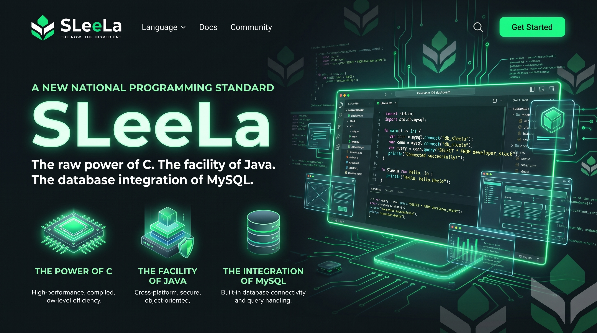
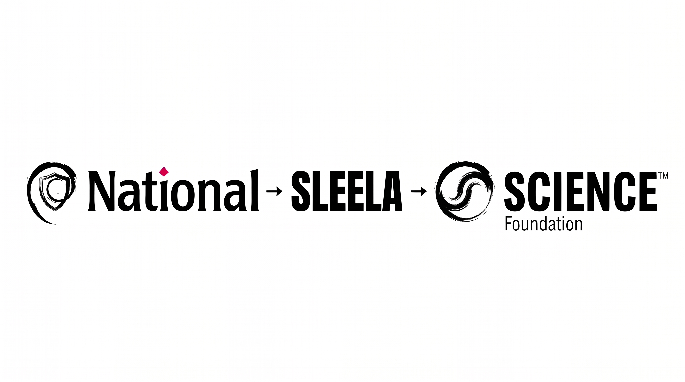
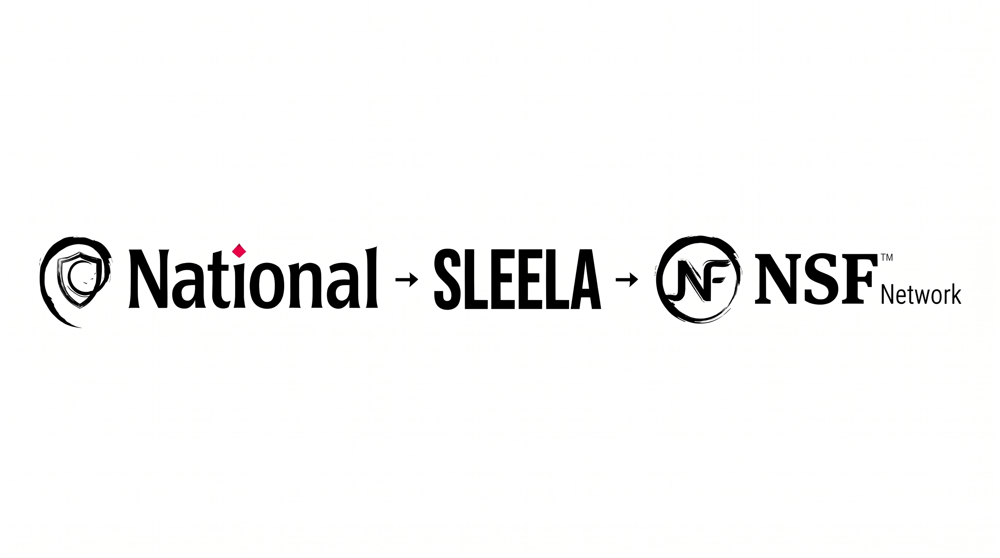

# SLeeLa 3.0 — Malaysia (MY)

<p align="center"></p>
<p align="center"></p>

<p align="center"><strong>Bahasa sistem natif, pengkompil, persekitaran masa jalan dan ekosistem mesin maya.</strong></p>
<p align="center"><a href="https://github.com/mearvk/SLeeLa/actions"></a> <a href="docs/PLATFORM-SUPPORT.md"></a></p>

> **Edisi negara antarabangsa.** Edisi ini disediakan dalam Bahasa Melayu (Malaysia). Pengecam teknikal, arahan, contoh kod, nama fail, laluan dan pautan tidak diubah berbanding [README.md](README.md) kanonik dalam bahasa Inggeris.

**The Now. The Ingredient.** Bahasa pengaturcaraan lebih daripada sekadar sintaks: ia ialah pengkompil, persekitaran masa jalan, pustaka, alat bantu dan kontrak platform yang menjadikan perisian boleh digunakan.

**Bidang yang diceburi SLeeLa.** SLeeLa menceburi **Math**, **Object**,
**Science** dan **Reach** — empat wajah kerjanya: perkara yang boleh dikira
(Math), benda yang telah mantap dan berdiri dalam katalog tentang apa yang
ada (Object), kajian yang berdisiplin tentang yang benar (Science), dan
perluasan jangkauan sesebuah sistem kepada sistem dan manusia lain (Reach).
**Kepentingan Nasional kekal** — tiada satu pun daripada keempat-empatnya
mengetepikannya; apabila sesuatu subjek menyentuh kepentingan sesebuah negara,
kedudukan itu dikekalkan (direkodkan dengan setia, contohnya dalam
`metaOrigin` / `metaNationalSchedule` pada Metadata setiap kelas), tidak
sekali-kali dileburkan.

## I. Mula di Sini
- [Bina pelaksanaan natif](impl/README.md)
- [Mesin maya & Modium — panduan pengguna secara praktikal](virtual-machine/USER-GUIDE.md) (`sleela vm`, `sleela modium`)
- [Tindanan CPU dalam kod sumber SLeeLa](lib/cpu/CPU.md) — mesin lengkap daripada get→ALU→teras→OS→program, senarai 130+ profil CPU, serta [voltan, jam boleh ubah dan pemasaan pakar](lib/cpu/TIMING.md) yang boleh dilaraskan, supaya anda boleh [menjalankannya mengikut spesifikasi dan melakukan overclock](lib/cpu/components/README.md)
- [Indeks dokumentasi](docs/README.md)
- [Sumber data CSPML dan rujukan penyelidikan Salt & Salary](CSPML.DATA.SOURCE.AND.SALT-AND-SALARY.REFERENCE.md) — asal usul data luaran A.S. (tempat, sosioekonomi, tenaga kerja, pendidikan dan sekolah awam) serta panduan integrasinya.
- [Dokumentasi API terjana](docs/api/README.md) — rujukan HTML terkini, edisi API berversi dan arahan penjanaan semula
- [Katalog API](api/README.md)
- [Piawaian perbandingan pengkomputeran](comparison/README.md) — piawaian jenis, memori, ABI dan pematuhan bagi VM SLeeLa, Java/JVM dan C/C++ natif.
- [Recursion stanchion — prototaip C dan C++](recursion/stanchion/README.md) — contoh yang dikhususkan bagi setiap primitif untuk Boolean, Byte, Character, Integer, Long, Float dan Double, bersama corak rekursi generik, gunaan, saintifik dan pengajaran.
- [Matriks sokongan platform dan pengesahan](docs/PLATFORM-SUPPORT.md)
- [Panduan jenama](docs/BRAND-GUIDE.md)
- [Konsep dan aset barangan jenama](merchandise/README.md)
- [Logo NitroWebExpress](images/nitro-web-express/nitrowebexpress-logo-004.jpeg)
- [Dasar pengujian dan get keluaran](markdown/TESTING.md)

## II. Berita

Tambahan terkini pada bahasa, pemacu dan pustaka standard:

- **Pakej pustaka standard `advantage` — meng-advantage-kan sebuah dividen,
  dengan matematik, fizik, integrasi, penggredan dan output yang boleh
  dihalakan.**
  [`lib/advantage/`](lib/advantage/README.md) merangkum *meng-advantage-kan
  sebuah dividen unik berkenaan sesuatu model* sebagai **bawang Sequitur**
  berlapis (dividen → semakan → kebimbangan → matematik → tambahan →
  penolakan → penyusunan semula → lelaran), yang boleh dilayari ke dalam dan
  ke luar dengan kemas kini dinamik sepenuhnya dan restitute, serta didedahkan
  melalui **model pengguna** yang ringkas dan **model pembangun** dengan
  kawalan penuh. Pakej ini mengandungi lima bidang subjek: **`math/`** ekonomi
  perdagangan dua hala (pemaksimuman keuntungan bersama, tawar-menawar Nash,
  nisbah kritikal newsvendor dua hala), **`physics/`** "fizik medan
  kepercayaan" dalam ekonomi struktur (kepercayaan sebagai tensor metrik,
  geodesik transaksi, struktur sentuhan pengumuman, SDE pereputan kepercayaan
  CIR+jump — satu analogi pemodelan, dan ditandakan sedemikian),
  **`integration/`** model integrasi menegak yang boleh digubah secara
  rekursif untuk kapitalisme/runcit (petak, ruang kejuruteraan, petak
  percubaan, dulang median newton dan skor kecanggihan sistem), **`grading/`**
  penggred litar kecanggihan yang menilai setiap modul dan mana-mana set modul
  pemenang/pecundang/penggred/mutlak daripada A hingga D, dan **`output/`**
  satu seam emit yang boleh dihalakan dan menghantar output modul ke terminal,
  permukaan berformat **CommonRails**, atau soket/penyambung (dirangka untuk
  `slnet_write` natif). Setiap kelas membawa rekod Metadata-Class; lima demo
  yang boleh dijalankan mengesahkan subjek tersebut, dan
  [`DEFINITIONS.md`](lib/advantage/DEFINITIONS.md),
  [`MATH.md`](lib/advantage/MATH.md) serta
  [`PHYSICS.md`](lib/advantage/PHYSICS.md) yang mengiringinya
  mendokumentasikannya. Pengguna C/C++ natif di bawah
  [`advantage/`](advantage/README.md) (teras C
  `advantage_value`/`advantage_mean`, stor pengetahuan XML, serta pustaka
  pemerolehan HTTPS/SFTP/SSH yang selamat + keystore + pengangkutan DH/ECDH)
  memautkan model itu ke dalam
  [contoh perdagangan](advantage/examples/README.md) yang telah diselesaikan —
  perdagangan positif daripada sumber internet yang diandaikan, urutan
  kerelevanan khalayak (Peniaga, Pengguna, Pembantu, Penyembuh) dan lapan model
  yang disusun A–D (D = paling banyak Cement, A = paling banyak Brand).
- **Anotasi pemasaan gelung — `@loopDelay` / `@loopBudget` (+ fungsi terbina
  dalam `sleep(ms)`).** Anotasi **peringkat pernyataan dan behavioral**
  pertama dalam SLeeLa: ditulis pada barisnya sendiri sebelum gelung `for` /
  `while` / `do`, anotasi ini menyelitkan jeda sebenar ke dalam pelaksanaan
  gelung. `@loopDelay(ms = 250)` / `@loopDelay(seconds = 2)` menidurkan gelung
  untuk tempoh tetap bagi setiap lelaran (`@loopDelay(250)` tanpa nama
  argumen secara lalai bermaksud milisaat); `@loopBudget(seconds = 10,
  iterations = 1000)` mengagihkan bilangan lelaran yang diketahui secara sama
  rata merentasi jumlah belanjawan masa jam dinding. Kedua-duanya diturunkan
  kepada opcode append-only baharu **`OP_SLEEP`** (ISA 157), yang turut
  menyokong fungsi terbina dalam umum **`sleep(<ms>)`** yang boleh dipanggil di
  mana-mana; jeda itu dilaksanakan secara mudah alih (`nanosleep` / `Sleep`).
  Dinyatakan dalam [`SLEELA.syntax` §32](SLEELA.syntax); rujukan API di
  [`api/sleela/3.0/LOOP_TIMING_API.md`](api/sleela/3.0/LOOP_TIMING_API.md);
  contoh yang boleh dijalankan
  [`examples/loop-timing-annotation-demo.sleela`](examples/loop-timing-annotation-demo.sleela).
  Indeks tambahan sesi (termasuk ini, pendaraban integer besar natif
  `OP_BIGMUL`, serta alat kendiri **[local-generator](local-generator/README.md)**
  dan **[pi-generator](pi-generator/README.md)**) terdapat di
  [`api/sleela/3.0/SESSION-ADDITIONS-API.md`](api/sleela/3.0/SESSION-ADDITIONS-API.md).
  Tiga permukaan API terjana
  ([`sleeladoc-api/`](sleeladoc-api/README.md),
  [`docs/api/`](docs/api/README.md) dan syot kilat
  [`api/sleela/3.0/version-014/`](api/sleela/3.0/version-014/index.html)
  yang tidak boleh diubah) telah dibina semula dengan `make api-docs` dan kini
  membawa entri arahan `SLISASleep` / `SLISABigMul` yang baharu pada halaman
  pakej `vm`.
- **SleelaDoc daripada baris arahan — `sleela docs`.** SleelaDoc kini boleh
  dicapai terus daripada terminal. `sleela docs` menyenaraikan setiap topik
  yang boleh didokumentasikan; `sleela docs crypto` memaparkan sebuah pakej;
  `sleela docs stringbuilder` menyelesaikan sebuah kelas (tanpa mengira huruf
  besar/kecil, dan melalui awalan pustaka standard `SL` →
  `SLStringBuilder`) serta mencetak halaman yang kaya — **takrifan, tujuan
  reka bentuk, perhubungan, struktur, user clay dan tangga penguasaan lima
  anak tangga** — dengan hasil "adakah maksud anda" yang disusun mengikut
  kedudukan bagi salah taip yang hampir betul. Penulis memperkaya mana-mana
  halaman hanya dengan menambah tag `@` SleelaDoc (`@intent`, `@thesis`,
  `@axiom`, `@param`, `@see`, `@mastery`). `sleela docs --generate [dir]`
  menulis korpus teks biasa (satu halaman bagi setiap kelas + `TOPICS.index`)
  yang kemudian dibaca oleh CLI secara luar talian; **`make sleeladoc`**
  menggabungkan korpus itu **beserta sumber `.sleela` yang sepadan** ke dalam
  `sleeladoc/build/sleeladoc.jar`. Bagi subjek yang hanya berupa fasad (cth.
  `psychiatry`, `politico`), `sleela docs --facade <topic>` menggeledah sistem
  fail semasa masa jalan dan menyenaraikan **folder (kemudian fail, sebagai
  gerak semula jadi)** yang sebenar, dihadkan oleh had yang boleh diatasi
  pengguna iaitu **6 MB / 6000 fail / 6 minit**. Unit `lib/sleeladoc`
  diselenggara pada edisi semasa, **`#sleela 3.0`**. Lihat
  [`man/man1/sleela.1`](man/man1/sleela.1) dan
  [`lib/sleeladoc/README.md`](lib/sleeladoc/README.md).
- **SleelaDoc — penyelesaian dokumentasi bergaya Javadoc, dengan tapak HTML
  terjana.** **SleelaDoc** ialah konvensyen komen dokumentasi dalam sumber
  SLeeLa (komen kurungan sudut yang ditandai dengan sentinel `@doc` /
  `@page`; lihat [`manifesto/SLEELADOC.md`](manifesto/SLEELADOC.md)), dan
  [`lib/sleeladoc`](lib/sleeladoc/README.md) ialah **pengekstrak** yang
  memaparkan unit `.sleela` sebagai halaman API Markdown atau HTML — seperti
  `javadoc` memaparkan Java, dengan mendokumentasikan *tujuan*. **Tapak
  dokumentasi HTML yang lengkap dan boleh dilayari untuk seluruh `/lib`**
  dijana ke dalam [`/sleeladoc-api`](sleeladoc-api/README.md) oleh
  `tools/generate-sleeladoc-api.py` (buka `sleeladoc-api/index.html`; gaya
  bersih biru / biru muda / kelabu muda / putih dengan hierarki pakej → kelas
  → ahli serta glosari yang ditulis untuk pembaca *Student 2*). Pengkompil
  turut menghasilkan output dokumentasi yang ditanda penulis sebagai hasil
  sampingan kompilasi (halaman MediaWiki `--wiki` + kembar sumber yang
  diasalkan), yang didokumentasikan dalam
  [`manifesto/SLEELADOC.WIKI.md`](manifesto/SLEELADOC.WIKI.md). Boleh
  dijalankan:
  [`lib/sleeladoc/sleeladoc-demo.sleela`](lib/sleeladoc/sleeladoc-demo.sleela).
- **Model Objek Dokumen XML (`lib/xml`).** DOM XML di sebelah SLeeLa — sebuah
  dokumen yang memiliki pepohon nod elemen/teks/komen/CDATA/PI dengan anak
  berurutan dan atribut bernama, sebuah penyiri (padat/kemas, pelarian XML 1.0
  §2.4), pengurai sel aksara, dan daftar kualiti `SLXmlAspect`. Kesamaan nod
  ialah ikatan kepercayaan tiga anak tangga (identiti → subjek sama →
  struktur), refleksif, simetri dan deterministik. Lihat
  [`lib/xml/README.md`](lib/xml/README.md) dan
  [`lib/xml/xml-dom.sleela`](lib/xml/xml-dom.sleela) yang boleh dijalankan.
- **Primitif integer bertanda lebar (`long`, `int64`, `int128`).** `int`,
  `long` dan `int64` kesemuanya ialah integer bertanda 64-bit yang disemak
  jenisnya dan dijalankan secara serupa; `int128` diterima sebagai jenis
  integer (buat masa ini disokong 64-bit, dengan 128-bit sebenar sebagai
  susulan yang didokumenkan). Siri bertanda asas-2 `int32`..`int16777216`
  (sintaks 2.7) dan siri tak bertanda yang sepadan `uint32`..`uint16777216`
  (sintaks 2.8) memperluaskannya. Lihat [`SLEELA.syntax`](SLEELA.syntax) §21,
  §24, §25.
- **Medan konsekuen `@mix` (sintaks 2.9).** Sesebuah kelas boleh mengisytiharkan
  beberapa medan instans dengan **nama yang sama** apabila setiap ulangan membawa
  `@mix`; bahasa memahami kumpulan itu sebagai konsekuen (tatasusunan / senarai
  berindeks), secara lalai dari atas ke bawah `1,2,3,…` atau secara manual
  melalui `@mix(1,2,3,...)` yang bilangan indeksnya mesti sama dengan bilangan
  medan. Lihat [`SLEELA.syntax`](SLEELA.syntax) §28.
- **Penanda dokumen — Proses Semula Jadi, bergelar Preonem
  (`author`/`authorial`, `material`, `memory`, `determine`, `object`, `field`).**
  Perkataan penanda dokumen kosong ini secara kolektif bergelar **Preonem**
  (satu penanda ialah sebuah *Preonem*; set itu, *Preonem* — lihat
  [`SLEELA.syntax`](SLEELA.syntax) §26.1). Penanda dokumen kelas pertama yang
  bersifat deklaratif sahaja, yang menamakan apakah sesebuah dokumen mengikut
  urutan pembuatannya: `author`/`authorial` (sintaks 2.4; dikendalikan oleh
  majlis profesional — satu-satunya ahli yang mempunyai kesan behavioral),
  `material;` (Sumber yang mantap) dan `memory;` (sintaks 2.5), `determine;`
  (sintaks 2.6; dokumen yang terbuka untuk diproses selanjutnya oleh doktor,
  tabib atau hantu ke arah penyempurnaan oleh tangan undang-undang), dan dua
  yang terbaharu, **`object;`** (benda yang mantap dan berdiri dalam katalog
  tentang apa yang ada — **direifikasi, diberi kedudukan konkrit, pada sintaks
  2.8**) dan **`field;`** (landasan perhubungan tempat objek berdiri dan
  bergerak) — kedua-duanya dihadkan sejak sintaks 2.6. Setiap satu ialah
  kosong, kontekstual dan dihadkan versi oleh front end tanpa kesan terhadap
  penguraian, penaipan atau codegen; di luar kedudukan penanda, setiap
  perkataan kekal sebagai pengecam biasa (maka `field` tidak sekali-kali
  mengganggu ahli kelas atau capaian `.field`). Lihat
  [`SLEELA.syntax`](SLEELA.syntax) §18–§20, §23 dan §26.
- **Nordshrift pada sintaks 3.0 dengan capaian pustaka penuh.** Nordshrift
  menyelesaikan melalui indeks `/lib` rekursif yang sama dengan pengkompil,
  mencapai setiap pakej dan unit `.sleela`; `nordshrift check` melaporkan
  kiraan seluruh pepohon.
- **Recursion stanchion.** Direktori [`recursion/stanchion/`](recursion/stanchion/README.md) kini merangkumi prototaip rujukan C dan C++ khusus untuk tujuh kontrak primitif yang didokumenkan, serta contoh generik, gunaan, saintifik dan pengajaran. Ini ialah sumber rujukan; kompil dan ujilah sebelum menganggapnya sebagai telah disahkan.

- **Komen kurungan sudut (`<` / `<<`).** Gaya komen baharu untuk masa hadapan —
  `< baris >` dan `<< blok >>` — yang dileksis oleh frontend SLeeLa dan
  didokumentasikan dalam [`SLEELA.syntax`](SLEELA.syntax) §1.1.
- **Literal integer beradiks.** Literal `int` kini menerima bentuk perenambelasan
  (`0x`), perduaan (`0b`) dan perlapanan (`0o`) dengan pemisah digit `_`, dalam
  bahasa sumber SLeeLa ([`SLEELA.syntax`](SLEELA.syntax) §1.4) dan juga dalam
  [format model CPU `.xlt`](lib/xlt/README.md).
- **Piawaian Kelas Metadata merentasi pustaka.** Metacorak metadata deskriptif
  (asal usul, kesahan undang-undang, skop bidang kuasa) kini dibawa oleh setiap
  fail `.sleela` yang mengandungi kelas di bawah `/lib`; lihat
  [`SLEELA.syntax`](SLEELA.syntax) §15 dan
  [pelajaran tutorialnya](tutorial/13-metadata-class.md).
- **Keluarga teks / String yang lebih kaya.** `lib/text` memperoleh pembantu
  dalam bahasa yang sebenar, paparan sel aksara yang memberikan
  `charAt`/`substring`/`indexOf`/`reverse`/penjajaran lajur yang tulen, dan
  pemplat kedudukan yang sebenar — lihat
  [tutorial teks & String](tutorial/14-text-and-strings.md) dan
  [`lib/text/text-string-demo.sleela`](lib/text/text-string-demo.sleela) yang
  boleh dijalankan.
- **`String` kelas pertama dalam helaian Nordshrift.** Helaian `.sst` boleh
  mengisytiharkan blok `strings:` bertaip yang menyumbang kepada manifes
  komponen binaan; lihat [Rujukan Helaian Nordshrift](wiki/Nordshrift-Sheet-Reference.md).
- **Model CPU dijalankan melalui opcode dan juga kesetaraan panggilan fungsi.**
  Setiap `SL<ARCH>CPU` mewarisi asas untuk menjalankan aliran arahan natif
  melalui gelung fetch-decode-execute-nya *dan* menjalankan kod proses lain yang
  diandaikan melalui panggilan setara pada substrat VM yang dikongsi — lihat
  [`lib/cpu/EXECUTION.md`](lib/cpu/EXECUTION.md) §5.

## III. Bina dan Uji

**Prasyarat:** rantai alat C/C++ (GCC atau Clang) dan GNU Make; Python 3 untuk
perkakasan manifes/aliran; pada Linux, pakej pembangunan X11/Xrandr untuk
produk paparan (`make deps` pada sesebuah modul melaporkan/memasang apa yang
diperlukannya). Binaan `impl/` bersifat fail-closed terhadap manifes SHA-256
yang dipercayai, yang ditunjuk secara automatik oleh `Makefile` akar.

Daripada checkout yang bersih, permulaan terpantas:

```sh
make                                  # build everything from the repo root
```

Atau bina dan uji teras natif sahaja:

```sh
make -C impl all                      # build the core compiler/runtime only
bash ./test-suites/run-all.sh --all   # run the full test suite
```

`make` pada akar repositori membina setiap produk (teras, VM, codec, churn,
antivirus, …) dan berakhir dengan membina **registry** serta mematerialkan
jadual asasnya — maka pepohon yang telah dibina menyertakan registry yang
boleh disemak sejak awal. Sasaran penting:

```sh
make                     # build everything (alias of `make all`; registry runs last)
make all                 # the same full build, named explicitly
sudo make install        # install commands + runtime support (see §IV)
make clean               # remove build outputs from every dispatched build system
make help                # list every target the root Makefile provides
```

Sasaran berguna yang lain:

```sh
make registry            # just the registry: build + materialize the table
./build-registry.sh      # same thing, invoked directly
make tests               # build and run the test suite
make ballum              # build the Ballum display library for this OS (see ballum/)
bin/install-modules      # paced install/build of each module over ~10-20 min (see bin/)
```

Sasaran `registry` menjalankan [`build-registry.sh`](build-registry.sh): ia
membina teras registry, menyemai jadual asas ke dalam stor teks mudah alih
`registry/build/sleela.sleelareg`, dan mengeksport skrip jadual MySQL
`registry/build/registry.sql` (melalui `sleela registry export`). Semaklah
dengan `sleela registry` atau `registry/build/sleela-registry review`. Lihat
[panduan registry](registry/README.md) dan [seni bina Registry 3.0](registry/REGISTRY-3.0-ARCHITECTURE.md).

Rujuk panduan binaan dan pengujian untuk prasyarat dan langkah khusus platform. Kejayaan membina satu komponen tidak membuktikan bahawa setiap pustaka atau platform sudah bersedia untuk keluaran.

## IV. Pemasangan

Selepas membina produk natif, pasang arahan dan fail sokongan persekitaran masa jalan:

```sh
sudo make install
make install PREFIX="$HOME/.local"       # user-local install, no sudo
make install DESTDIR="$PWD/package-root" # staged package install
make install-check
```

Pemasang konvensional menggunakan `/usr/local/bin`, `/usr/local/lib/sleela`
dan `/usr/local/share/sleela` secara lalai. Ia mengekalkan konfigurasi
permulaan yang sedia ada dan enggan menimpa arahan sedia ada yang tidak
dijejaki. Nyahpasang hanya membuang fail yang direkodkan oleh pemasang, dengan
mengekalkan konfigurasi dan data masa jalan yang tidak dijejaki.

Untuk penempatan berpandu yang tertumpu pada pakej utama sahaja — binari
`sleela`, `sleelvac` dan `nordshrift`, pustaka standard, protokol dan modul
sokongan — gunakan pemasang bersih:

```sh
make clean-install       # guided install of the main package only
```

Ia membuat satu keputusan utama (memasang pakej utama), kemudian pilihan skop,
dan apabila berjaya, pemilih pilihan untuk modul peningkatan terpilih. Untuk
aliran kerja penempatan interaktif dan semua pilihan pemasangan, lihat
[Pemasangan Pantas dan Selamat](install/README.md).

## V. Bahasa dan Persekitaran Masa Jalan
Tatabahasa autoritatif ialah [`SLEELA.syntax`](SLEELA.syntax). Repositori ini kini mendokumenkan sintaks **3.0**; versi pengkompil/alat dan versi sintaks sumber ialah dua perkara yang berbeza. Permukaan 3.0 menambah **penanda dokumen `pure` dan `gasoline`** (§30) — sepasang Preonem kosong, kontekstual dan bersifat deklaratif sahaja yang bermaksud hampir sama, masing-masing menandakan kedudukan dokumen melalui kejujurannya sendiri. Sintaks 3.0 menyatukan permukaan bahasa 1.0–2.9 ke dalam edisi normatif semasa, dengan mengekalkan semua get minimum khusus ciri. Permukaan 2.9 sebelumnya menambah **medan konsekuen `@mix`** (§28) — sesebuah kelas boleh mengisytiharkan beberapa medan instans bernama sama apabila setiap satu membawa `@mix`, difahami sebagai satu kumpulan berindeks (dari atas ke bawah `1,2,3,…` atau secara manual `@mix(1,2,3,...)` yang bilangan indeksnya mesti sama dengan kumpulan itu). Ia meneruskan keluarga integer lebar bertanda/tak bertanda asas-2 `int32`..`int16777216` (§24) dan `uint32`..`uint16777216` (§25) di atas `long`/`int64`/`int128` yang lebih awal (§21); **dokumen penyokong kata kunci** (§22); dan **Preonem** — penanda dokumen yang bersifat deklaratif sahaja `author`/`authorial` (§18), `material`/`memory` (§19–§20), `determine` (§23), `object`/`field` (§26), `pure`/`gasoline` (§30), dan `artifact` (§35, kedudukan bertaraf badan perundangan yang digredkan terhadap masa dan ruang), yang secara kolektif bergelar Preonem (§26.1). Resolusi lebihan beban pembina serta delegasi `this(...)`/pembina asas secara jelas berada di luar kontrak sintaks 1.8 yang telah disahkan. Rujuk tatabahasa dan nota pelaksanaan sebelum bergantung pada sesuatu ciri. Sembilan unit sumber SleelaDoc kini mengisytiharkan `#sleela 3.0`; get pengkompil bersama menerima sintaks sumber 1.0–3.0. API baharu dihasilkan dengan `make api-docs`.

Repositori ini merangkumi pelaksanaan C/C++ natif, rujukan penjanaan SLVM, modul pustaka standard, ujian, contoh dan integrasi platform. Status pelaksanaan dan pengesahan berbeza mengikut modul; rujuklah spesifikasi dan keputusan CI terkini, jangan menganggap kelengkapan yang seragam.

## VI. Prinsip Kejuruteraan
- **Bukti mengatasi dakwaan:** bezakan tingkah laku yang telah dilaksanakan, diuji, eksperimen dan dirancang.
- **Satu kontrak bagi setiap sempadan:** dokumenkan sintaks, API, format fail, andaian platform dan tingkah laku apabila gagal.
- **Mudah alih sejak reka bentuk:** asingkan bahagian belakang khusus platform dan uji pada pelari natif.
- **Gagal dengan selamat:** uji input cacat, had sumber, kegagalan proses dan laluan pembersihan.
- **Keluaran yang boleh dihasilkan semula:** bina semula secara bersih serta terbitkan cincangan artifak dan nota keluaran.

## VII. Binaan Antivirus dan Integriti

Pakej antivirus Sleelavirin merangkumi pengimbas SHA-256 natif, penyesuai
ClamAV pilihan, manifes integriti sumber/indeks dan hasil tambah semak pakej
platform. Bina dan uji pakej itu dari akar repositori:

```sh
make antivirus
make antivirus-test
make antivirus-integrity
make antivirus-integrity-check MANIFEST=build/INTEGRITY-MANIFEST.json
```

Manifes integriti dijana di bawah `antivirus/build/`; ia meliputi input sumber
dan dokumentasi yang dijejaki serta fail indeks tandatangan yang dilindungi,
dan mengecualikan output terjana serta cache ClamAV yang boleh berubah. Syot
kilat pangkalan data ClamAV mempunyai manifes masing-masing. ZIP keluaran
menyertakan `INTEGRITY-MANIFEST.json`, `SHA256SUMS` dan fail sampingan
`.sha256`. Sahkan cincangan arkib yang dimuat turun berbanding nilai yang
dipercayai yang diperoleh secara bebas: hasil tambah semak yang disimpan di
sebelah arkib bukan tandatangan penerbit. Lihat [panduan Sleelavirin](antivirus/README.md),
[senarai semak keselamatan](antivirus/SECURITY.md) dan
[aliran kerja binaan antivirus](.github/workflows/antivirus-binaries.yml).

Sesuatu keluaran tidak dianggap telah disahkan sehingga tugas CI yang berkaitan
lulus pada commit keluaran yang tepat dan artifak yang terhasil telah disemak.


## VIII. Tema Editor SLeeLa — Vim dan Emacs

SLeeLa merangkumi set skema warna gelap profesional yang diselaraskan untuk **Vim** dan **Emacs**, serta utiliti palet C/C++ natif. Skema **American Professional** yang asal kekal sebagai lalai. Sepuluh palet pendamping disediakan untuk pelbagai inspirasi reka bentuk budaya dan institusi; palet ini ialah palet reka bentuk interpretatif, bukan perwakilan rasmi mana-mana negara, budaya, mahkamah atau institusi.

### Sebelas Skema dan Warnanya

| Skema | Latar Belakang | Latar Depan | Kata Kunci | Jenis | String | Komen |
|---|---|---|---|---|---|---|
| **American Professional** | <span style="display:inline-block;width:1em;height:1em;background:#101820;border:1px solid #888"></span> `#101820` | <span style="display:inline-block;width:1em;height:1em;background:#F4F7FA;border:1px solid #888"></span> `#F4F7FA` | <span style="display:inline-block;width:1em;height:1em;background:#7FB3FF;border:1px solid #888"></span> `#7FB3FF` | <span style="display:inline-block;width:1em;height:1em;background:#73DACA;border:1px solid #888"></span> `#73DACA` | <span style="display:inline-block;width:1em;height:1em;background:#F2C078;border:1px solid #888"></span> `#F2C078` | <span style="display:inline-block;width:1em;height:1em;background:#8A96A3;border:1px solid #888"></span> `#8A96A3` |
| **Pan-Eurasian** | <span style="display:inline-block;width:1em;height:1em;background:#111827;border:1px solid #888"></span> `#111827` | <span style="display:inline-block;width:1em;height:1em;background:#F0F2F5;border:1px solid #888"></span> `#F0F2F5` | <span style="display:inline-block;width:1em;height:1em;background:#7AA7E8;border:1px solid #888"></span> `#7AA7E8` | <span style="display:inline-block;width:1em;height:1em;background:#69C9B3;border:1px solid #888"></span> `#69C9B3` | <span style="display:inline-block;width:1em;height:1em;background:#D7B56D;border:1px solid #888"></span> `#D7B56D` | <span style="display:inline-block;width:1em;height:1em;background:#8995A5;border:1px solid #888"></span> `#8995A5` |
| **Russian and Slavic — Medium** | <span style="display:inline-block;width:1em;height:1em;background:#202733;border:1px solid #888"></span> `#202733` | <span style="display:inline-block;width:1em;height:1em;background:#E8EAF0;border:1px solid #888"></span> `#E8EAF0` | <span style="display:inline-block;width:1em;height:1em;background:#A9C0DD;border:1px solid #888"></span> `#A9C0DD` | <span style="display:inline-block;width:1em;height:1em;background:#8FC4B2;border:1px solid #888"></span> `#8FC4B2` | <span style="display:inline-block;width:1em;height:1em;background:#D6BD8B;border:1px solid #888"></span> `#D6BD8B` | <span style="display:inline-block;width:1em;height:1em;background:#9AA3AF;border:1px solid #888"></span> `#9AA3AF` |
| **Central Asian / Silk Road** | <span style="display:inline-block;width:1em;height:1em;background:#1C2529;border:1px solid #888"></span> `#1C2529` | <span style="display:inline-block;width:1em;height:1em;background:#F5F0E5;border:1px solid #888"></span> `#F5F0E5` | <span style="display:inline-block;width:1em;height:1em;background:#7FADE0;border:1px solid #888"></span> `#7FADE0` | <span style="display:inline-block;width:1em;height:1em;background:#45C6C2;border:1px solid #888"></span> `#45C6C2` | <span style="display:inline-block;width:1em;height:1em;background:#D9B56D;border:1px solid #888"></span> `#D9B56D` | <span style="display:inline-block;width:1em;height:1em;background:#92A3A0;border:1px solid #888"></span> `#92A3A0` |
| **East Asian** | <span style="display:inline-block;width:1em;height:1em;background:#171A1C;border:1px solid #888"></span> `#171A1C` | <span style="display:inline-block;width:1em;height:1em;background:#F2EFE7;border:1px solid #888"></span> `#F2EFE7` | <span style="display:inline-block;width:1em;height:1em;background:#D97878;border:1px solid #888"></span> `#D97878` | <span style="display:inline-block;width:1em;height:1em;background:#72C7A5;border:1px solid #888"></span> `#72C7A5` | <span style="display:inline-block;width:1em;height:1em;background:#D8B76A;border:1px solid #888"></span> `#D8B76A` | <span style="display:inline-block;width:1em;height:1em;background:#969F9B;border:1px solid #888"></span> `#969F9B` |
| **ICC — International Criminal Court** | <span style="display:inline-block;width:1em;height:1em;background:#0E1A2B;border:1px solid #888"></span> `#0E1A2B` | <span style="display:inline-block;width:1em;height:1em;background:#EAF0F7;border:1px solid #888"></span> `#EAF0F7` | <span style="display:inline-block;width:1em;height:1em;background:#5B8FD6;border:1px solid #888"></span> `#5B8FD6` | <span style="display:inline-block;width:1em;height:1em;background:#7FB7C9;border:1px solid #888"></span> `#7FB7C9` | <span style="display:inline-block;width:1em;height:1em;background:#D9B25A;border:1px solid #888"></span> `#D9B25A` | <span style="display:inline-block;width:1em;height:1em;background:#7E8CA0;border:1px solid #888"></span> `#7E8CA0` |
| **SCOTUS — U.S. Supreme Court** | <span style="display:inline-block;width:1em;height:1em;background:#1A1416;border:1px solid #888"></span> `#1A1416` | <span style="display:inline-block;width:1em;height:1em;background:#F3EEE6;border:1px solid #888"></span> `#F3EEE6` | <span style="display:inline-block;width:1em;height:1em;background:#9E2B35;border:1px solid #888"></span> `#9E2B35` | <span style="display:inline-block;width:1em;height:1em;background:#8FA9B8;border:1px solid #888"></span> `#8FA9B8` | <span style="display:inline-block;width:1em;height:1em;background:#C9A24B;border:1px solid #888"></span> `#C9A24B` | <span style="display:inline-block;width:1em;height:1em;background:#8C8178;border:1px solid #888"></span> `#8C8178` |
| **Greek (Hellenic)** | <span style="display:inline-block;width:1em;height:1em;background:#0A1A30;border:1px solid #888"></span> `#0A1A30` | <span style="display:inline-block;width:1em;height:1em;background:#FFFFFF;border:1px solid #888"></span> `#FFFFFF` | <span style="display:inline-block;width:1em;height:1em;background:#2E7BD6;border:1px solid #888"></span> `#2E7BD6` | <span style="display:inline-block;width:1em;height:1em;background:#5E9FE0;border:1px solid #888"></span> `#5E9FE0` | <span style="display:inline-block;width:1em;height:1em;background:#9FC3EC;border:1px solid #888"></span> `#9FC3EC` | <span style="display:inline-block;width:1em;height:1em;background:#6E86A6;border:1px solid #888"></span> `#6E86A6` |
| **Turkish (Al Bayrak)** | <span style="display:inline-block;width:1em;height:1em;background:#2A0609;border:1px solid #888"></span> `#2A0609` | <span style="display:inline-block;width:1em;height:1em;background:#FFFFFF;border:1px solid #888"></span> `#FFFFFF` | <span style="display:inline-block;width:1em;height:1em;background:#F23D48;border:1px solid #888"></span> `#F23D48` | <span style="display:inline-block;width:1em;height:1em;background:#F0A9AE;border:1px solid #888"></span> `#F0A9AE` | <span style="display:inline-block;width:1em;height:1em;background:#F0C9A9;border:1px solid #888"></span> `#F0C9A9` | <span style="display:inline-block;width:1em;height:1em;background:#A8767A;border:1px solid #888"></span> `#A8767A` |
| **Kiro** | <span style="display:inline-block;width:1em;height:1em;background:#0B0B12;border:1px solid #888"></span> `#0B0B12` | <span style="display:inline-block;width:1em;height:1em;background:#F5F5FA;border:1px solid #888"></span> `#F5F5FA` | <span style="display:inline-block;width:1em;height:1em;background:#A98EDA;border:1px solid #888"></span> `#A98EDA` | <span style="display:inline-block;width:1em;height:1em;background:#6E8BE0;border:1px solid #888"></span> `#6E8BE0` | <span style="display:inline-block;width:1em;height:1em;background:#E8C547;border:1px solid #888"></span> `#E8C547` | <span style="display:inline-block;width:1em;height:1em;background:#6A6482;border:1px solid #888"></span> `#6A6482` |
| **SLeeLa** | <span style="display:inline-block;width:1em;height:1em;background:#08080E;border:1px solid #888"></span> `#08080E` | <span style="display:inline-block;width:1em;height:1em;background:#FFFFFF;border:1px solid #888"></span> `#FFFFFF` | <span style="display:inline-block;width:1em;height:1em;background:#B07CFF;border:1px solid #888"></span> `#B07CFF` | <span style="display:inline-block;width:1em;height:1em;background:#5A7CFF;border:1px solid #888"></span> `#5A7CFF` | <span style="display:inline-block;width:1em;height:1em;background:#FFD21E;border:1px solid #888"></span> `#FFD21E` | <span style="display:inline-block;width:1em;height:1em;background:#6E5F9E;border:1px solid #888"></span> `#6E5F9E` |

#### Warna Bendera Kebangsaan (Palet Sumber)

Skema Yunani dan Turki diperoleh daripada **warna bendera kebangsaan rasmi** kedua-dua negara, yang ditunjukkan di sini dengan nilai perenambelasan yang diterbitkan secara tepat. Latar belakang/aksen skema di atas ialah tafsiran yang digelapkan dan mesra editor bagi warna sumber ini — jadual di bawah ialah rujukan "warna sebagaimana diterbitkan secara kebangsaan".

| Negara | Warna | Perenambelasan | Asas dan makna |
|---|---|---|---|
| **Yunani** | Biru | <span style="display:inline-block;width:1em;height:1em;background:#0D5EAF;border:1px solid #888"></span> `#0D5EAF` | Biru bendera kebangsaan (Undang-Undang 851/1978). Langit dan laut; dalam blazon heraldik disebut *azure*. |
| **Yunani** | Putih | <span style="display:inline-block;width:1em;height:1em;background:#FFFFFF;border:1px solid #888"></span> `#FFFFFF` | Putih bendera kebangsaan. Kesucian perjuangan kemerdekaan; salib melambangkan agama Kristian Ortodoks Timur. |
| **Türkiye** | Merah (*al bayrak*) | <span style="display:inline-block;width:1em;height:1em;background:#E30A17;border:1px solid #888"></span> `#E30A17` | Merah bendera kebangsaan (Undang-Undang Bendera Türkiye). Medan bendera; menurut tradisi melambangkan darah para syuhada dan kedaulatan Uthmaniyah. |
| **Türkiye** | Putih | <span style="display:inline-block;width:1em;height:1em;background:#FFFFFF;border:1px solid #888"></span> `#FFFFFF` | Putih bendera kebangsaan. Bulan sabit dan bintang — keamanan, kesucian dan simbol warisan Turkik/Islam. |

Skema ini menambat latar depan setiap editor pada **putih** kebangsaan, serta kata kunci, kursor, pemilihan dan baris status pada **biru** kebangsaan (`#0D5EAF`) atau **merah** kebangsaan (`#E30A17`) yang tepat, supaya warna yang penting benar-benar ialah warna kebangsaan. Ini ialah palet reka bentuk interpretatif; rujukan warna bendera disediakan demi asal usul dan bukan perwakilan rasmi kedua-dua negara. Makna warna mengikut huraian simbol negara daripada Kementerian Luar Republik Hellenik dan tradisi Undang-Undang Bendera Türkiye.


### Jadual Swatch Warna

Sel palet di bawah menggunakan **swatch SVG**, supaya GitHub memaparkan warna sebenar dan bukan sel warna HTML yang kosong. Setiap jalur menunjukkan enam warna dalam susunan ini: latar belakang, latar depan, kata kunci, jenis, string dan komen. Kod perenambelasan yang tepat disenaraikan di sebelah setiap swatch, mengikut susunan skema yang sama seperti jadual rujukan di atas.

| Skema | Warna palet yang dipaparkan | Kod perenambelasan (latar belakang · latar depan · kata kunci · jenis · string · komen) |
|---|---|---|
| **American Professional** |  | `#101820` · `#F4F7FA` · `#7FB3FF` · `#73DACA` · `#F2C078` · `#8A96A3` |
| **Pan-Eurasian** |  | `#111827` · `#F0F2F5` · `#7AA7E8` · `#69C9B3` · `#D7B56D` · `#8995A5` |
| **Russian and Slavic — Medium** |  | `#202733` · `#E8EAF0` · `#A9C0DD` · `#8FC4B2` · `#D6BD8B` · `#9AA3AF` |
| **Central Asian / Silk Road** |  | `#1C2529` · `#F5F0E5` · `#7FADE0` · `#45C6C2` · `#D9B56D` · `#92A3A0` |
| **East Asian** |  | `#171A1C` · `#F2EFE7` · `#D97878` · `#72C7A5` · `#D8B76A` · `#969F9B` |
| **ICC — International Criminal Court** |  | `#0E1A2B` · `#EAF0F7` · `#5B8FD6` · `#7FB7C9` · `#D9B25A` · `#7E8CA0` |
| **SCOTUS — U.S. Supreme Court** |  | `#1A1416` · `#F3EEE6` · `#9E2B35` · `#8FA9B8` · `#C9A24B` · `#8C8178` |
| **Greek (Hellenic)** |  | `#0A1A30` · `#FFFFFF` · `#2E7BD6` · `#5E9FE0` · `#9FC3EC` · `#6E86A6` |
| **Turkish (Al Bayrak)** |  | `#2A0609` · `#FFFFFF` · `#F23D48` · `#F0A9AE` · `#F0C9A9` · `#A8767A` |
| **Kiro** |  | `#0B0B12` · `#F5F5FA` · `#A98EDA` · `#6E8BE0` · `#E8C547` · `#6A6482` |
| **SLeeLa** |  | `#08080E` · `#FFFFFF` · `#B07CFF` · `#5A7CFF` · `#FFD21E` · `#6E5F9E` |

Warna aksen tambahan digunakan untuk fungsi, pemalar, pemilihan, diagnostik dan arahan prapemproses. Palet Rusia dan Slavik dengan sengaja menggunakan kelabu batu loh, biru, hijau sage, delima dan emas antik berintensiti sederhana untuk rupa profesional yang lebih tenang.

### Memasang Skema Vim

Dari akar repositori:

```sh
mkdir -p ~/.vim/{syntax,ftdetect,colors}
cp lib/linux-editors/vim/syntax/sleela.vim ~/.vim/syntax/
cp lib/linux-editors/vim/ftdetect/sleela.vim ~/.vim/ftdetect/
cp lib/linux-editors/vim/colors/sleela-*.vim ~/.vim/colors/
```

Tambahkan yang berikut ke dalam `~/.vimrc` untuk mengaktifkan penyerlahan sintaks SLeeLa dan memilih skema:

```vim
syntax enable
set background=dark
colorscheme sleela-american
```

Pilih tepat satu daripada nama colorscheme berikut:

- `sleela-american`
- `sleela-eurasia`
- `sleela-russian-slavic`
- `sleela-silk-road`
- `sleela-east-asian`
- `sleela-greek`
- `sleela-turkish`
- `sleela-kiro`
- `sleela-sleela`

Sebagai contoh, gunakan `colorscheme sleela-russian-slavic` untuk palet Rusia dan Slavik berintensiti sederhana, atau `colorscheme sleela-greek` / `colorscheme sleela-turkish` untuk palet Hellenik dan Al Bayrak. Mulakan semula Vim atau muatkan konfigurasi anda dengan `:source $MYVIMRC`.

### Memasang Skema Emacs

Cipta direktori tema setempat dan salin fail mod serta tema dari akar repositori:

```sh
mkdir -p ~/.emacs.d/sleela
cp lib/linux-editors/emacs/sleela-mode.el ~/.emacs.d/sleela/
cp lib/linux-editors/emacs/sleela-*-theme.el ~/.emacs.d/sleela/
```

Tambahkan ini ke dalam `~/.emacs` atau `~/.emacs.d/init.el`:

```elisp
(add-to-list 'load-path (expand-file-name "~/.emacs.d/sleela"))
(add-to-list 'custom-theme-load-path (expand-file-name "~/.emacs.d/sleela"))
(require 'sleela-mode)
(load-theme 'sleela-american t)
```

Gantikan `sleela-american` dengan `sleela-eurasia`, `sleela-russian-slavic`, `sleela-silk-road`, `sleela-east-asian`, `sleela-greek`, `sleela-turkish`, `sleela-kiro` atau `sleela-sleela` untuk memilih skema lain. Jika Emacs bertanya sama ada tema itu dipercayai, semak fail tema setempat sebelum menerimanya.

### Pratonton Palet C/C++ Natif

Utiliti palet natif yang kecil boleh menyenaraikan skema, mencetak warna terminalnya dan mencari satu warna individu:

```sh
make -C linux-editors
./linux-editors/build/sleela-editor-theme --themes
./linux-editors/build/sleela-editor-theme --theme eurasia --palette
./linux-editors/build/sleela-editor-theme --theme russian-slavic --hex keyword
make -C linux-editors test
```

Demi keserasian ke belakang, `--palette` dan `--hex COLOR` tanpa `--theme` memilih American Professional. Hasil binaan dan ujian hendaklah disemak pada sistem sasaran dan CI; dokumentasi sesuatu arahan bukanlah bukti bahawa arahan itu lulus.

Lihat [panduan integrasi editor](linux-editors/README.md) untuk huraian palet penuh dan butiran utiliti.


## IX. Sumbangan
1. Baca indeks dokumentasi dan dasar pengujian.
2. Buat perubahan yang tertumpu bersama ujian positif dan negatif.
3. Jalankan ujian yang disasarkan, kemudian rangkaian ujian yang menyeluruh.
4. Laporkan butiran OS/rantai alat; jangan menyatakan pemeriksaan yang dilangkau sebagai lulus.

SLeeLa dibangunkan oleh **MEARVK LLC**. Bahan muka depan bersejarah dikekalkan di [`docs/README-LEGACY.md`](docs/README-LEGACY.md).

## X. AE6E66 — Jangkaan Levi ke atas E-mel Round Public

Bagi inisiatif AE6E66, jangkaan yang dinyatakan projek ialah **$300,000,000.00 USD bagi setiap e-mel Round Public** sebagai jumlah levi cukai yang dicadangkan berkaitan dengan setiap e-mel Round Public yang layak.

Kenyataan ini hanya merekodkan jangkaan projek. Ia **bukan** taksiran cukai yang sah, perintah kerajaan, keputusan mahkamah atau liabiliti cukai yang ditetapkan secara bebas. Sebarang levi sebenar memerlukan pihak berkuasa undang-undang yang berwibawa, bidang kuasa, takrifan, prosedur dan penetapan kerajaan yang berwibawa.


## XI. Persekitaran Masa Jalan Abjad dan Set Aksara

Dokumentasi abjad SLeeLa dan persekitaran masa jalan aksara natif diselenggara di alphabet/sleela/ dan lib/alphabet/native/. Ujian C++17 natif merangkumi penyahkodan/pengekodan skalar UTF-8 yang ketat, tandatangan kapasiti C<n>, dan keahlian set aksara yang dihadkan:

    make -C lib/alphabet/native test

Katalog UTF-4088 yang bersifat eksperimen dan penyesuai carian SLeeLa-nya didokumentasikan di utf-4088/SLeeLa-ALPHABET-INTEGRATION.md. ID UTF-4088 ialah ruang nama tersendiri, bukan nilai skalar Unicode. Kerja pengikatan pengkompil dan SLVM dijejaki secara berasingan dan jelas daripada asas natif ini.

## XII. AutoCAD Creator™

[AutoCAD Creator™](autocad/creator/README.md) ialah aplikasi CAD 2D interaktif
yang ditulis sepenuhnya dalam SLeeLa. Jika AutoCAD Renderer yang sepasang
dengannya menukarkan pelan lantai kepada lukisan secara sekali jalan, Creator
membolehkan anda **mencipta dan mengubah** dokumen AutoCAD 2D secara langsung —
menambah dinding, bilik, dimensi dan nota, kemudian mengalih, melabel semula,
memindahkan lapisan, memadam dan membuat asal (undo) apa yang telah anda
letakkan — dan **menyimpan** hasilnya sebagai lukisan AutoCAD DXF yang sebenar
(teks R12, boleh dibuka dalam AutoCAD / LibreCAD).

Antara muka grafiknya dibina di atas **SleelaUI™**, kit alat UI merentas platform
milik SLeeLa sendiri (di bawah [`lib/user-interface`](lib/user-interface)) —
bukan JavaFX — yang memunculkan tetingkap natif sebenar pada X11 / Cocoa /
Win32. Reka bentuknya mengikut satu peraturan, **"SleelaUI memaparkan; SLeeLa
memutuskan"**: GUI tidak sekali-kali mengira geometri atau menulis DXF. Setiap
alat mengeluarkan hasrat create / alter / delete / undo / save kepada
[`SLCadCreator`](lib/autocad/SLCadCreator.sleela) yang berautoriti, yang memiliki
dokumen boleh sunting dan sejarah arahan yang boleh diundurkan, manakala kanvas
hanya mempratonton geometri yang dipegang oleh Creator.

Enjin penyuntingan yang boleh digunakan semula terletak di [`lib/autocad`](lib/autocad) —
[`SLCadEntity`](lib/autocad/SLCadEntity.sleela),
[`SLCadDocument`](lib/autocad/SLCadDocument.sleela),
[`SLCadCommand`](lib/autocad/SLCadCommand.sleela) dan
[`SLCadCreator`](lib/autocad/SLCadCreator.sleela) — dan berjalan dari hujung ke
hujung tanpa paparan (headless). Shell GUI dan demonya terletak di
[`autocad/creator`](autocad/creator):

```sh
make creator          # from autocad/: run the Creator demo -> out/altered.dxf
```

Pada mesin yang mempunyai paparan, ini membuka tetingkap penyuntingan langsung;
pada hos headless, ia membina lukisan dalam memori, mencetak laporan beserta
DXF-nya, dan keluar dengan bersih.


## XIII. Pengisihan Peta Input UTF-4088

Katalog UTF-4088 yang khusus mentakrifkan penelusuran peta input spatial dan lelaran tekanan abstraknya dalam [`utf-4088/INPUT-MAP-AND-PRESSURE.md`](../utf-4088/INPUT-MAP-AND-PRESSURE.md). Dasar indeks subjek National Lien terdapat dalam [`utf-4088/NATIONAL-LIEN-REGISTER.md`](../utf-4088/NATIONAL-LIEN-REGISTER.md). Koordinat peta, peringkat tekanan (1–50), ID katalog kekal dan kedudukan abjad ialah medan yang bebas; tiada satu pun boleh digantikan secara senyap oleh yang lain. Tekanan ialah peringkat lelaran algoritma, bukan kuantiti fizikal.


## XIV. Indeks Pakej Terkini dan Yang Diperluas

Indeks tambahan ini menyerlahkan pakej, pustaka domain dan koleksi sumber yang
baru-baru ini diperluas. Entri dikumpulkan mengikut abjad berdasarkan nama
pakej atau topik. Huraian menunjukkan lokasi dalam repositori; status
pelaksanaan dan pengesahan hendaklah disemak pada dokumentasi dan ujian
setiap pakej.

### A–C

- **Advantage** — `lib/advantage/` dan `advantage/`: meng-advantage-kan sebuah
  dividen unik berkenaan sesuatu model sebagai bawang Sequitur berlapis, dengan
  lima subfolder subjek — `math/` (pemaksimuman keuntungan bersama,
  tawar-menawar Nash, newsvendor dua hala), `physics/` (metrik/geodesik/
  sentuhan/SDE medan kepercayaan, satu analogi pemodelan yang ditandakan),
  `integration/` (petak integrasi menegak dan skor kecanggihan), `grading/`
  (penggred litar kecanggihan A–D untuk modul dan set) dan `output/` (emit ke
  terminal / CommonRails / soket). Pengguna C/C++ natif (`advantage/`)
  memautkan model itu ke dalam contoh perdagangan yang telah diselesaikan.
  Lihat [`lib/advantage/README.md`](lib/advantage/README.md)
  dan [`DEFINITIONS.md`](lib/advantage/DEFINITIONS.md).
- **Abjad dan UTF-4088** — `alphabet/sleela/`, `lib/alphabet/native/` dan
  `utf-4088/`: katalog abjad, sokongan set aksara natif, pengisihan peta
  input dan dokumentasi integrasi UTF-4088.
- **AutoCAD Creator** — `autocad/creator/` dan `lib/autocad/`: aliran kerja
  lukisan 2D interaktif dan komponen dokumen/penyuntingan CAD yang boleh
  digunakan semula.
- **Ballum** — kawalan paparan peringkat piksel: set/get bagi setiap piksel,
  blit kawasan, kecerahan/kehangatan/gamma seluruh skrin, input penuding/papan
  kekunci, dan **permukaan framebuffer skrin penuh** untuk kawalan setiap
  piksel yang menyeluruh, dimiliki sendiri dan pantas (tetingkap
  override-redirect + persembahan `XPutImage`/MIT-SHM tunggal pada
  Linux/X11). Teras natif di bawah `ballum/` dengan fasad SLeeLa di
  `lib/ballum/` dan jambatan VM di bawah `impl/`; lihat
  [`ballum/README.md`](ballum/README.md) dan
  [`ballum/example/`](ballum/example/) yang boleh dijalankan.
- **CDMA** — `cdma/` dan `lib/cdma/`: bahan teknikal berkaitan CDMA dan kerja
  pustaka sumber SLeeLa.
- **Character** — `lib/character/`: profil watak dan statistik watak yang
  boleh digunakan semula, termasuk contoh profil biografi.
- **Coorenagraph** — `lib/coorenagraph/`: penaakulan beretika, kosa kata
  moral, musyawarah dan konsep berkaitan; lihat README pakejnya dan fail
  sumbernya.

### D–G

- **Model sumber tadbir urus (Governance)** — [lib/governance](lib/governance/README.md) mentakrifkan bentuk sumber SLeeLa yang deklaratif untuk cadangan, kertas undi manual tanpa nama dan rekapitulasi agregat. Anotasi @vote yang dicadangkan dan proses manualnya didokumentasikan dalam [registry/DEMOCRATIC-VOTING-SYNTAX.md](registry/DEMOCRATIC-VOTING-SYNTAX.md); pengkompil pada masa ini menganggapnya sebagai metadata komen yang lengai.

### H–I

- **HTTP 1.0–8.0** — `lib/http-1.0/` hingga direktori pakej HTTP berversi yang
  tersedia: spesifikasi protokol dan pelaksanaan khusus versi. Rujuk
  dokumentasi setiap versi untuk skop tepat dan status pengesahannya.
- **International Criminal Court** — `lib/international-criminal-court/` dan
  `INTERNATIONAL.CRIMINAL.COURTS.md`: sumber dan dokumentasi khusus domain yang berkaitan.

### O–S

- **OFDMA** — `ofdma/`: bahan teknikal capaian berbilang pembahagian frekuensi
  ortogon dan sumber pembangunan C/C++.
- **Falsafah dan modul Conversation Mask** — [`philosophy/`](philosophy/README.md)
  mengandungi asas C/C++ natif dan [`philosophy/module/`](philosophy/module/README.md)
  menyusun lapisan modul seterusnya kepada tiga kawasan yang jelas:
  [`data/`](philosophy/module/data/README.md) untuk pemerhatian bertaip dan
  bertarikh, penghujung peristiwa, penetapan separuh hayat, asal usul dan
  persetujuan; [`helper/`](philosophy/module/helper/README.md) untuk
  pengesahan deterministik, pereputan kerelevanan, perbandingan yang serasi dan
  pembentangan yang ditapis persetujuan; serta
  [`psychiatry-friend/`](philosophy/module/psychiatry-friend/README.md) untuk
  antara muka perbualan yang menyokong dan bukan klinikal. Handle yang
  menghadap SLeeLa dan Tree gubahan terletak di
  [`lib/philosophy/`](lib/philosophy/README.md), bersebelahan pakej falsafah
  yang lebih luas. Modul ini berasaskan input yang jelas dan mengutamakan
  persetujuan: ia tidak memantau orang atau media secara pasif, tidak
  mendiagnosis, tidak membuat inferens tentang niat peribadi, tidak menilai
  nilai diri manusia dan tidak mengesyorkan perubahan ubat. Pautan
  peristiwanya memelihara asal usul dan navigasi, bukan pengukuhan bukti secara
  bebas.
- **Synchro** — integrasi persekitaran masa jalan/pengkompil natif serta
  fungsi penghantaran pakej dan pengukuran; lihat sumber `impl/` yang berkaitan
  dan pelaksanaan pengkompil.
- **SleelaUI / UI terminal** — `lib/user-interface/` dan projek
  `sleela-terminal`: integrasi UI SLeeLa dan komponen interaksi berorientasikan terminal.

### U–W

- **United Nations** — `united-nations/`: bahan repositori khusus domain.
- **Wi-Fi 4, Wi-Fi 5 dan Wi-Fi 6** — `wi-fi-4/`, `wi-fi-5/`,
  `wi-fi-6/` dan direktori sumber `lib/wifi/` yang berkaitan: bahan rangkaian
  wayarles dan sumber konfigurasi khusus generasi.

### Penyelenggaraan Indeks Pakej

Apabila sesebuah pakej ditambah atau diperluas secara ketara, tambahkan
entrinya di sini pada kumpulan abjad yang sesuai, pautkan ke direktori dan
README kanoniknya, dan huraikan hanya keupayaan yang disokong oleh sumber yang
telah di-check-in. Kekalkan indeks ini bersifat tambahan: jangan membuang atau
menulis semula bahagian README sedia ada sebagai sebahagian daripada kemas kini
indeks pakej.


---

##  XV. Bitcoin Conjegeum


bc1qs6v4q9zsw70t0umk3m0quhvf9dr6cdeskl28dh :: ⠝⠇⠼⠁⠟⠎⠼⠋⠧⠼⠙⠟⠼⠊⠵⠎⠺⠼⠛⠼⠚⠞⠼⠚⠥⠍⠦⠼⠉⠍⠼⠚⠟⠥⠓⠧⠦⠼⠊⠙⠫⠼⠋⠉⠙⠑⠎⠅⠇⠼⠼⠃⠼⠗⠙⠓


bc1qx33vma553gddsjkq372l3xlm8e8huv2vzad3cc :: ⠃⠉⠼⠁⠟⠭⠼⠉⠼⠉⠪⠍⠁⠼⠑⠑⠛⠙⠙⠎⠚⠅⠟⠼⠉⠼⠛⠼⠝⠇⠼⠉⠼⠭⠇⠍⠼⠨e⠼⠨a⠓⠥⠪⠼⠪⠼⠪⠵⠁⠙⠼⠉⠉

Demokratik A.S. dan Dasar A.S.

---

## XVI. Imej Jenama National Science

<p align="center"></p>

<p align="center"></p>


## XVII. Katalog Eksperimen UTF-4088 Sejuta Entri

[Penjana katalog UTF-4088](utf-4088/tools/generate_catalogue.py) membina secara deterministik katalog simbol eksperimen yang mengandungi 1,048,576 entri. Format padat yang didokumenkan diterangkan dalam [utf-4088/FORMAT.md](utf-4088/FORMAT.md); kontrak penjanaan dan pengesahannya terdapat di [utf-4088/GENERATION-RESULTS.md](utf-4088/GENERATION-RESULTS.md).

Jalankan penjana dengan Python 3:

```sh
python3 utf-4088/tools/generate_catalogue.py \
  --output utf4088-million.bin \
  --summary utf4088-million.summary.json
```

Binari yang dihasilkan bersaiz 16,777,244 bait dan direka supaya kekal di bawah 20,000,000 bait. Ujian unit dan aliran kerja GitHub Actions mengesahkan bilangan entri, keunikan glif, saiz dan SHA-256; larian yang berjaya menerbitkan binari dan ringkasannya sebagai artifak aliran kerja `utf4088-million-catalogue`. Binari yang dijana sengaja tidak disimpan dalam sejarah Git. UTF-4088 kekal bersifat eksperimen dan tidak serasi dengan Unicode.

---

# SLeeLa
<p align="center"></p>
<p align="center"></p>

---

## XVIII. Tambahan Terkini — Pemalar Pi, Permulaan Modium/Registry, Matematik sleelactl dan `@native`

Bahagian ini merekodkan ciri yang ditambah semasa kerja 2026-11, dengan kumpulan terbaharu dahulu. Fail sumber yang dipautkan dan status pengesahannya bersifat autoritatif; perubahan yang masih dalam semakan tidak diterangkan sebagai telah digabungkan sehingga ia sampai ke `master`.

### Pemalar katalog Pi 100,000,000 digit

Repositori ini menyertakan nilai π **seratus juta digit** yang telah disahkan di [`pi-generator/pi.100000000.digits`](pi-generator/pi.100000000.digits) (perpuluhan yang terbentuk dengan baik, `3.14159…`), bersama nilai 57,344 digit di [`pi-generator/pi.57344.digits`](pi-generator/pi.57344.digits). Kedua-duanya disahkan secara bebas sebagai π yang tulen — lihat [`pi-generator/VERIFIED.md`](pi-generator/VERIFIED.md), yang mendokumentasikan semakannya (awalan buku teks, titik Feynman pada kedudukan pecahan 762, digit sejutaan yang terkenal, kesepadanan dengan `lib/math/SLPiReference.sleela`, dan analisis kekerapan digit seluruh fail) serta skrip pengulangan sekali jalan.

### Modium™ / Registry™ memuatkan pemalar Pi semasa permulaan subsistem

Pada titik masuk subsistem yang khusus — `sleela registry` dan `sleela modium` (serta larian pertama pemasang), **bukan** pada setiap `sleela run` — subsistem Modium dan Registry memuatkan pemalar katalog π yang besar. Pada terminal interaktif, kedua-duanya mencetak baris merah sementara `Loading Modium™` / `Loading Registry™` yang kemudian dipadam di tempat sebelum output biasa bermula; kesan ini terhad sepenuhnya kepada TTY, maka output paip dan output ujian kekal serupa bait demi bait. Pencari lokasi (bukan bait-baitnya) disemai sebagai lalai kunci `Math` registry `piReferenceLargePath` dan `piReferenceLargeDigits`, dalam model SLeeLa ([`lib/registry/SLRegistry.sleela`](lib/registry/SLRegistry.sleela)) dan penyemai natif ([`registry/sleela_registry.c`](registry/sleela_registry.c)); `lib/math/SLPiReference.sleela` mendedahkan `largePath()` / `largeDigits()`. Pemalar π dipasang ke lokasi SLeeLa OS (`<data>/pi/`) oleh **kedua-dua** pemasang `make` piawai dan pemasang "beautiful" berpandu. Butiran: [`pi-generator/MODIUM-REGISTRY-PI-STARTUP.md`](pi-generator/MODIUM-REGISTRY-PI-STARTUP.md).

### `sleelactl` — pemasang beautiful dan subjek `math` berasaskan natif

- Pemasang berpandu ("beautiful") kini memasang `sleelactl` (satah kawalan SLeeLa) beserta registry modulnya, sama seperti pemasang `make`. Lihat [`bin/SLEELACTL.md`](bin/SLEELACTL.md).
- `sleelactl` memperoleh sifat **`subject`** baharu bagi pustaka subjek C/C++ natif yang dikompil ke dalam persekitaran masa jalan, dan mendaftarkan yang pertama: **`math`**. `sleelactl run math` menjalankan bahagian belakang `__NativeMath` natif (`impl/subjects/math/math_native.cpp`) dari hujung ke hujung melalui demo rujukan subjek itu; `sleelactl info math` menerangkan cara mencapainya (`import math;`). Sifat subjek hanya menawarkan `run info` — sengaja tiada kata kerja `check`, kerana `sleela check` tidak memuatkan subjek natif yang didaftarkan dalam SHEET.

### `@native`, Native Drive dan pelaksanaan berbilang bahasa

Anotasi kaedah **`@native`** yang baharu meminta kompilasi natif awal masa (ahead-of-time) bagi kaedah yang panas (hot). Arahan `sleela aot` yang baharu mencari kaedah `@native`, mengesahkan bahawa setiap satu berada dalam *subset yang boleh dipunggah* yang disokong, dan menjana C/C++ — **gagal secara tertutup** (menolak, dengan sebab yang tepat) pada sebarang binaan yang belum dapat diterjemahkannya, supaya kaedah yang separuh diterjemah tidak sekali-kali dihasilkan.

```sh
sleela aot --list <file.sleela>    # per-method verdict: ok / REFUSED (reason)
sleela aot --emit <file.sleela>    # emit C/C++ (stdout) for an in-subset program
```

`@native` kekal sebagai permintaan layanan AOT, dengan binaan yang tidak disokong ditolak sebelum penjanaan. [Native Drive](impl/native-drive/README.md) menyokong binaan boleh laksana dan pustaka kongsi C/C++ berbilang unit melalui pengkompil hos (termasuk MSVC), output AOT SLeeLa yang disokong, pemeriksaan simbol terhadap ABI native-loader, pelaksanaan proses tanpa shell, pengendalian stdin/stdout/stderr, penyaluran berbilang peringkat, dan delegasi XClass kepada pemuat pengeluaran. `sleelactl` mendedahkan arahan bina/jalannya dan menyalurkan pemeriksaan XClass serta pemaparan/pemasangan unit systemd yang jelas melalui `inspect native-drive`. VM mempunyai jadual handle modul natif yang dihadkan dengan kebenaran hos yang wajib dan handle yang disemak generasinya. Sintaks 3.0 kini menambah `nativeOpen`, `nativeCall` dan `nativeClose`: penghantaran bytecode append-only merentasi ABI null/bool/int64/double/UTF-8 yang berversi secara berasingan, manakala tatasusunan, struct dan nilai komposit lain milik VM kekal di dalam pentafsir dan boleh menggunakan fallback bytecode yang bernama sama. Pemalam boleh menerima secara pilihan jadual panggil balik hos berversi untuk memanggil fungsi SLeeLa yang tepat melalui pelaksanaan VM bersarang, dengan GC rooting bagi tindanan yang digantung, senarai benar nama panggil balik hos yang jelas, dan panggilan API natif rekursif ditolak. Kod natif kekal sebagai kod dipercayai dalam proses, bukan kotak pasir. Anotasi dasar proses pada sumber mempunyai skema berversi tetapi belum diurai/dikuatkuasakan. Butiran, sempadan keselamatan dan lejar tujuh aliran kerja: [Native Drive](impl/native-drive/README.md) dan [`pi-generator/AT-NATIVE.md`](pi-generator/AT-NATIVE.md).


## XIX. Edisi README Antarabangsa

SLeeLa menyediakan titik masuk README khusus negara untuk 50 pasaran dalam edisi antarabangsanya. Setiap negara mempunyai satu fail bernama `README.<CC>.md`; apabila beberapa bahasa relevan, bahasa-bahasa itu dikumpulkan dalam fail negara tersebut.

- [README.AE](README.AE.md)
- [README.AT](README.AT.md)
- [README.AU](README.AU.md)
- [README.BE](README.BE.md)
- [README.BR](README.BR.md)
- [README.CA](README.CA.md)
- [README.CH](README.CH.md)
- [README.CL](README.CL.md)
- [README.CN](README.CN.md)
- [README.CO](README.CO.md)
- [README.CZ](README.CZ.md)
- [README.DE](README.DE.md)
- [README.DK](README.DK.md)
- [README.EE](README.EE.md)
- [README.ES](README.ES.md)
- [README.FI](README.FI.md)
- [README.FR](README.FR.md)
- [README.GB](README.GB.md)
- [README.GR](README.GR.md)
- [README.HK](README.HK.md)
- [README.HU](README.HU.md)
- [README.ID](README.ID.md)
- [README.IE](README.IE.md)
- [README.IL](README.IL.md)
- [README.IN](README.IN.md)
- [README.IS](README.IS.md)
- [README.IT](README.IT.md)
- [README.JP](README.JP.md)
- [README.KR](README.KR.md)
- [README.LU](README.LU.md)
- [README.MX](README.MX.md)
- [README.MY](README.MY.md)
- [README.NL](README.NL.md)
- [README.NO](README.NO.md)
- [README.NZ](README.NZ.md)
- [README.PH](README.PH.md)
- [README.PL](README.PL.md)
- [README.PT](README.PT.md)
- [README.QA](README.QA.md)
- [README.RU](README.RU.md)
- [README.SA](README.SA.md)
- [README.SE](README.SE.md)
- [README.SG](README.SG.md)
- [README.SI](README.SI.md)
- [README.SK](README.SK.md)
- [README.TH](README.TH.md)
- [README.TR](README.TR.md)
- [README.TW](README.TW.md)
- [README.US](README.US.md)
- [README.ZA](README.ZA.md)

**Dasar terjemahan:** Fail-fail ini ialah titik masuk negara yang dilokalkan pada peringkat awal. Pengenalan dan tajuk bahasanya dilokalkan, manakala rujukan teknikal lengkap kekal dalam [README.md](README.md) kanonik berbahasa Inggeris. Fail negara tidak boleh disifatkan sebagai terjemahan lengkap sebelum setiap bahagian diterjemahkan, pengecam teknikal dan pautan disemak, dan edisi tersebut telah melalui semakan bahasa. Liputan bahasa pada fasa pertama ini bersifat mewakili dan bukan dakwaan bahawa setiap bahasa yang diiktiraf dari segi perlembagaan, bahasa wilayah, bahasa orang asli atau bahasa isyarat telah diterjemahkan sepenuhnya.

## Lampiran — Panduan Serantau yang Dikekalkan

Lampiran ini mengekalkan bahan praktikal daripada panduan Bahasa Melayu sebelumnya yang tidak terdapat sebagai bahagian tersendiri dalam README kanonik. Bahan ini tidak menggantikan README kanonik; jika terdapat perbezaan, [README.md](README.md) kanonik berbahasa Inggeris dan [`SLEELA.syntax`](SLEELA.syntax) menjadi rujukan. Panduan sebelumnya tidak mengandungi catatan khusus tentang bahasa daerah atau bahasa isyarat, maka tiada apa-apa yang ditambah mengenainya.

### Pengkompil, representasi dan mesin maya

Saluran kompilasi SLeeLa memisahkan bahasa sumber, analisis frontend, representasi perantaraan, penjanaan kod dan pelaksanaan masa jalan. Pemisahan ini penting: versi pengkompil, versi sintaks dan versi VM/ISA ialah penanda yang berbeza. Semak pengisytiharan versi pada sumber dan spesifikasi yang terpakai sebelum menganggap sesuatu ciri tersedia.

Secara konsepnya, aliran kerjanya merangkumi:

1. **Sumber:** fail UTF-8 `.sleela` dengan pragma versi dan pengisytiharan.
2. **Lexer dan parser:** menukarkan teks kepada token dan struktur sintaks.
3. **Analisis semantik:** menyemak nama, simbol, jenis dan peraturan bahasa.
4. **Representasi perantaraan:** bentuk program berstruktur untuk proses lowering seterusnya.
5. **Penjanaan kod:** output bagi sasaran VM atau perantaraan yang disokong.
6. **Masa jalan:** pelaksanaan program terkompil dengan mekanisme memori dan aliran kawalan yang tersedia.

Butiran pelaksanaan boleh berubah. Ciri yang tersenarai dalam spesifikasi tidak semestinya tersedia pada setiap sasaran. Rujukan normatif ialah [SLEELA.syntax](SLEELA.syntax); untuk format sumber dan kitar hayat fail, lihat [dokumentasi sumber](markdown/SOURCE.md) dan [dokumentasi pengkompil](markdown/COMPILER.md).

### Jenis data dan model objek

Kosa kata jenis sumber merangkumi `int`, `double`, `boolean`, `String`, `void`, jenis `struct` yang diisytiharkan dan tandatangan jenis rujukan yang disokong. Dalam model yang didokumenkan sekarang, `int`, `long` dan `int64` ialah integer bertanda 64-bit. `int128` diterima sebagai jenis integer tetapi belum patut dianggap sebagai aritmetik 128-bit penuh.

`struct` ialah agregat bernama yang mengandungi medan. Handle struct yang diurus VM bukan penuding mentah. Tugasan dan penghantaran parameter berkongsi instans yang sama; kesamaan adalah berdasarkan identiti. Untuk pertukaran mudah alih, gunakan fungsi bersiri yang didokumenkan seperti `structPack(instance)` dan `structUnpack(TypeName, json)`; handle yang terikat kepada VM bukan nilai rangkaian mudah alih.

Kelas mengandungi medan dan kaedah. Dalam model pelaksanaan semasa, medan ialah keadaan kelas yang dikongsi manakala pemboleh ubah setempat kaedah adalah khusus kepada thread. Pewarisan, kelas bersarang dan generik tertakluk pada get versi sintaks. Rujuk [International Language Reference](LANGUAGE.INTERNATIONAL.3.0.md).

### Aliran kawalan dan pemasaan gelung

Anotasi peringkat pernyataan `@loopDelay` dan `@loopBudget` menetapkan jeda atau belanjawan masa bagi gelung, diletakkan sebelum gelung dan diturunkan kepada arahan VM `OP_SLEEP` (ISA 157). Fungsi terbina dalam `sleep(ms)` menggunakan arahan yang sama. Lihat [SLEELA.syntax §32](SLEELA.syntax) dan [Loop Timing API](api/sleela/3.0/LOOP_TIMING_API.md).

### Integriti, keselamatan dan pengesahan

SLeeLa menekankan kebolehjejakan antara sumber, dokumentasi, proses binaan dan keputusan ujian. Manifes cincangan dan alat pengesahan boleh menyemak sama ada fail sepadan dengan kandungan yang dijangka. Keputusan pemeriksaan hanya terpakai bagi skop dan masa pemeriksaan yang dinyatakan.

Prinsip penting:

- Rujukan mengenal pasti sumber; rujukan tidak memberikan kebenaran pelaksanaan.
- Antara muka natif mesti jelas dan terhad.
- Hasil ujian mesti membezakan pass, fail dan skip.
- Dakwaan sokongan platform mesti disokong oleh binaan dan ujian yang berkaitan.
- Dokumentasi terjana mesti boleh dijejaki kepada sumber dan penjana.
- Pemeriksaan keselamatan mesti gagal secara tertutup apabila maklumat integriti yang diwajibkan tiada.

### Sasaran, profil dan sempadan pelaksanaan

SLeeLa memisahkan kod sumber daripada sasaran binaan dan pelaksanaan. Keluarga sasaran yang didokumenkan merangkumi `SLVM`, `SLJVM` dan `SLIR`; `NATIVE` ialah sasaran terhad dan bersyarat, bukan mod yang boleh dianggap tersedia pada semua platform. Profil `BASIC_COMPLETE` dan `ADVANCED_TOTAL` menunjukkan skop yang berbeza. Sahkan sasaran, profil dan sokongan platform yang benar-benar digunakan pada setiap binaan.

Rujukan mengenal pasti fail, modul atau sumber; rujukan tidak dengan sendirinya memberikan kebenaran untuk melaksanakannya. Apabila program menggunakan fail, pustaka luaran, native bindings atau sumber sistem, sempadan kebenaran dan tanggungjawab pelaksanaan mesti ditetapkan dengan jelas. Pernyataan dalam dokumentasi sahaja bukan bukti jaminan keselamatan masa jalan; semak pelaksanaan dan ujian yang berkaitan.

### Kitar hayat sumber dan penyahpepijatan

Dokumentasikan pemilikan, jangka hayat dan tanggungjawab penyegerakan bagi sumber yang dikongsi antara fungsi atau thread. Bezakan pemboleh ubah setempat, keadaan objek kongsi, handle VM dan data boleh bersiri. Handle setempat VM bukan format fail atau mesej rangkaian yang stabil. Gunakan antara muka pensirian yang ditakrifkan oleh modul, dan uji nilai tidak sah, tiada serta sempadan.

Semasa menyahpepijat, rekodkan commit, OS, seni bina dan rantai alat. Bina sasaran berkaitan yang terkecil dahulu, simpan output ralat penuh, bezakan ralat pengkompil daripada ralat masa jalan, dan hasilkan contoh minimum yang boleh diulang. Binaan yang berjaya tidak dengan sendirinya membuktikan tingkah laku masa jalan yang betul.

Laporan pengesahan hendaklah menyatakan commit yang tepat, OS/seni bina, versi pengkompil, arahan bina/ujian penuh, bilangan pass/fail/skip dan batasan yang diketahui. Ujian yang dilangkau atau tidak dijalankan tidak boleh dikira sebagai lulus.

### Kontrak API modul, keserasian dan strategi pengujian

Apabila API baharu diperkenalkan, dokumentasikan input, output, keadaan ralat, pemilikan data dan sama ada operasi menghasilkan kesan sampingan. Contoh dokumentasi hendaklah menunjukkan penggunaan biasa serta pengendalian input tidak sah atau tiada. Jangan menyatakan sesuatu tingkah laku sebagai jaminan jika pelaksanaan dan ujian belum mengesahkannya.

Asingkan ujian mengikut peringkat saluran pengkompil: lexing/parsing, analisis semantik, IR lowering, penjanaan kod, pelaksanaan VM dan integrasi natif. Bagi setiap kes regresi, simpan input minimum yang boleh diulang, hasil yang dijangka dan hasil sebenar. Perubahan API mesti menerangkan keserasian ke belakang, langkah migrasi dan kesannya terhadap contoh sedia ada.

### Penyetempatan, pengekodan dan kebolehbacaan

Kekalkan pengecam teknikal, arahan, laluan, sintaks dan blok kod dalam bentuk yang sama merentas bahasa. Terjemahkan teks penerangan, bukan token atau nama yang digunakan dalam kod sumber. Nyatakan bahasa dan konteks wilayah dengan jelas; istilah Bahasa Melayu boleh berbeza mengikut komuniti dan negara. Edisi Malaysia ini menggunakan Bahasa Melayu sebagai bahasa utama; istilah teknikal boleh dikekalkan dalam bahasa Inggeris apabila terjemahan akan mengaburkan nama API, konsep pengkompil atau arahan. Sumbangan istilah tempatan digalakkan melalui glosari yang konsisten dan semakan penutur jati yang memahami bidang teknikal.

Selepas setiap kemas kini, periksa pautan Markdown, hierarki tajuk, pagar kod dan contoh. Apabila dokumen kanonik bahasa Inggeris berubah, bandingkan bahagian berkaitan dan kemas kini terjemahan secara menyeluruh, bukan sekadar pengenalan. Tandakan kandungan yang belum disemak oleh penutur jati atau penyemak teknikal.

**Status terjemahan:** Bahagian I–XIX diterjemahkan ke dalam Bahasa Melayu (Malaysia). Pengecam teknikal, arahan, contoh kod, nama fail, pautan dan alamat dikekalkan. Semakan bahasa akhir oleh penutur jati disyorkan.
