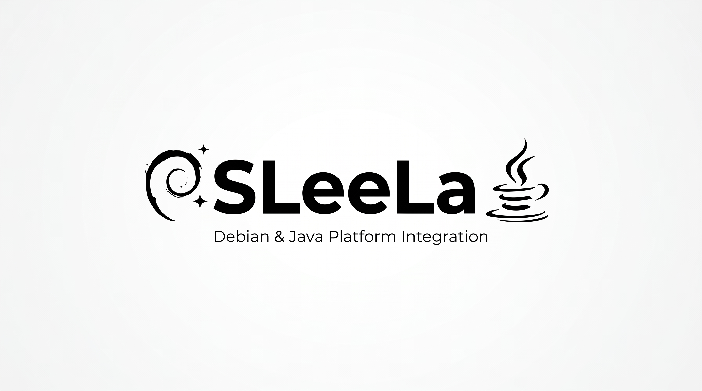

# Slecompiler™

**Max Rupplin - MEARVK LLC - 2026**

Slecompiler™ is the SLeeLa native-binary analysis, decompilation, library inspection, driver investigation, and refactoring subsystem.

## Build

Requirements: CMake 3.20 or newer, a C++20-capable compiler, and GNU Make (for the Makefile wrapper).

From this directory:

```sh
make                 # Configure and build
make test            # Build and run the registered tests
make check           # Alias for make test
make stage           # Install into ./build/stage
make clean           # Remove generated build files
```

Useful overrides:

```sh
make BUILD_TYPE=Debug
make JOBS=4
make BUILD_EXAMPLES=OFF
make GENERATOR=Ninja
make PREFIX=/your/staging/path stage
```

The same CMake project can be built directly without GNU Make:

```sh
cmake -S . -B build -DCMAKE_BUILD_TYPE=Release
cmake --build build --config Release --parallel
ctest --test-dir build --output-on-failure
```

The wrapper and CMake project target Linux, macOS, and Windows toolchains. On Windows, use a shell/environment that provides GNU Make and CMake, or invoke CMake directly. A build has not been validated on every platform merely by providing these build definitions.

## Linux-first native coverage

Slecompiler™ treats Linux native software as a first-class target, including:

- ELF executables and PIE programs;
- ELF shared objects (.so and versioned .so.*);
- GNU/Linux system libraries such as libc, libm, libdl, libpthread compatibility interfaces, libstdc++, and other ELF DSOs;
- plugin and extension libraries loaded through dynamic-loader mechanisms;
- static archives (.a) as collections of object files;
- relocatable ELF objects (.o);
- Linux kernel modules (.ko);
- compressed or packaged kernel modules when safely identifiable and decompressed for analysis;
- firmware and raw binary images;
- PE/COFF and Mach-O libraries and drivers where applicable.

The API models both individual artifacts and library families: dependencies, imported/exported symbols, relocation records, ABI clues, calling conventions, symbol versions, build identifiers, section permissions, and provenance can be represented as related records.

## Coverage status

Coverage is described honestly as three distinct capability levels. A format may be
*detected* (identity and architecture recognized), *parsed* (sections, symbols, imports,
exports, and metadata recovered), and/or *disassembled* (machine code lifted to
instructions and a control-flow graph).

| Container | Detected | Parsed | Disassembled |
|---|---|---|---|
| ELF (exe, PIE, `.so`/`.so.*`, `.o`, `.ko`) | yes | full: sections, segments, symbols, imports, exports, relocations, dynamic metadata, symbol versions, build-id, kernel-module `.modinfo` | x86, x86-64, AArch64 (ARM64), ARM (A32 + Thumb/T32) |
| PE/COFF (`.exe`, `.dll`, `.sys`) | yes | sections, import directory (DLL deps + named/ordinal imports), export name table, base-relocation presence, image base, entry point, subsystem/driver class | x86, x86-64, AArch64 (ARM64), ARM (A32 + Thumb/T32) |
| Mach-O thin (32/64-bit) and FAT/universal | yes | load commands: sections, dylib dependencies, symbol table (imports/exports); first analyzable FAT slice lifted | x86, x86-64, AArch64 (ARM64), ARM (A32 + Thumb/T32) |
| GNU static archive (`.a`) | yes | member enumeration with per-member format identification | per-member (ELF members) |
| Raw / firmware | yes | recorded as an opaque byte artifact with SHA-256 provenance | linear byte view |

Disassembly recovers the control-flow-relevant instruction set — branches, calls,
returns, conditional branches, indirect transfers — which is what the CFG,
function-candidate, and SLIR stages consume, plus a growing set of common data-movement
and arithmetic instructions:

- **x86 / x86-64**: full prefix handling (legacy prefixes, the `0x66` operand-size
  override, and 64-bit REX), near/short `jmp`/`jcc`/`call`, `ret`/`retn`, indirect
  `ff /2`/`/4` (and `ff /6` push), `push`/`pop` (register and immediate), `mov reg,imm`,
  the ModR/M reg/rm arithmetic-logic group (`add`/`or`/`adc`/`sbb`/`and`/`sub`/`xor`/
  `cmp`), the immediate-group forms (`80`/`81`/`83` with correctly sized `ib`/`iz`
  immediates), `mov r/m,imm` (`c6`/`c7`), `mov`/`test`/`xchg`/`lea r,r/m`, and
  `nop`/`leave`/`int3`/`hlt`/`cdq`/`cqo`. Unknown encodings degrade to `db`.
- **AArch64 (ARM64)**: `b`/`bl`, `b.cond`, `cbz`/`cbnz`, `tbz`/`tbnz`, `br`/`blr`, `ret`,
  `nop`. Unknown words degrade to `.inst`.
- **ARM (A32)**: `b`/`bl` (with condition codes), `bx`/`blx` register (and `bx lr`
  recognized as a return), pc-writing `ldm`/`pop` and `mov pc,lr` returns, `nop`. Unknown
  words degrade to `.inst`.
- **ARM Thumb (T32)**: variable-width (16/32-bit) decode with correct per-instruction
  width resolution — `b`/`b.w` (conditional and unconditional), `bl`/`blx(imm)`,
  `bx`/`blx(reg)` (and `bx lr` as a return), `cbz`/`cbnz`, pc-writing `pop` returns, and
  `nop`. Selected via the `--thumb` flag; the ARM default remains A32 (`--arm`). Unknown
  encodings degrade to `.inst` of their detected width.

Encodings outside these subsets are represented conservatively with low confidence rather
than guessed, preserving the provenance guarantee. The `disassemble`/`cfg`/`functions`
commands start the linear sweep at the first executable section (e.g. `.text`/`__text`)
when one is identified, rather than at file offset 0.

### ARM state mapping (`$a`/`$t`/`$d`)

For ARM ELF images, Slecompiler reads the static `.symtab` mapping symbols — `$a` (A32),
`$t` (Thumb), `$d` (inline data) — and, in the default `Auto` mode, switches the decoder
to the correct state per region automatically (translating each mapping's virtual address
through the section table to the file offset). Data regions are left as bytes rather than
disassembled. `--arm` / `--thumb` force a single state when mapping symbols are absent.

### Operand-level recovery

Decoded x86/x86-64 instructions carry a fully rendered form (`Instruction::text`), not just
a mnemonic: register, immediate, and memory operands are recovered in Intel order with
correct operand sizing (REX.W), SIB/displacement decoding, and signed displacements
rendered as a reviewer expects (`mov [rbp-0x4], 0x2a`, `lea rax, [rbp-0x8]`,
`mov rcx, [rbp+0x10]`). Relocation-backed operands are annotated with their symbol.

### Review-grade source and header emission

`decompile` renders C, C++, Java, and Sleela reconstructions with a provenance banner, a
per-function evidence block (control-flow summary plus an aligned address/bytes/instruction
/basis table in which every line is a valid comment for the target language), and
doxygen-style function documentation. `--header` emits the companion header (`.h`/`.hpp`)
with an include guard and documented prototypes. Function candidates are promoted from
call targets and symbol/export evidence rather than from every basic-block leader, so the
recovered interface reflects real entry points.

### SLIR statement lifting

Recovered instructions are lifted into architecture-neutral **SLIR** (`Lifter::lift`):
each native instruction maps to one SLIR `Operation` whose opcode reflects its observed
effect — `Move` (mov/lea), `Add`/`Sub`/`Mul`/`Div`, `Compare` (cmp/test/cbz), `Branch`,
`Call`, `Return`, `Store`/`Load` (push/pop) — with register/operand labels carried as SLIR
`Value`s via per-function value numbering, the original immediate, and preserved
provenance. Each operation also carries a rendered, architecture-neutral statement
(`rbp = rsp;`, `rsp -= 0x10;`, `compare([rbp-0x4], 0x7f);`, `if (cc) goto 0x59;`,
`return;`). Unrecognized effects become `Nop` rather than invented semantics, keeping the
lift faithful. The lifted `Module` is the same shape the SLIR VM executes, so lifted or
hand-built IR can be validated by the deterministic VM.

`decompile` renders these lifted statements as the function body (above the evidence
table) for C, C++, Java, and Sleela — in Sleela as `<` annotations so the module stays
lexically valid. The result graduates the reconstruction from evidence-only comments to
readable, provenance-backed statements.

The natural next increments are per-region decode following `$a`/`$t` in the function
recovery (not only the linear sweep), reconciling symbol virtual addresses with the
file-offset sweep so symbol-named functions lift their bodies, 8-bit/16-bit x86 register
naming for byte-form opcodes, and SSA/dataflow typing over the lifted SLIR.

## Native artifact classes

1. **Executable** — a native program image.
2. **DynamicLibrary** — an ELF DSO, PE DLL, Mach-O dylib, or equivalent loadable library.
3. **StaticArchive** — an archive containing relocatable object members.
4. **RelocatableObject** — an object intended for later linking.
5. **KernelModule** — Linux .ko and comparable kernel-loadable ELF artifacts.
6. **RawArtifact** — firmware, dumps, blobs, or other data whose container is unknown.

For Linux .ko files, Slecompiler™ records kernel-module evidence such as module name, vermagic when present, exported/imported symbols, section layout, relocation information, module metadata strings, license/author/description fields when present, dependency metadata, and kernel-version/build identifiers. This is static evidence; Slecompiler™ does not load the module into a kernel.

## Documentation and examples

The product documentation is divided into the API surface, architecture, terminology, format notes, and the product tutorial. Runnable API exemplars are maintained under `decompiler/examples/` and are built by default through `SLEE_LA_BUILD_API_EXAMPLES`.

Start with:

- `decompiler/docs/TUTORIAL.md` — build and API tutorial;
- `decompiler/API.md` — C++ API layer map;
- `decompiler/TERMINOLOGY.md` — Slecompiler terminology;
- `decompiler/ARCHITECTURE.md` — analysis architecture;
- `api/sleela/2.1/decompiler/API.html` — browser-oriented API summary.

## Analysis pipeline

artifact → container → symbols/metadata → decoder → instructions → CFG → functions → SLIR → analysis → C/C++/report

For libraries, the pipeline additionally models dependency relationships and public interfaces so collections of .so, .a, .o, or .ko files can be analyzed as a software family rather than isolated byte streams.

## Safety and evidence

Analysis is read-only by default. Slecompiler™ never executes an analyzed artifact as part of parsing or lifting. Driver and kernel-module images are treated as untrusted input. Kernel-mode loading, device I/O, memory writes, and execution of recovered native code are outside the default operation.

Use the subsystem only with software you are authorized to inspect.

---

# SLeeLa
<p align="center"></p>
<p align="center"></p>

## SLeeLa source edition — Syntax 3.0

SLeeLa is the current source reconstruction target under the normative
SLEELA.syntax **3.0** edition. The shared compiler accepts source syntax
**1.0–3.0**. A decompiler must preserve a known original source version and
artifact metadata; it must not automatically upgrade historical source or
assign 3.0 to output whose constructs have not been validated against that
edition and their feature-specific minimum gates. Decompiler product releases
and binary-format versions remain independent.
