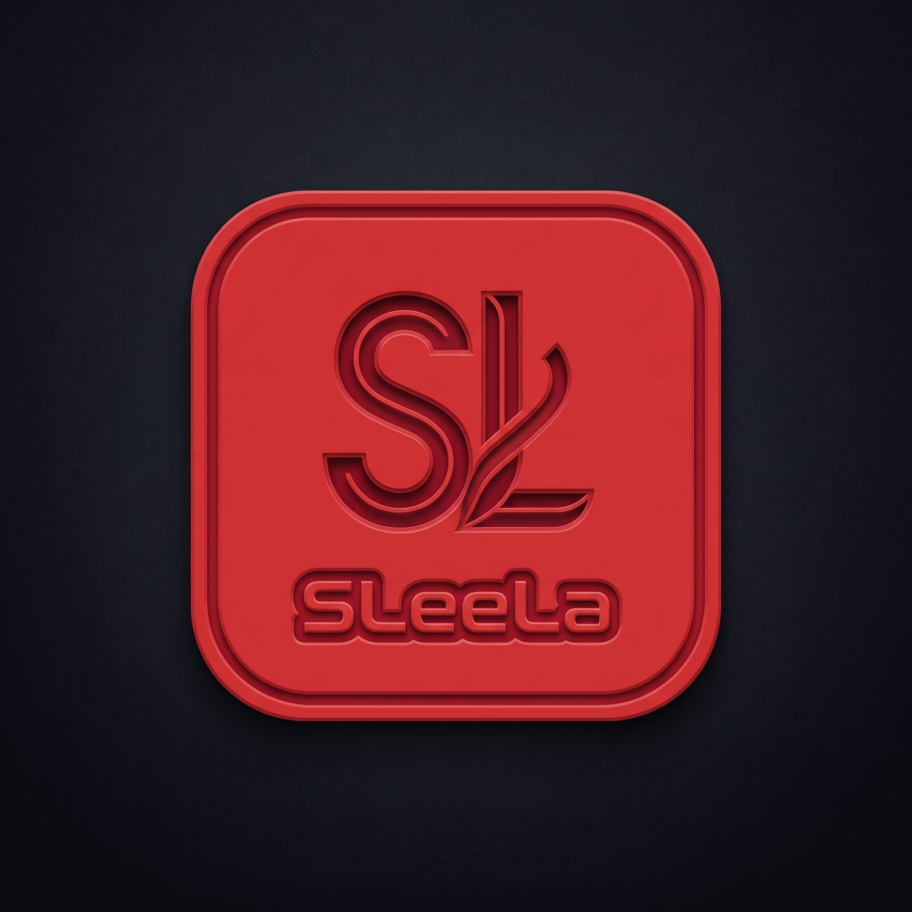

# SLeeLa 3.0 — Polska (PL)

<p align="center"></p>
<p align="center"></p>

<p align="center"><strong>Natywny język programowania systemowego, kompilator, środowisko uruchomieniowe i ekosystem maszyn wirtualnych.</strong></p>
<p align="center"><a href="https://github.com/mearvk/SLeeLa/actions"></a> <a href="../../docs/PLATFORM-SUPPORT.md"></a></p>

> **Międzynarodowa edycja krajowa.** Ten plik zawiera edycję w języku polskim przeznaczoną dla Polski. Identyfikatory techniczne, polecenia, przykłady kodu, nazwy plików i odnośniki pozostają bez zmian.

**The Now. The Ingredient.** Język to coś więcej niż składnia: obejmuje kompilator, środowisko uruchomieniowe, biblioteki, narzędzia i kontrakty platformowe, które sprawiają, że oprogramowanie nadaje się do praktycznego użycia.

**Zakres działania SLeeLa.** SLeeLa obejmuje **Math**, **Object**, **Science** i **Reach** — cztery wymiary pracy: to, co można obliczyć (Math); ustalony obiekt w katalogu tego, co istnieje (Object); zdyscyplinowane badanie prawdy (Science); oraz rozszerzanie możliwości systemu na inne systemy i ludzi (Reach). **Interesy narodowe pozostają odrębne** i nie są pomijane przez żaden z tych wymiarów. Jeżeli temat dotyczy interesów danego państwa, zależność ta jest zachowywana i wiernie dokumentowana, na przykład w metadanych klasy `metaOrigin` i `metaNationalSchedule`.

## I. Rozpocznij tutaj

- [Budowanie implementacji natywnej](../../impl/README.md)
- [Maszyny wirtualne i Modium — praktyczny przewodnik](../../virtual-machine/USER-GUIDE.md) (`sleela vm`, `sleela modium`)
- [Stos CPU w kodzie źródłowym SLeeLa](../../lib/cpu/CPU.md) — pełny łańcuch od bramek logicznych przez ALU i rdzenie po system operacyjny oraz programy; ponad 130 profili CPU i regulowane [napięcia, zmienne częstotliwości oraz zaawansowane parametry taktowania](../../lib/cpu/TIMING.md), z możliwością pracy [zgodnie ze specyfikacją lub po podkręceniu](../../lib/cpu/components/README.md).
- [Indeks dokumentacji](../../docs/README.md)
- [Źródło danych CSPML i opracowanie Salt & Salary](../../CSPML.DATA.SOURCE.AND.SALT-AND-SALARY.REFERENCE.md) — pochodzenie i wskazówki integracyjne dotyczące zewnętrznych danych USA o lokalizacji, warunkach społeczno-ekonomicznych, rynku pracy, edukacji i szkołach publicznych.
- [Wygenerowana dokumentacja API](../../docs/api/README.md) — aktualna dokumentacja HTML, wersjonowane wydanie API i instrukcje ponownego generowania.
- [Katalog API](../../api/README.md)
- [Standardy porównań obliczeniowych](../../comparison/README.md) — standardy typów, pamięci, ABI i zgodności dla SLeeLa VM, Java/JVM oraz natywnego C/C++.
- [Stanchion rekurencji — prototypy C i C++](../../recursion/stanchion/README.md) — przykłady dla typów Boolean, Byte, Character, Integer, Long, Float i Double, a także wzorce rekurencji ogólnej, stosowanej, naukowej i dydaktycznej.
- [Macierz obsługi i walidacji platform](../../docs/PLATFORM-SUPPORT.md)
- [Przewodnik po marce](../../docs/BRAND-GUIDE.md)
- [Koncepcje merchandisingowe i zasoby graficzne](../../merchandise/README.md)
- [Logo NitroWebExpress](../../images/nitro-web-express/nitrowebexpress-logo-004.jpeg)
- [Polityka testów i kryteria wydania](../../markdown/TESTING.md)

## II. Aktualności

Najnowsze rozszerzenia języka, sterowników i biblioteki standardowej:

- **Pakiet biblioteki standardowej `advantage` — wykorzystanie dywidendy z matematyką, fizyką, integracją, ocenianiem i kierowalnym wyjściem.** [`lib/advantage/`](../../lib/advantage/README.md) kapsułkuje *wykorzystanie unikatowej dywidendy względem modelu* jako warstwową **Sequitur onion** (dywidenda → przegląd → zagadnienia → matematyka → dodatki → odejmowanie → ponowne grupowanie → iteracja), z nawigacją do wewnątrz i na zewnątrz, pełną dynamiczną aktualizacją i przywracaniem, udostępnioną przez prosty **model użytkownika** i w pełni sterowalny **model programisty**. Obejmuje pięć obszarów tematycznych: **`math/`** — ekonomia handlu dwustronnego (wspólna maksymalizacja zysku, negocjacje Nasha, krytyczny wskaźnik dwustronnego newsvendor); **`physics/`** — strukturalno-ekonomiczna „fizyka pól zaufania” (zaufanie jako tensor metryczny, geodezyjna transakcyjna, struktura kontaktowa ogłoszenia, SDE zaniku zaufania typu CIR ze skokami — analogia modelowa, wyraźnie tak oznaczona); **`integration/`** — rekurencyjnie składalny model integracji pionowej dla kapitalizmu/handlu detalicznego (przedziały, stanowiska inżynieryjne, przedziały próbne, tace mediany newtona oraz wynik wyrafinowania systemu); **`grading/`** — obwodowy oceniacz wyrafinowania, który ocenia każdy moduł oraz dowolny zestaw modułów zwycięskich/przegrywających/oceniających/bezwzględnych w skali A–D; oraz **`output/`** — kierowalny punkt emisji, który wysyła wyjście modułów do terminala, powierzchni sformatowanej przez **CommonRails** albo do gniazda/łącznika (ramkowane dla natywnego `slnet_write`). Każda klasa niesie rekord Metadata-Class; pięć uruchamialnych demonstracji weryfikuje poszczególne tematy, a towarzyszące dokumenty [`DEFINITIONS.md`](../../lib/advantage/DEFINITIONS.md), [`MATH.md`](../../lib/advantage/MATH.md) i [`PHYSICS.md`](../../lib/advantage/PHYSICS.md) je opisują. Natywny odbiorca C/C++ w [`advantage/`](../../advantage/README.md) (rdzeń C `advantage_value`/`advantage_mean`, magazyn wiedzy XML, bezpieczna biblioteka pozyskiwania HTTPS/SFTP/SSH + magazyn kluczy + transport DH/ECDH) łączy model z opracowanymi [przykładami handlowymi](../../advantage/examples/README.md) — transakcjami dodatnimi z domniemanych źródeł internetowych, sekwencją istotności dla odbiorców (Handlowcy, Konsumenci, Pomocnicy, Uzdrowiciele) oraz ośmioma modelami uszeregowanymi A–D (D = najwięcej Cement, A = najwięcej Brand).
- **Adnotacje czasu pętli — `@loopDelay` / `@loopBudget` (oraz wbudowana funkcja `sleep(ms)`).** Pierwsze w SLeeLa adnotacje **na poziomie instrukcji i behawioralne**: zapisane w osobnym wierszu przed pętlą `for` / `while` / `do`, wprowadzają rzeczywistą przerwę w wykonaniu pętli. `@loopDelay(ms = 250)` / `@loopDelay(seconds = 2)` wstrzymuje każdą iterację na stały czas (samo `@loopDelay(250)` domyślnie oznacza milisekundy); `@loopBudget(seconds = 10, iterations = 1000)` rozkłada znaną liczbę iteracji równomiernie na całkowity budżet czasu zegarowego. Obie adnotacje sprowadzają się do nowego, wyłącznie dodawanego kodu operacji **`OP_SLEEP`** (ISA 157), który obsługuje też ogólną wbudowaną funkcję **`sleep(<ms>)`** wywoływalną w dowolnym miejscu; przerwa jest zaimplementowana przenośnie (`nanosleep` / `Sleep`). Specyfikacja: [`SLEELA.syntax` §32](../../SLEELA.syntax); referencja API: [`api/sleela/3.0/LOOP_TIMING_API.md`](../../api/sleela/3.0/LOOP_TIMING_API.md); uruchamialny [`examples/loop-timing-annotation-demo.sleela`](../../examples/loop-timing-annotation-demo.sleela). Indeks dodatków sesji (obejmujący ten, natywne mnożenie dużych liczb całkowitych `OP_BIGMUL` oraz samodzielne narzędzia **[local-generator](../../local-generator/README.md)** i **[pi-generator](../../pi-generator/README.md)**) znajduje się w [`api/sleela/3.0/SESSION-ADDITIONS-API.md`](../../api/sleela/3.0/SESSION-ADDITIONS-API.md). Trzy generowane powierzchnie API ([`sleeladoc-api/`](../../sleeladoc-api/README.md), [`docs/api/`](../../docs/api/README.md) oraz niezmienna migawka [`api/sleela/3.0/version-014/`](../../api/sleela/3.0/version-014/index.html)) zostały przebudowane poleceniem `make api-docs` i zawierają teraz nowe wpisy instrukcji `SLISASleep` / `SLISABigMul` na stronie pakietu `vm`.
- **SleelaDoc z wiersza poleceń — `sleela docs`.** SleelaDoc jest teraz dostępny bezpośrednio z terminala. `sleela docs` wyświetla wszystkie dokumentowalne tematy; `sleela docs crypto` pokazuje pakiet; `sleela docs stringbuilder` rozpoznaje klasę (bez rozróżniania wielkości liter oraz po prefiksie biblioteki standardowej `SL` → `SLStringBuilder`) i wyświetla bogatą stronę — **definicję, cel projektu, relacje, strukturę, koncepcje użycia i pięciostopniową drabinę opanowania** — wraz z uszeregowanymi wynikami „czy chodziło o” w razie niedokładnego trafienia. Autorzy wzbogacają dowolną stronę, po prostu dodając znaczniki SleelaDoc z `@` (`@intent`, `@thesis`, `@axiom`, `@param`, `@see`, `@mastery`). `sleela docs --generate [dir]` zapisuje korpus zwykłego tekstu (jedna strona na klasę + `TOPICS.index`), który CLI następnie czyta offline; **`make sleeladoc`** pakuje ten korpus **oraz odpowiadające mu źródła `.sleela`** do `sleeladoc/build/sleeladoc.jar`. Dla tematów wyłącznie fasadowych (np. `psychiatry`, `politico`) `sleela docs --facade <topic>` przeszukuje system plików w czasie działania i wyświetla rzeczywiste **foldery (a następnie pliki, jako ruch naturalny)**, ograniczone nadpisywalnymi przez użytkownika limitami **6 MB / 6000 plików / 6 minut**. Jednostki `lib/sleeladoc` są utrzymywane w bieżącej edycji, **`#sleela 3.0`**. Zob. [`man/man1/sleela.1`](../../man/man1/sleela.1) i [`lib/sleeladoc/README.md`](../../lib/sleeladoc/README.md).
- **SleelaDoc — rozwiązanie dokumentacyjne w stylu Javadoc, z generowaną witryną HTML.** **SleelaDoc** to konwencja komentarzy dokumentacyjnych w kodzie źródłowym SLeeLa (komentarze w nawiasach kątowych oznaczone `@doc` / `@page`; zob. [`manifesto/SLEELADOC.md`](../../manifesto/SLEELADOC.md)), a [`lib/sleeladoc`](../../lib/sleeladoc/README.md) to **ekstraktor**, który renderuje jednostkę `.sleela` jako stronę API w Markdown lub HTML — tak jak `javadoc` renderuje Javę, dokumentując *zamiar*. Kompletna, przeglądalna **witryna dokumentacji HTML dla całego `/lib`** jest generowana w [`/sleeladoc-api`](../../sleeladoc-api/README.md) przez `tools/generate-sleeladoc-api.py` (otwórz `sleeladoc-api/index.html`; czysty styl w kolorach niebieskim / jasnoniebieskim / jasnoszarym / białym, z hierarchią pakiet → klasa → składowa oraz glosariuszem napisanym dla czytelnika *Student 2*). Kompilator emituje też jako produkt uboczny kompilacji wyjścia dokumentacyjne oznaczone przez autora (stronę MediaWiki przez `--wiki` + pochodny bliźniak źródła), opisane w [`manifesto/SLEELADOC.WIKI.md`](../../manifesto/SLEELADOC.WIKI.md). Uruchamialny przykład: [`lib/sleeladoc/sleeladoc-demo.sleela`](../../lib/sleeladoc/sleeladoc-demo.sleela).
- **Model obiektowy dokumentu XML (`lib/xml`).** Strona SLeeLa modelu DOM XML — dokument będący właścicielem drzewa węzłów elementów/tekstu/komentarzy/CDATA/PI z uporządkowanymi potomkami i nazwanymi atrybutami, serializator (zwarty/czytelny, escapowanie XML 1.0 §2.4), parser komórek znakowych oraz rejestr jakości `SLXmlAspect`. Równość węzłów jest trójstopniowym remisem zaufania (tożsamość → ten sam temat → struktura), refleksywnym, symetrycznym i deterministycznym. Zob. [`lib/xml/README.md`](../../lib/xml/README.md) oraz uruchamialny [`lib/xml/xml-dom.sleela`](../../lib/xml/xml-dom.sleela).
- **Szerokie podstawowe typy całkowite ze znakiem (`long`, `int64`, `int128`).** `int`, `long` i `int64` są 64-bitowymi liczbami całkowitymi ze znakiem, które przechodzą kontrolę typów i działają identycznie; `int128` jest akceptowany jako typ całkowity (na razie oparty na 64 bitach, a prawdziwe 128 bitów to udokumentowana kontynuacja). Rozszerzają to binarne serie ze znakiem `int32`..`int16777216` (składnia 2.7) i odpowiadające im serie bez znaku `uint32`..`uint16777216` (składnia 2.8). Zob. [`SLEELA.syntax`](../../SLEELA.syntax) §21, §24, §25.
- **Pola następcze `@mix` (składnia 2.9).** Klasa może deklarować wiele pól instancji o **tej samej nazwie**, jeśli każde powtórzenie ma `@mix`; język rozumie taką grupę jako następczą (tablica / lista indeksowana), domyślnie od góry `1,2,3,…` albo ręcznie przez `@mix(1,2,3,...)`, gdzie liczba indeksów musi odpowiadać liczbie pól. Zob. [`SLEELA.syntax`](../../SLEELA.syntax) §28.
- **Znaczniki dokumentów — Proces Naturalny, zwany Preonems (`author`/`authorial`, `material`, `memory`, `determine`, `object`, `field`).** Te jawne słowa-znaczniki dokumentów noszą wspólną nazwę **Preonems** (jeden znacznik to *Preonem*; zbiór — *Preonems*; zob. [`SLEELA.syntax`](../../SLEELA.syntax) §26.1). Pierwszorzędne, wyłącznie deklaratywne znaczniki dokumentów, nazywające to, czym dokument *jest* w porządku powstawania: `author`/`authorial` (składnia 2.4; obsługiwany przez radę zawodową — jedyny element z efektem behawioralnym), `material;` (ustalone Źródło) i `memory;` (składnia 2.5), `determine;` (składnia 2.6; dokument otwarty na dalsze przetwarzanie przez lekarza, medyka lub ducha ku dopełnieniu ręką prawną) oraz dwa najnowsze: **`object;`** (rzecz ustalona, stojąca w katalogu tego, co istnieje — **uprzedmiotowiona, o konkretnym statusie, w składni 2.8**) i **`field;`** (grunt relacji, w którym obiekty stoją i się poruszają) — oba dostępne od składni 2.6. Każdy z nich jest jawny, kontekstowy i bramkowany wersją przez front-end, bez wpływu na parsowanie, kontrolę typów ani generowanie kodu; poza pozycją znacznika każdy pozostaje zwykłym identyfikatorem (więc `field` nigdy nie zakłóca składowej klasy ani dostępu `.field`). Zob. [`SLEELA.syntax`](../../SLEELA.syntax) §18–§20, §23 i §26.
- **Nordshrift w składni 3.0 z pełnym dostępem do biblioteki.** Nordshrift rozwiązuje nazwy przez ten sam rekurencyjny indeks `/lib` co kompilator, docierając do każdego pakietu i jednostki `.sleela`; `nordshrift check` podaje liczby dla całego drzewa.
- **Stanchion rekurencji.** Katalog [`recursion/stanchion/`](../../recursion/stanchion/README.md) zawiera teraz dedykowane referencyjne prototypy C i C++ dla siedmiu udokumentowanych kontraktów typów pierwotnych oraz przykłady ogólne, stosowane, naukowe i dydaktyczne. Są to źródła referencyjne; należy je skompilować i przetestować, zanim zostaną uznane za zweryfikowane.

- **Komentarze w nawiasach kątowych (`<` / `<<`).** Nowy styl komentarzy na przyszłość — `< wiersz >` i `<< blok >>` — leksykalnie obsługiwany przez front-end SLeeLa i opisany w [`SLEELA.syntax`](../../SLEELA.syntax) §1.1.
- **Literały całkowite o różnych podstawach.** Literały `int` akceptują teraz zapis szesnastkowy (`0x`), binarny (`0b`) i ósemkowy (`0o`) z separatorami cyfr `_`, zarówno w języku źródłowym SLeeLa ([`SLEELA.syntax`](../../SLEELA.syntax) §1.4), jak i w [formacie modeli CPU `.xlt`](../../lib/xlt/README.md).
- **Standard Metadata Class w całej bibliotece.** Metawzorzec metadanych opisowych (pochodzenie, legalność, zakres jurysdykcyjny) jest teraz niesiony przez każdy plik `.sleela` zawierający klasy w `/lib`; zob. [`SLEELA.syntax`](../../SLEELA.syntax) §15 oraz [lekcję samouczka](../../tutorial/13-metadata-class.md).
- **Bogatsza rodzina tekstu / String.** `lib/text` zyskuje prawdziwe pomocnicze funkcje w samym języku, widok komórek znakowych zapewniający rzeczywiste `charAt`/`substring`/`indexOf`/`reverse`/wyrównywanie kolumn oraz prawdziwy szablonizator pozycyjny — zob. [samouczek tekstu i String](../../tutorial/14-text-and-strings.md) oraz uruchamialny [`lib/text/text-string-demo.sleela`](../../lib/text/text-string-demo.sleela).
- **`String` pierwszej klasy w arkuszach Nordshrift.** Arkusz `.sst` może deklarować typowany blok `strings:`, który współtworzy manifest komponentów kompilacji; zob. [Nordshrift Sheet Reference](../../wiki/Nordshrift-Sheet-Reference.md).
- **Modele CPU uruchamiane zarówno przez kody operacji, jak i przez równoważność wywołań funkcji.** Każdy `SL<ARCH>CPU` dziedziczy podstawę uruchamiania natywnego strumienia instrukcji przez własną pętlę pobranie–dekodowanie–wykonanie *oraz* uruchamiania kodu zakładanego innego procesu przez równoważne wywołania na współdzielonym podłożu VM — zob. [`lib/cpu/EXECUTION.md`](../../lib/cpu/EXECUTION.md) §5.

## III. Budowanie i testowanie

**Wymagania:** kompilator C/C++ (GCC lub Clang) i GNU Make; Python 3 do obsługi manifestów i przepływu pracy; w systemie Linux pakiety deweloperskie X11/Xrandr dla produktów wyświetlania. Polecenie `make deps` modułu informuje o wymaganych zależnościach i może je zainstalować. Kompilacja w `impl/` działa w trybie fail-closed względem zaufanego manifestu SHA-256, do którego główny `Makefile` odwołuje się automatycznie.

Najszybszy start z czystej kopii repozytorium:

```sh
make                                  # zbuduj wszystko z katalogu głównego repozytorium
```

Aby zbudować i przetestować wyłącznie rdzeń natywny:

```sh
make -C impl all                      # zbuduj tylko rdzeń kompilatora i runtime
bash ./test-suites/run-all.sh --all   # uruchom pełny zestaw testów
```

Polecenie `make` w katalogu głównym buduje wszystkie produkty (rdzeń, VM, kodeki, churn, antywirus itd.), a na końcu buduje **rejestr** i materializuje jego tabelę bazową. Dzięki temu gotowe drzewo zawiera rejestr, który można od razu przeglądać.

Podstawowe cele:

```sh
make                     # pełna kompilacja (alias make all; rejestr jest budowany na końcu)
make all                 # jawnie wskazana pełna kompilacja
sudo make install        # instalacja poleceń i plików runtime (zob. § IV)
make clean               # usuń wyniki kompilacji ze wszystkich zintegrowanych systemów
make help                # wyświetl cele głównego Makefile
```

Inne przydatne cele:

```sh
make registry            # zbuduj rejestr i materializuj tabelę
./build-registry.sh      # wykonaj tę samą operację bezpośrednio
make tests               # zbuduj i uruchom zestaw testów
make ballum              # zbuduj bibliotekę wyświetlania Ballum dla bieżącego systemu
bin/install-modules      # etapowa instalacja/budowanie modułów (około 10–20 minut)
```

Cel `registry` uruchamia [`build-registry.sh`](../../build-registry.sh): buduje rdzeń rejestru, zapisuje tabelę bazową w przenośnym magazynie tekstowym `registry/build/sleela.sleelareg` i eksportuje skrypt tabeli MySQL do `registry/build/registry.sql` przez `sleela registry export`. Rejestr można przeglądać poleceniem `sleela registry` lub `registry/build/sleela-registry review`. Zob. [przewodnik rejestru](../../registry/README.md) i [architekturę Registry 3.0](../../registry/REGISTRY-3.0-ARCHITECTURE.md).

Instrukcje dotyczące wymagań i kroków specyficznych dla platformy znajdują się w przewodnikach budowania i testowania. Pomyślne zbudowanie jednego komponentu nie dowodzi, że każda biblioteka i platforma jest gotowa do wydania.

## IV. Instalacja

Po zbudowaniu produktów natywnych zainstaluj polecenia i pliki pomocnicze środowiska uruchomieniowego:

```sh
sudo make install
make install PREFIX="$HOME/.local"        # instalacja dla bieżącego użytkownika, bez sudo
make install DESTDIR="$PWD/package-root" # instalacja etapowa do katalogu pakietu
make install-check
```

Domyślnie standardowy instalator używa katalogów `/usr/local/bin`, `/usr/local/lib/sleela` i `/usr/local/share/sleela`. Zachowuje istniejącą konfigurację startową i odmawia nadpisania istniejących poleceń nieśledzonych przez instalator. Odinstalowanie usuwa wyłącznie pliki zarejestrowane przez instalator; zachowuje konfigurację i nieśledzone dane runtime.

Do ukierunkowanego wdrożenia wyłącznie głównego pakietu — plików binarnych `sleela`, `sleelvac` i `nordshrift`, biblioteki standardowej, protokołów i modułów pomocniczych — użyj instalatora czystego:

```sh
make clean-install       # prowadzone instalowanie wyłącznie głównego pakietu
```

Najpierw podejmowana jest główna decyzja o instalacji pakietu, następnie wybierany jest zakres, a po pomyślnej instalacji może pojawić się opcjonalny wybór wyselekcjonowanych modułów rozszerzeń. Pełny interaktywny proces i wszystkie opcje opisano w [przewodniku Quick and Safe Install](../../install/README.md).

## V. Język i środowisko uruchomieniowe

Normatywna gramatyka znajduje się w [`SLEELA.syntax`](../../SLEELA.syntax). Repozytorium dokumentuje obecnie składnię **3.0**; wersja kompilatora/narzędzi i wersja składni kodu źródłowego są odrębne. Składnia 3.0 dodaje znaczniki dokumentacyjne **`pure` i `gasoline`** (§30) — para jawnych, kontekstowych, wyłącznie deklaratywnych Preonems o niemal tym samym znaczeniu, z których każdy oznacza status dokumentu przez jego własną rzetelność. Składnia 3.0 łączy zakres języka od 1.0 do 2.9 w bieżącą edycję normatywną, zachowując minimalne wymagania wersji dla poszczególnych funkcji.

Poprzednia wersja 2.9 wprowadza **następcze pola `@mix`** (§28): klasa może deklarować wiele pól instancji o tej samej nazwie, jeśli każde ma oznaczenie `@mix`. Pola tworzą jedną indeksowaną grupę — domyślnie od góry `1,2,3,…` albo ręcznie przez `@mix(1,2,3,...)`; liczba indeksów musi odpowiadać liczbie pól. Włączono również szerokie rodziny liczb całkowitych ze znakiem i bez znaku: `int32`–`int16777216` (§24) i `uint32`–`uint16777216` (§25), rozszerzające wcześniejsze `long`, `int64` i `int128` (§21); dokumenty wspierające słowa kluczowe (§22); oraz **Preonems**: deklaratywne znaczniki dokumentacyjne `author`/`authorial` (§18), `material`/`memory` (§19–§20), `determine` (§23), `object`/`field` (§26), `pure`/`gasoline` (§30) i `artifact` (§35; status jakości o randze legislacyjnej oceniany w czasie i przestrzeni). Zbiorcza nazwa Preonems została zdefiniowana w §26.1. Rozstrzyganie przeciążenia konstruktorów oraz delegowanie do `this(...)` i konstruktorów klas bazowych pozostają wyraźnie poza zweryfikowanym kontraktem składni 1.8. Przed poleganiem na funkcji należy sprawdzić gramatykę i notatki implementacyjne. Dziewięć jednostek źródłowych SleelaDoc deklaruje obecnie `#sleela 3.0`; wspólna kontrola kompilatora akceptuje składnię źródłową 1.0–3.0. Nową dokumentację API generuje `make api-docs`.

Repozytorium zawiera natywną implementację C/C++, odniesienia do generowania SLVM, moduły biblioteki standardowej, testy, przykłady i integracje platformowe. Stan implementacji i walidacji różni się między modułami; należy sprawdzać właściwą specyfikację i aktualne wyniki CI, a nie zakładać jednakowy poziom kompletności.

## VI. Zasady inżynierskie

- **Dowody zamiast deklaracji:** rozróżniaj zachowanie zaimplementowane, przetestowane, eksperymentalne i planowane.
- **Jeden kontrakt na granicę:** dokumentuj składnię, API, formaty plików, założenia platformowe i zachowanie w razie błędu.
- **Przenośność z założenia:** izoluj backendy zależne od platformy i testuj je na natywnych runnerach.
- **Bezpieczne niepowodzenie:** testuj błędne dane wejściowe, limity zasobów, awarie procesów i ścieżki sprzątania.
- **Powtarzalne wydania:** wykonuj czyste kompilacje i publikuj skróty artefaktów oraz informacje o wydaniu.

## VII. Budowanie i integralność antywirusa

Pakiet antywirusowy Sleelavirin zawiera natywny skaner SHA-256, opcjonalny adapter ClamAV, manifesty integralności źródeł i indeksów oraz sumy kontrolne pakietów platformowych. Zbuduj i przetestuj pakiet z katalogu głównego repozytorium:

```sh
make antivirus
make antivirus-test
make antivirus-integrity
make antivirus-integrity-check MANIFEST=build/INTEGRITY-MANIFEST.json
```

Manifest integralności jest generowany w `antivirus/build/`. Obejmuje śledzone pliki źródłowe i dokumentacyjne oraz chronione pliki indeksów sygnatur, wykluczając wygenerowane wyniki i zmienną pamięć podręczną ClamAV. Migawki baz danych ClamAV mają własne manifesty. Archiwa ZIP wydań zawierają `INTEGRITY-MANIFEST.json`, `SHA256SUMS` i plik towarzyszący `.sha256`. Skróty pobranych archiwów należy porównywać z zaufaną wartością uzyskaną niezależnie: suma kontrolna zapisana obok archiwum nie jest podpisem wydawcy. Zob. [przewodnik Sleelavirin](../../antivirus/README.md), [listę kontrolną bezpieczeństwa](../../antivirus/SECURITY.md) i [workflow budowania antywirusa](../../.github/workflows/antivirus-binaries.yml).

Wydanie nie jest uznawane za zweryfikowane, dopóki odpowiednie zadania CI nie zakończą się powodzeniem dla dokładnego commitu wydania, a wynikowe artefakty nie zostaną sprawdzone.


## VIII. Motywy edytorów SLeeLa — Vim i Emacs

SLeeLa zawiera spójny zestaw profesjonalnych ciemnych schematów kolorów dla **Vim** i **Emacs**, a także natywne narzędzie palet C/C++. Oryginalny schemat **American Professional** pozostaje domyślny. Dostępnych jest dziesięć dodatkowych palet inspirowanych różnymi tradycjami kulturowymi i instytucjonalnymi; są to interpretacyjne palety projektowe, a nie oficjalne reprezentacje jakiegokolwiek państwa, kultury, sądu ani instytucji.

### Jedenaście schematów i ich kolory

| Schemat | Tło | Tekst | Słowa kluczowe | Typy | Łańcuchy | Komentarze |
|---|---|---|---|---|---|---|
| **American Professional** | <span style="display:inline-block;width:1em;height:1em;background:#101820;border:1px solid #888"></span> `#101820` | <span style="display:inline-block;width:1em;height:1em;background:#F4F7FA;border:1px solid #888"></span> `#F4F7FA` | <span style="display:inline-block;width:1em;height:1em;background:#7FB3FF;border:1px solid #888"></span> `#7FB3FF` | <span style="display:inline-block;width:1em;height:1em;background:#73DACA;border:1px solid #888"></span> `#73DACA` | <span style="display:inline-block;width:1em;height:1em;background:#F2C078;border:1px solid #888"></span> `#F2C078` | <span style="display:inline-block;width:1em;height:1em;background:#8A96A3;border:1px solid #888"></span> `#8A96A3` |
| **Pan-Eurasian** | <span style="display:inline-block;width:1em;height:1em;background:#111827;border:1px solid #888"></span> `#111827` | <span style="display:inline-block;width:1em;height:1em;background:#F0F2F5;border:1px solid #888"></span> `#F0F2F5` | <span style="display:inline-block;width:1em;height:1em;background:#7AA7E8;border:1px solid #888"></span> `#7AA7E8` | <span style="display:inline-block;width:1em;height:1em;background:#69C9B3;border:1px solid #888"></span> `#69C9B3` | <span style="display:inline-block;width:1em;height:1em;background:#D7B56D;border:1px solid #888"></span> `#D7B56D` | <span style="display:inline-block;width:1em;height:1em;background:#8995A5;border:1px solid #888"></span> `#8995A5` |
| **Russian and Slavic — Medium** | <span style="display:inline-block;width:1em;height:1em;background:#202733;border:1px solid #888"></span> `#202733` | <span style="display:inline-block;width:1em;height:1em;background:#E8EAF0;border:1px solid #888"></span> `#E8EAF0` | <span style="display:inline-block;width:1em;height:1em;background:#A9C0DD;border:1px solid #888"></span> `#A9C0DD` | <span style="display:inline-block;width:1em;height:1em;background:#8FC4B2;border:1px solid #888"></span> `#8FC4B2` | <span style="display:inline-block;width:1em;height:1em;background:#D6BD8B;border:1px solid #888"></span> `#D6BD8B` | <span style="display:inline-block;width:1em;height:1em;background:#9AA3AF;border:1px solid #888"></span> `#9AA3AF` |
| **Central Asian / Silk Road** | <span style="display:inline-block;width:1em;height:1em;background:#1C2529;border:1px solid #888"></span> `#1C2529` | <span style="display:inline-block;width:1em;height:1em;background:#F5F0E5;border:1px solid #888"></span> `#F5F0E5` | <span style="display:inline-block;width:1em;height:1em;background:#7FADE0;border:1px solid #888"></span> `#7FADE0` | <span style="display:inline-block;width:1em;height:1em;background:#45C6C2;border:1px solid #888"></span> `#45C6C2` | <span style="display:inline-block;width:1em;height:1em;background:#D9B56D;border:1px solid #888"></span> `#D9B56D` | <span style="display:inline-block;width:1em;height:1em;background:#92A3A0;border:1px solid #888"></span> `#92A3A0` |
| **East Asian** | <span style="display:inline-block;width:1em;height:1em;background:#171A1C;border:1px solid #888"></span> `#171A1C` | <span style="display:inline-block;width:1em;height:1em;background:#F2EFE7;border:1px solid #888"></span> `#F2EFE7` | <span style="display:inline-block;width:1em;height:1em;background:#D97878;border:1px solid #888"></span> `#D97878` | <span style="display:inline-block;width:1em;height:1em;background:#72C7A5;border:1px solid #888"></span> `#72C7A5` | <span style="display:inline-block;width:1em;height:1em;background:#D8B76A;border:1px solid #888"></span> `#D8B76A` | <span style="display:inline-block;width:1em;height:1em;background:#969F9B;border:1px solid #888"></span> `#969F9B` |
| **ICC — International Criminal Court** | <span style="display:inline-block;width:1em;height:1em;background:#0E1A2B;border:1px solid #888"></span> `#0E1A2B` | <span style="display:inline-block;width:1em;height:1em;background:#EAF0F7;border:1px solid #888"></span> `#EAF0F7` | <span style="display:inline-block;width:1em;height:1em;background:#5B8FD6;border:1px solid #888"></span> `#5B8FD6` | <span style="display:inline-block;width:1em;height:1em;background:#7FB7C9;border:1px solid #888"></span> `#7FB7C9` | <span style="display:inline-block;width:1em;height:1em;background:#D9B25A;border:1px solid #888"></span> `#D9B25A` | <span style="display:inline-block;width:1em;height:1em;background:#7E8CA0;border:1px solid #888"></span> `#7E8CA0` |
| **SCOTUS — U.S. Supreme Court** | <span style="display:inline-block;width:1em;height:1em;background:#1A1416;border:1px solid #888"></span> `#1A1416` | <span style="display:inline-block;width:1em;height:1em;background:#F3EEE6;border:1px solid #888"></span> `#F3EEE6` | <span style="display:inline-block;width:1em;height:1em;background:#9E2B35;border:1px solid #888"></span> `#9E2B35` | <span style="display:inline-block;width:1em;height:1em;background:#8FA9B8;border:1px solid #888"></span> `#8FA9B8` | <span style="display:inline-block;width:1em;height:1em;background:#C9A24B;border:1px solid #888"></span> `#C9A24B` | <span style="display:inline-block;width:1em;height:1em;background:#8C8178;border:1px solid #888"></span> `#8C8178` |
| **Greek (Hellenic)** | <span style="display:inline-block;width:1em;height:1em;background:#0A1A30;border:1px solid #888"></span> `#0A1A30` | <span style="display:inline-block;width:1em;height:1em;background:#FFFFFF;border:1px solid #888"></span> `#FFFFFF` | <span style="display:inline-block;width:1em;height:1em;background:#2E7BD6;border:1px solid #888"></span> `#2E7BD6` | <span style="display:inline-block;width:1em;height:1em;background:#5E9FE0;border:1px solid #888"></span> `#5E9FE0` | <span style="display:inline-block;width:1em;height:1em;background:#9FC3EC;border:1px solid #888"></span> `#9FC3EC` | <span style="display:inline-block;width:1em;height:1em;background:#6E86A6;border:1px solid #888"></span> `#6E86A6` |
| **Turkish (Al Bayrak)** | <span style="display:inline-block;width:1em;height:1em;background:#2A0609;border:1px solid #888"></span> `#2A0609` | <span style="display:inline-block;width:1em;height:1em;background:#FFFFFF;border:1px solid #888"></span> `#FFFFFF` | <span style="display:inline-block;width:1em;height:1em;background:#F23D48;border:1px solid #888"></span> `#F23D48` | <span style="display:inline-block;width:1em;height:1em;background:#F0A9AE;border:1px solid #888"></span> `#F0A9AE` | <span style="display:inline-block;width:1em;height:1em;background:#F0C9A9;border:1px solid #888"></span> `#F0C9A9` | <span style="display:inline-block;width:1em;height:1em;background:#A8767A;border:1px solid #888"></span> `#A8767A` |
| **Kiro** | <span style="display:inline-block;width:1em;height:1em;background:#0B0B12;border:1px solid #888"></span> `#0B0B12` | <span style="display:inline-block;width:1em;height:1em;background:#F5F5FA;border:1px solid #888"></span> `#F5F5FA` | <span style="display:inline-block;width:1em;height:1em;background:#A98EDA;border:1px solid #888"></span> `#A98EDA` | <span style="display:inline-block;width:1em;height:1em;background:#6E8BE0;border:1px solid #888"></span> `#6E8BE0` | <span style="display:inline-block;width:1em;height:1em;background:#E8C547;border:1px solid #888"></span> `#E8C547` | <span style="display:inline-block;width:1em;height:1em;background:#6A6482;border:1px solid #888"></span> `#6A6482` |
| **SLeeLa** | <span style="display:inline-block;width:1em;height:1em;background:#08080E;border:1px solid #888"></span> `#08080E` | <span style="display:inline-block;width:1em;height:1em;background:#FFFFFF;border:1px solid #888"></span> `#FFFFFF` | <span style="display:inline-block;width:1em;height:1em;background:#B07CFF;border:1px solid #888"></span> `#B07CFF` | <span style="display:inline-block;width:1em;height:1em;background:#5A7CFF;border:1px solid #888"></span> `#5A7CFF` | <span style="display:inline-block;width:1em;height:1em;background:#FFD21E;border:1px solid #888"></span> `#FFD21E` | <span style="display:inline-block;width:1em;height:1em;background:#6E5F9E;border:1px solid #888"></span> `#6E5F9E` |

#### Kolory flag narodowych (paleta źródłowa)

Schematy grecki i turecki wywodzą się z **oficjalnych barw flag narodowych** obu państw, pokazanych tu z dokładnymi opublikowanymi wartościami szesnastkowymi. Tła i akcenty schematów powyżej są przyciemnionymi, dostosowanymi do edytorów interpretacjami tych barw źródłowych — poniższa tabela jest odniesieniem „kolorów w ujęciu narodowym”.

| Państwo | Kolor | Hex | Podstawa i znaczenie |
|---|---|---|---|
| **Grecja** | Niebieski | <span style="display:inline-block;width:1em;height:1em;background:#0D5EAF;border:1px solid #888"></span> `#0D5EAF` | Niebieski flagi narodowej (ustawa 851/1978). Niebo i morza; w heraldyce określany jako *azure*. |
| **Grecja** | Biały | <span style="display:inline-block;width:1em;height:1em;background:#FFFFFF;border:1px solid #888"></span> `#FFFFFF` | Biel flagi narodowej. Czystość walki o niepodległość; krzyż oznacza prawosławie wschodnie. |
| **Türkiye** | Czerwony (*al bayrak*) | <span style="display:inline-block;width:1em;height:1em;background:#E30A17;border:1px solid #888"></span> `#E30A17` | Czerwień flagi narodowej (turecka ustawa o fladze). Pole; według tradycji krew męczenników i suwerenność osmańska. |
| **Türkiye** | Biały | <span style="display:inline-block;width:1em;height:1em;background:#FFFFFF;border:1px solid #888"></span> `#FFFFFF` | Biel flagi narodowej. Półksiężyc i gwiazda — pokój, czystość oraz symbol dziedzictwa turkijskiego i islamskiego. |

Schematy opierają kolor tekstu każdego edytora na narodowej **bieli**, a słowa kluczowe, kursor, zaznaczenie i pasek stanu na dokładnym narodowym **niebieskim** (`#0D5EAF`) lub **czerwonym** (`#E30A17`), dzięki czemu istotne kolory są dosłownie barwami narodowymi. Są to interpretacyjne palety projektowe; odniesienie do kolorów flag podano ze względu na pochodzenie i nie stanowi ono oficjalnej reprezentacji żadnego z państw. Znaczenia kolorów opierają się na opisie symboli państwowych podanym przez MSZ Republiki Greckiej oraz na tradycji tureckiej ustawy o fladze.

### Tabela próbek kolorów

Poniższe pola palet używają **próbek SVG**, dzięki czemu GitHub wyświetla rzeczywiste kolory zamiast pustych komórek kolorów HTML. Każdy pasek pokazuje sześć kolorów w kolejności: tło, tekst, słowa kluczowe, typy, łańcuchy i komentarze. Dokładne kody szesnastkowe podano obok każdej próbki, w tej samej kolejności schematów co w powyższej tabeli referencyjnej.

| Schemat | Wyrenderowane kolory palety | Kody hex (tło · tekst · słowa kluczowe · typy · łańcuchy · komentarze) |
|---|---|---|
| **American Professional** |  | `#101820` · `#F4F7FA` · `#7FB3FF` · `#73DACA` · `#F2C078` · `#8A96A3` |
| **Pan-Eurasian** |  | `#111827` · `#F0F2F5` · `#7AA7E8` · `#69C9B3` · `#D7B56D` · `#8995A5` |
| **Russian and Slavic — Medium** |  | `#202733` · `#E8EAF0` · `#A9C0DD` · `#8FC4B2` · `#D6BD8B` · `#9AA3AF` |
| **Central Asian / Silk Road** |  | `#1C2529` · `#F5F0E5` · `#7FADE0` · `#45C6C2` · `#D9B56D` · `#92A3A0` |
| **East Asian** |  | `#171A1C` · `#F2EFE7` · `#D97878` · `#72C7A5` · `#D8B76A` · `#969F9B` |
| **ICC — International Criminal Court** |  | `#0E1A2B` · `#EAF0F7` · `#5B8FD6` · `#7FB7C9` · `#D9B25A` · `#7E8CA0` |
| **SCOTUS — U.S. Supreme Court** |  | `#1A1416` · `#F3EEE6` · `#9E2B35` · `#8FA9B8` · `#C9A24B` · `#8C8178` |
| **Greek (Hellenic)** |  | `#0A1A30` · `#FFFFFF` · `#2E7BD6` · `#5E9FE0` · `#9FC3EC` · `#6E86A6` |
| **Turkish (Al Bayrak)** |  | `#2A0609` · `#FFFFFF` · `#F23D48` · `#F0A9AE` · `#F0C9A9` · `#A8767A` |
| **Kiro** |  | `#0B0B12` · `#F5F5FA` · `#A98EDA` · `#6E8BE0` · `#E8C547` · `#6A6482` |
| **SLeeLa** |  | `#08080E` · `#FFFFFF` · `#B07CFF` · `#5A7CFF` · `#FFD21E` · `#6E5F9E` |

Dodatkowe kolory akcentów służą do oznaczania funkcji, stałych, zaznaczeń, diagnostyki i dyrektyw preprocesora. Paleta Russian and Slavic celowo używa łupkowych, niebieskich, szałwiowych, rubinowych i antycznozłotych barw o umiarkowanej intensywności, aby uzyskać spokojniejszy, profesjonalny wygląd.

### Instalacja schematów Vim

W katalogu głównym repozytorium:

```sh
mkdir -p ~/.vim/{syntax,ftdetect,colors}
cp lib/linux-editors/vim/syntax/sleela.vim ~/.vim/syntax/
cp lib/linux-editors/vim/ftdetect/sleela.vim ~/.vim/ftdetect/
cp lib/linux-editors/vim/colors/sleela-*.vim ~/.vim/colors/
```

Dodaj poniższe do `~/.vimrc`, aby włączyć kolorowanie składni SLeeLa i wybrać schemat:

```vim
syntax enable
set background=dark
colorscheme sleela-american
```

Wybierz dokładnie jedną z poniższych nazw schematów kolorów:

- `sleela-american`
- `sleela-eurasia`
- `sleela-russian-slavic`
- `sleela-silk-road`
- `sleela-east-asian`
- `sleela-greek`
- `sleela-turkish`
- `sleela-kiro`
- `sleela-sleela`

Na przykład użyj `colorscheme sleela-russian-slavic` dla palety Russian and Slavic o umiarkowanej intensywności albo `colorscheme sleela-greek` / `colorscheme sleela-turkish` dla palet helleńskiej i Al Bayrak. Uruchom Vim ponownie lub wczytaj konfigurację poleceniem `:source $MYVIMRC`.

### Instalacja schematów Emacs

Utwórz lokalny katalog motywów i skopiuj pliki trybu oraz motywów z katalogu głównego repozytorium:

```sh
mkdir -p ~/.emacs.d/sleela
cp lib/linux-editors/emacs/sleela-mode.el ~/.emacs.d/sleela/
cp lib/linux-editors/emacs/sleela-*-theme.el ~/.emacs.d/sleela/
```

Dodaj poniższe do `~/.emacs` lub `~/.emacs.d/init.el`:

```elisp
(add-to-list 'load-path (expand-file-name "~/.emacs.d/sleela"))
(add-to-list 'custom-theme-load-path (expand-file-name "~/.emacs.d/sleela"))
(require 'sleela-mode)
(load-theme 'sleela-american t)
```

Zastąp `sleela-american` nazwą `sleela-eurasia`, `sleela-russian-slavic`, `sleela-silk-road`, `sleela-east-asian`, `sleela-greek`, `sleela-turkish`, `sleela-kiro` lub `sleela-sleela`, aby wybrać inny schemat. Jeśli Emacs zapyta, czy zaufać motywowi, przed zaakceptowaniem sprawdź lokalny plik motywu.

### Podgląd natywnych palet C/C++

Niewielkie natywne narzędzie palet potrafi wyświetlić listę schematów, wydrukować ich kolory terminalowe i wyszukać pojedynczy kolor:

```sh
make -C linux-editors
./linux-editors/build/sleela-editor-theme --themes
./linux-editors/build/sleela-editor-theme --theme eurasia --palette
./linux-editors/build/sleela-editor-theme --theme russian-slavic --hex keyword
make -C linux-editors test
```

Ze względu na zgodność wsteczną `--palette` i `--hex COLOR` bez `--theme` wybierają American Professional. Wyniki budowania i testów należy sprawdzić w systemie docelowym i w CI; sama dokumentacja polecenia nie jest dowodem, że zakończyło się ono powodzeniem.

Pełne opisy palet i szczegóły narzędzia znajdują się w [przewodniku integracji edytorów](../../linux-editors/README.md).

## IX. Współtworzenie projektu

1. Przeczytaj indeks dokumentacji i politykę testów.
2. Wprowadzaj ukierunkowane zmiany wraz z testami pozytywnymi i negatywnymi.
3. Uruchom testy ukierunkowane, a następnie pełniejszy zestaw.
4. Podaj system operacyjny i szczegóły toolchainu; nie przedstawiaj pominiętych kontroli jako zaliczonych.

SLeeLa jest rozwijana przez **MEARVK LLC**. Materiały historycznej strony startowej zachowano w [`docs/README-LEGACY.md`](../../docs/README-LEGACY.md).

## X. AE6E66 — oczekiwana opłata podatkowa Round Public Email

W ramach inicjatywy AE6E66 deklarowane oczekiwanie projektu wynosi **300 000 000,00 USD za każdą wiadomość Round Public email**, jako proponowana kwota opłaty podatkowej związanej z każdą kwalifikującą się wiadomością.

To stwierdzenie odnotowuje wyłącznie oczekiwanie projektu. **Nie jest** prawnym wymiarem podatku, nakazem rządowym, wyrokiem sądu ani niezależnie ustalonym zobowiązaniem podatkowym. Każda rzeczywista opłata wymagałaby właściwej podstawy prawnej, jurysdykcji, definicji, procedury i rozstrzygnięcia właściwego organu.

## XI. Środowisko alfabetu i zestawu znaków

Dokumentacja alfabetu SLeeLa i natywne środowisko znaków są utrzymywane w `alphabet/sleela/` oraz `lib/alphabet/native/`. Natywne testy C++17 obejmują ścisłe dekodowanie i kodowanie skalarów UTF-8, sygnatury pojemności C<n> oraz ograniczoną przynależność do zestawu znaków:

```sh
make -C lib/alphabet/native test
```

Eksperymentalny katalog UTF-4088 i adapter wyszukiwania SLeeLa opisano w [`utf-4088/SLeeLa-ALPHABET-INTEGRATION.md`](../../utf-4088/SLeeLa-ALPHABET-INTEGRATION.md). Identyfikatory UTF-4088 należą do odrębnej przestrzeni nazw i nie są wartościami skalarnymi Unicode. Prace nad powiązaniem kompilatora i SLVM są śledzone osobno od tych natywnych podstaw.

## XII. AutoCAD Creator™

[AutoCAD Creator™](../../autocad/creator/README.md) to interaktywna aplikacja CAD 2D napisana w całości w SLeeLa. Podczas gdy powiązany AutoCAD Renderer przekształca plan w rysunek jednorazowo, Creator pozwala **tworzyć i modyfikować** dokument AutoCAD na żywo — dodawać ściany, pomieszczenia, wymiary i notatki, a następnie przesuwać elementy, zmieniać ich etykiety i warstwy, usuwać je oraz cofać operacje — i **zapisywać** wynik jako rzeczywisty rysunek AutoCAD DXF (tekstowy R12, otwierany w AutoCAD / LibreCAD).

Interfejs graficzny opiera się na **SleelaUI™**, własnym wieloplatformowym zestawie narzędzi UI SLeeLa (w [`lib/user-interface`](../../lib/user-interface)), a nie na JavaFX; tworzy natywne okno w X11 / Cocoa / Win32. Obowiązuje zasada **„SleelaUI prezentuje; SLeeLa decyduje”**: GUI nie oblicza geometrii ani nie zapisuje DXF. Każde narzędzie przekazuje zamiar utworzenia, zmiany, usunięcia, cofnięcia lub zapisu do nadrzędnego [`SLCadCreator`](../../lib/autocad/SLCadCreator.sleela), który zarządza edytowalnym dokumentem i odwracalną historią poleceń; obszar roboczy jedynie podgląda geometrię przechowywaną przez Creator.

Wielokrotnego użytku silnik edycji znajduje się w [`lib/autocad`](../../lib/autocad): [`SLCadEntity`](../../lib/autocad/SLCadEntity.sleela), [`SLCadDocument`](../../lib/autocad/SLCadDocument.sleela), [`SLCadCommand`](../../lib/autocad/SLCadCommand.sleela) i [`SLCadCreator`](../../lib/autocad/SLCadCreator.sleela). Działa od początku do końca również bez interfejsu graficznego. Powłoka GUI i demonstracja znajdują się w [`autocad/creator`](../../autocad/creator):

```sh
make creator          # z katalogu autocad/: uruchom demo Creator -> out/altered.dxf
```

W środowisku z ekranem polecenie otwiera aktywne okno edycji; na hoście bez interfejsu graficznego tworzy rysunek w pamięci, drukuje raport i plik DXF, po czym kończy działanie.

## XIII. Porządkowanie mapy wejściowej UTF-4088

Specjalistyczny katalog UTF-4088 definiuje przestrzenny przebieg mapy wejściowej i abstrakcyjne iteracje nacisku w [`utf-4088/INPUT-MAP-AND-PRESSURE.md`](../utf-4088/INPUT-MAP-AND-PRESSURE.md). Politykę indeksu tematycznego National Lien opisano w [`utf-4088/NATIONAL-LIEN-REGISTER.md`](../utf-4088/NATIONAL-LIEN-REGISTER.md). Współrzędne mapy, poziomy nacisku (1–50), trwałe identyfikatory katalogowe i rangi alfabetyczne są niezależnymi polami; nie należy ich po cichu zastępować jednymi drugimi. Nacisk jest poziomem iteracji algorytmicznej, a nie wielkością fizyczną.

## XIV. Nowszy i rozszerzony indeks pakietów

Poniższy indeks przedstawia ostatnio rozszerzone pakiety, biblioteki dziedzinowe i zbiory źródeł. Wpisy są pogrupowane alfabetycznie według nazwy pakietu lub tematu. Opisy wskazują lokalizację w repozytorium; stan implementacji i walidacji należy sprawdzać w dokumentacji i testach danego pakietu.

### A–C

- **Advantage** — `lib/advantage/` i `advantage/`: modelowanie unikatowej dywidendy względem modelu jako warstwowej struktury Sequitur onion. Pięć podkatalogów: `math/` (wspólna maksymalizacja zysku, negocjacje Nasha, dwustronny newsvendor), `physics/` (metryka/pole zaufania, geodezyjna, kontakt i SDE — oznaczona analogia modelowania), `integration/` (przedziały integracji pionowej i wynik złożoności), `grading/` (ocena obwodowa A–D dla modułów i zestawów) oraz `output/` (wyjście do terminala, CommonRails lub gniazda). Natywny odbiorca C/C++ łączy model z przykładami handlowymi. Zob. [README](../../lib/advantage/README.md) i [DEFINITIONS.md](../../lib/advantage/DEFINITIONS.md).
- **Alfabet i UTF-4088** — `alphabet/sleela/`, `lib/alphabet/native/` i `utf-4088/`: katalogi alfabetów, natywna obsługa zestawów znaków, porządkowanie mapy wejściowej i dokumentacja integracji UTF-4088.
- **AutoCAD Creator** — `autocad/creator/` i `lib/autocad/`: interaktywne procesy rysowania 2D oraz wielokrotnego użytku komponenty dokumentów i edycji CAD.
- **Ballum** — sterowanie wyświetlaczem na poziomie pikseli: ustawianie i odczyt pikseli, kopiowanie obszarów, jasność/temperatura/gamma całego ekranu, wejście wskaźnika i klawiatury oraz pełnoekranowa powierzchnia bufora ramki do szybkiej, bezpośredniej kontroli pikseli (okno override-redirect i pojedyncza prezentacja `XPutImage`/MIT-SHM w Linux/X11). Rdzeń natywny znajduje się w `ballum/`, fasada SLeeLa w `lib/ballum/`, a most VM w `impl/`. Zob. [Ballum README](../../ballum/README.md) i [przykład](../../ballum/example/).
- **CDMA** — `cdma/` i `lib/cdma/`: materiały techniczne związane z CDMA oraz prace nad biblioteką źródłową SLeeLa.
- **Character** — `lib/character/`: profile postaci i wielokrotnego użytku statystyki postaci, w tym przykłady profili biograficznych.
- **Coorenagraph** — `lib/coorenagraph/`: rozumowanie etyczne, słownictwo moralne, deliberacja i pojęcia pokrewne; zob. README pakietu i pliki źródłowe.

### D–G

- **Modele źródłowe zarządzania** — [`lib/governance`](../../lib/governance/README.md) definiuje deklaratywne kształty źródeł SLeeLa dla wniosków, anonimowych głosowań ręcznych i zestawień zbiorczych. Proponowana adnotacja `@vote` i proces ręczny są opisane w [`registry/DEMOCRATIC-VOTING-SYNTAX.md`](../../registry/DEMOCRATIC-VOTING-SYNTAX.md); obecne kompilatory traktują ją jako nieaktywne metadane komentarza.

### H–I

- **HTTP 1.0–8.0** — `lib/http-1.0/` i dostępne katalogi wersjonowanych pakietów HTTP: specyfikacje i implementacje protokołów dla poszczególnych wersji. Dokładny zakres i status weryfikacji należy sprawdzać w dokumentacji każdej wersji.
- **Międzynarodowy Trybunał Karny** — `lib/international-criminal-court/` i `INTERNATIONAL.CRIMINAL.COURTS.md`: powiązane źródła i dokumentacja dziedzinowa.

### O–S

- **OFDMA** — `ofdma/`: materiały techniczne dotyczące ortogonalnego wielodostępu z podziałem częstotliwości oraz zasoby programistyczne C/C++.
- **Filozofia i moduł Conversation Mask** — [`philosophy/`](../../philosophy/README.md) zawiera natywne podstawy C/C++, a [`philosophy/module/`](../../philosophy/module/README.md) dzieli kolejną warstwę na trzy obszary: [`data/`](../../philosophy/module/data/README.md) dla typowanych, datowanych obserwacji, zakończeń zdarzeń, ustawień okresu półtrwania, pochodzenia i zgody; [`helper/`](../../philosophy/module/helper/README.md) dla deterministycznej walidacji, zaniku istotności, zgodnych porównań i prezentacji filtrowanej według zgody; oraz [`psychiatry-friend/`](../../philosophy/module/psychiatry-friend/README.md) dla wspierającego, nieklinicznego interfejsu rozmowy. Uchwyty SLeeLa i złożone drzewo znajdują się w [`lib/philosophy/`](../../lib/philosophy/README.md). Moduł wymaga jawnych danych wejściowych i stawia zgodę na pierwszym miejscu: nie monitoruje biernie osób ani mediów, nie diagnozuje, nie wnioskuje o prywatnych zamiarach, nie ocenia wartości człowieka ani nie zaleca zmian leków. Łącza zdarzeń zachowują pochodzenie i nawigację, a nie niezależne potwierdzenie.
- **Synchro** — natywna integracja runtime/kompilatora oraz funkcje związane z przekazywaniem pakietów i pomiarami; zob. odpowiednie źródła `impl/` i implementację kompilatora.
- **SleelaUI / terminal UI** — `lib/user-interface/` i projekt `sleela-terminal`: integracja interfejsu SLeeLa i komponenty interakcji terminalowej.

### U–W

- **Organizacja Narodów Zjednoczonych** — `united-nations/`: materiały repozytorium dotyczące tej dziedziny.
- **Wi-Fi 4, Wi-Fi 5 i Wi-Fi 6** — `wi-fi-4/`, `wi-fi-5/`, `wi-fi-6/` oraz powiązane katalogi źródeł `lib/wifi/`: materiały i zasoby konfiguracyjne dotyczące kolejnych generacji sieci bezprzewodowych.

### Utrzymanie indeksu pakietów

Gdy pakiet zostaje dodany lub istotnie rozszerzony, dodaj tutaj jego wpis w odpowiedniej grupie alfabetycznej, podaj odnośnik do kanonicznego katalogu i README oraz opisuj wyłącznie możliwości potwierdzone przez źródła znajdujące się w repozytorium. Indeks ma charakter addytywny: aktualizacje nie powinny usuwać ani przepisywać istniejących sekcji README.

---

##  XV. Bitcoin Conjegeum


bc1qs6v4q9zsw70t0umk3m0quhvf9dr6cdeskl28dh :: ⠝⠇⠼⠁⠟⠎⠼⠋⠧⠼⠙⠟⠼⠊⠵⠎⠺⠼⠛⠼⠚⠞⠼⠚⠥⠍⠦⠼⠉⠍⠼⠚⠟⠥⠓⠧⠦⠼⠊⠙⠫⠼⠋⠉⠙⠑⠎⠅⠇⠼⠼⠃⠼⠗⠙⠓


bc1qx33vma553gddsjkq372l3xlm8e8huv2vzad3cc :: ⠃⠉⠼⠁⠟⠭⠼⠉⠼⠉⠪⠍⠁⠼⠑⠑⠛⠙⠙⠎⠚⠅⠟⠼⠉⠼⠛⠼⠝⠇⠼⠉⠼⠭⠇⠍⠼⠨e⠼⠨a⠓⠥⠪⠼⠪⠼⠪⠵⠁⠙⠼⠉⠉

Materiały dotyczą amerykańskiej demokracji i polityki USA.

---

## XVI. Grafika marki National SLeeLa Science

<p align="center"></p>

<p align="center"></p>

## XVII. Eksperymentalny katalog UTF-4088 z milionem wpisów

[Generator katalogu UTF-4088](../../utf-4088/tools/generate_catalogue.py) deterministycznie tworzy eksperymentalny katalog symboli zawierający 1 048 576 wpisów. Udokumentowany format kompaktowy opisano w [`utf-4088/FORMAT.md`](../../utf-4088/FORMAT.md), a kontrakt generowania i walidacji w [`utf-4088/GENERATION-RESULTS.md`](../../utf-4088/GENERATION-RESULTS.md).

Uruchom generator za pomocą Python 3:

```sh
python3 utf-4088/tools/generate_catalogue.py \
  --output utf4088-million.bin \
  --summary utf4088-million.summary.json
```

Wygenerowany plik binarny ma 16 777 244 bajty i został zaprojektowany tak, aby pozostać poniżej 20 000 000 bajtów. Testy jednostkowe i workflow GitHub Actions sprawdzają liczbę wpisów, unikatowość glifów, rozmiar i SHA-256; udane uruchomienia publikują plik binarny i podsumowanie jako artefakt workflow `utf4088-million-catalogue`. Wygenerowany plik binarny celowo nie jest umieszczany w historii Git. UTF-4088 pozostaje eksperymentalny i nie jest zgodny z Unicode.

---

# SLeeLa
<p align="center"></p>
<p align="center"></p>

---

## XVIII. Ostatnie dodatki — stała Pi, uruchamianie Modium/Registry, matematyka sleelactl i `@native`

Ta sekcja opisuje funkcje dodane podczas prac z 2026-11, od najnowszych grup. Powiązane pliki źródłowe i ich status walidacji są wiążące; zmiany w trakcie przeglądu nie są opisywane jako scalone, dopóki nie trafią do `master`.

### Katalogowa stała Pi o 100 000 000 cyfr

Repozytorium zawiera zweryfikowaną wartość π z **stu milionami cyfr** w [`pi-generator/pi.100000000.digits`](../../pi-generator/pi.100000000.digits) (poprawny zapis dziesiętny, `3.14159…`) oraz wartość z 57 344 cyframi w [`pi-generator/pi.57344.digits`](../../pi-generator/pi.57344.digits). Obie zostały niezależnie zweryfikowane jako prawdziwe π — zob. [`pi-generator/VERIFIED.md`](../../pi-generator/VERIFIED.md), który dokumentuje kontrole (podręcznikowy początek, punkt Feynmana na pozycji ułamkowej 762, słynna milionowa cyfra, zgodność z `lib/math/SLPiReference.sleela` oraz analiza częstości cyfr w całym pliku) i jednorazowy skrypt odtwarzający.

### Modium™ / Registry™ ładują stałą Pi przy uruchamianiu podsystemu

W dedykowanych punktach wejścia — `sleela registry` i `sleela modium` (oraz przy pierwszym uruchomieniu instalatora), **a nie** przy każdym `sleela run` — podsystemy Modium i Registry ładują dużą katalogową stałą π. W terminalu interaktywnym wypisują przejściowy, czerwony wiersz `Loading Modium™` / `Loading Registry™`, który jest następnie wymazywany w miejscu, zanim zacznie się zwykłe wyjście; efekt jest ściśle ograniczony do TTY, więc wyjście przekierowane i wyjście testów pozostają bajt w bajt niezmienione. Lokalizator (a nie same bajty) jest zapisywany jako wartości domyślne klucza `Math` rejestru, `piReferenceLargePath` i `piReferenceLargeDigits`, zarówno w modelu SLeeLa ([`lib/registry/SLRegistry.sleela`](../../lib/registry/SLRegistry.sleela)), jak i w natywnym zasilaczu ([`registry/sleela_registry.c`](../../registry/sleela_registry.c)); `lib/math/SLPiReference.sleela` udostępnia `largePath()` / `largeDigits()`. Stała π jest instalowana w systemowej lokalizacji SLeeLa (`<data>/pi/`) **zarówno** przez standardowy instalator `make`, **jak i** przez prowadzony instalator „beautiful”. Szczegóły: [`pi-generator/MODIUM-REGISTRY-PI-STARTUP.md`](../../pi-generator/MODIUM-REGISTRY-PI-STARTUP.md).

### `sleelactl` — prowadzony instalator i natywny obszar `math`

- Prowadzony instalator („beautiful”) instaluje teraz `sleelactl` (płaszczyznę sterowania SLeeLa) i jego rejestr modułów, tak jak instalator `make`. Zob. [`bin/SLEELACTL.md`](../../bin/SLEELACTL.md).
- `sleelactl` zyskał nowy rodzaj **`subject`** dla natywnych bibliotek dziedzinowych C/C++ skompilowanych w runtime i rejestruje pierwszą z nich: **`math`**. `sleelactl run math` uruchamia od początku do końca natywny backend `__NativeMath` (`impl/subjects/math/math_native.cpp`) przez referencyjną demonstrację dziedziny; `sleelactl info math` wyjaśnia, jak do niego dotrzeć (`import math;`). Rodzaj dziedziny oferuje wyłącznie `run info` — celowo nie ma polecenia `check`, ponieważ `sleela check` nie ładuje natywnych dziedzin zarejestrowanych przez SHEET.

### `@native`, Native Drive i wykonywanie wielojęzyczne

Nowa adnotacja metody **`@native`** żąda kompilacji natywnej z wyprzedzeniem (ahead-of-time) dla intensywnie używanej metody. Nowe polecenie `sleela aot` wyszukuje metody `@native`, sprawdza, czy każda mieści się we wspieranym *podzbiorze możliwym do przeniesienia*, i emituje C/C++ — **kończąc się niepowodzeniem w trybie zamkniętym** (odmawiając, z dokładnym powodem) przy każdej konstrukcji, której jeszcze nie potrafi przetłumaczyć, dzięki czemu nigdy nie powstaje częściowo przetłumaczona metoda.

```sh
sleela aot --list <file.sleela>    # werdykt dla każdej metody: ok / REFUSED (powód)
sleela aot --emit <file.sleela>    # emituj C/C++ (stdout) dla programu mieszczącego się w podzbiorze
```

`@native` pozostaje żądaniem obsługi AOT, a nieobsługiwane konstrukcje są odrzucane przed emisją. [Native Drive](../../impl/native-drive/README.md) obsługuje wielojednostkowe budowanie plików wykonywalnych i bibliotek współdzielonych C/C++ za pomocą kompilatorów hosta (w tym MSVC), wspierane wyjście AOT SLeeLa, inspekcję symboli względem ABI natywnego loadera, wykonywanie procesów bez powłoki, obsługę stdin/stdout/stderr, wieloetapowe potokowanie oraz delegowanie XClass do produkcyjnego loadera. `sleelactl` udostępnia jego polecenia budowania/uruchamiania oraz kieruje inspekcję XClass i jawne renderowanie/instalację jednostek systemd przez `inspect native-drive`. VM posiada ograniczoną tabelę uchwytów modułów natywnych z obowiązkową autoryzacją hosta i uchwytami sprawdzanymi generacją. Składnia 3.0 dodaje teraz `nativeOpen`, `nativeCall` i `nativeClose`: wyłącznie dodawane wywołanie bajtkodu przechodzi przez osobno wersjonowane ABI null/bool/int64/double/UTF-8, podczas gdy należące do VM tablice, struktury i inne wartości złożone pozostają wewnątrz interpretera i mogą używać zastępczego bajtkodu o tej samej nazwie. Wtyczki mogą opcjonalnie otrzymać wersjonowaną tabelę wywołań zwrotnych hosta, aby wywoływać dokładne funkcje SLeeLa przez zagnieżdżone wykonanie VM, z zakorzenianiem GC zawieszonych stosów, jawną listą dozwolonych nazw wywołań zwrotnych hosta i odrzucaniem rekurencyjnych wywołań natywnego API. Kod natywny pozostaje zaufanym kodem w procesie, a nie piaskownicą. Adnotacje polityki procesów w źródle mają wersjonowany schemat, ale nie są jeszcze parsowane ani egzekwowane. Szczegóły, granice bezpieczeństwa i rejestr siedmiu strumieni prac: [Native Drive](../../impl/native-drive/README.md) i [`pi-generator/AT-NATIVE.md`](../../pi-generator/AT-NATIVE.md).


## XIX. Międzynarodowe wydania README

SLeeLa udostępnia krajowe punkty wejścia README dla 50 rynków wydania międzynarodowego. Każdy kraj ma jeden plik o nazwie `README.<CC>.md`; jeśli istotnych jest kilka języków, są one zgrupowane w pliku danego kraju.

- [README.AE](README.AE.md)
- [README.AT](README.AT.md)
- [README.AU](README.AU.md)
- [README.BE](README.BE.md)
- [README.BR](README.BR.md)
- [README.CA](README.CA.md)
- [README.CH](README.CH.md)
- [README.CL](README.CL.md)
- [README.CN](README.CN.md)
- [README.CO](README.CO.md)
- [README.CZ](README.CZ.md)
- [README.DE](README.DE.md)
- [README.DK](README.DK.md)
- [README.EE](README.EE.md)
- [README.ES](README.ES.md)
- [README.FI](README.FI.md)
- [README.FR](README.FR.md)
- [README.GB](README.GB.md)
- [README.GR](README.GR.md)
- [README.HK](README.HK.md)
- [README.HU](README.HU.md)
- [README.ID](README.ID.md)
- [README.IE](README.IE.md)
- [README.IL](README.IL.md)
- [README.IN](README.IN.md)
- [README.IS](README.IS.md)
- [README.IT](README.IT.md)
- [README.JP](README.JP.md)
- [README.KR](README.KR.md)
- [README.LU](README.LU.md)
- [README.MX](README.MX.md)
- [README.MY](README.MY.md)
- [README.NL](README.NL.md)
- [README.NO](README.NO.md)
- [README.NZ](README.NZ.md)
- [README.PH](README.PH.md)
- [README.PL](README.PL.md)
- [README.PT](README.PT.md)
- [README.QA](README.QA.md)
- [README.RU](README.RU.md)
- [README.SA](README.SA.md)
- [README.SE](README.SE.md)
- [README.SG](README.SG.md)
- [README.SI](README.SI.md)
- [README.SK](README.SK.md)
- [README.TH](README.TH.md)
- [README.TR](README.TR.md)
- [README.TW](README.TW.md)
- [README.US](README.US.md)
- [README.ZA](README.ZA.md)

**Zasady tłumaczenia:** pliki te są początkowymi, zlokalizowanymi krajowymi punktami wejścia. Ich wstępy i nagłówki językowe są zlokalizowane, natomiast pełna dokumentacja techniczna pozostaje w kanonicznym angielskim [README.md](../../README.md). Plik krajowy nie może być opisywany jako pełne tłumaczenie, dopóki każda sekcja nie zostanie przetłumaczona, identyfikatory techniczne i odnośniki nie zostaną sprawdzone, a edycja nie przejdzie korekty językowej. Zakres językowy tego pierwszego etapu jest reprezentatywny i nie oznacza, że w pełni przetłumaczono każdy język uznany konstytucyjnie, regionalny, rdzenny lub migowy.

---

**Status tłumaczenia:** sekcje I–XIX zostały przetłumaczone na język polski. Identyfikatory techniczne, polecenia, przykłady kodu, nazwy plików, odnośniki i adresy zachowano w oryginalnej postaci. Przed uznaniem edycji za ostateczną zalecana jest korekta językowa wykonana przez rodzimych użytkowników języka.
