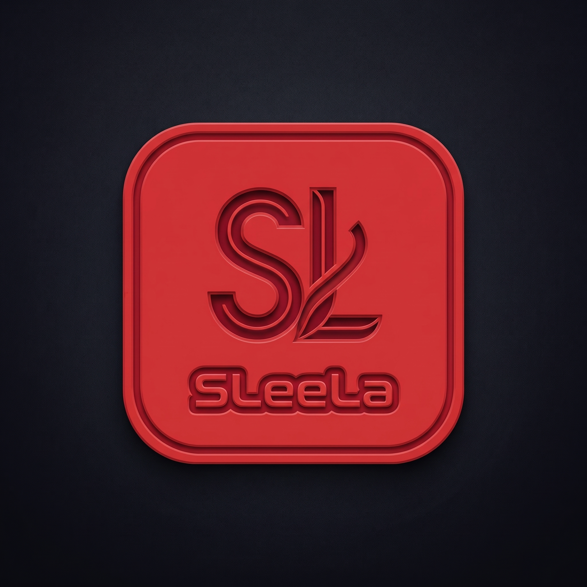

# Java to SLeeLa Conversion: Overall Status

## Verification refresh — 2026-11-18

**Inspected master:** `3478f4856d044b615ff2e999ca5730a80eedd394`. **Release decision: HOLD.** Current verification metadata does not establish a passing production build or Java behavioral equivalence.

- SHA-256 manifest/provenance regeneration: **UNVERIFIED**.
- Runtime and C++ converter clean builds: **UNVERIFIED**; no completed current-master build logs inspected.
- Model 1.5.0 self-check and result-type row check: **PENDING**.
- Positive differential and refusal suites: **PENDING**; PR #378 Java converter and regression jobs are queued, not passed.
- SLeeLa-native per-member stub policy and repeat-run/transaction/provenance tests: **UNVERIFIED**.
- Representative Java execution comparisons: **UNVERIFIED**.
- JDK 28 API/signature campaign: **PENDING**.
- Windows 10+/MinGW-w64 and macOS host qualification: **PENDING**; their portability jobs are queued.

PR [#378](https://github.com/mearvk/SLeeLa/pull/378) remains open/unmerged. Its head `6f7fc49723eed52dfbbe9827c047944c1787e43c` is 4 commits ahead and 9 behind current master; its divergence consists only of four workflow-file changes. The four associated runs ([portability](https://github.com/mearvk/SLeeLa/actions/runs/44405716080), [Java converter](https://github.com/mearvk/SLeeLa/actions/runs/44405716173), [regression](https://github.com/mearvk/SLeeLa/actions/runs/44405715950), [JDK 28](https://github.com/mearvk/SLeeLa/actions/runs/44405715986)) were queued/pending on that PR head, not on current master. No current-master workflow run was found during this check.

This refresh records repository/workflow state only. It does not convert historical 2026-11-13 measurements into current evidence and does not claim any build or test was executed.


## Current master and production qualification update (2026-11-18)

**Source baseline inspected:** `3478f4856d044b615ff2e999ca5730a80eedd394` (master tip at verification time; subsequent commits in this update are documentation-only).
**Merged work:** [PR #375](https://github.com/mearvk/SLeeLa/pull/375), merged 2026-11-18.  
**Release decision:** **HOLD — current production qualification has not completed.**

PR #375 added the deterministic erased-signature index, generic declaration metadata, erased-signature collision reporting, inherited superclass/interface implementation checks, constructor compatibility by parameter kind, JDK 28 reflection generation, and JDK 25-to-28 API comparison scaffolding. It did not establish that the revised converter compiles or that converted programs execute correctly.

### Current evidence (do not conflate with historical measurements)

| Gate | Status on 2026-11-18 |
|---|---|
| Runtime clean build from current master | NOT RUN in this session |
| C++ converter build and model self-check | NOT RUN |
| Current positive Java differential suite | NOT RUN |
| Current refusal fixture suite | NOT RUN |
| SLeeLa-native per-member stub-policy test | NOT RUN |
| Repeat-run / transactional publication / provenance tests | NOT RUN |
| Representative converted program execution | NOT RUN |
| JDK 28 reflection and signature campaign | PENDING; no completed artifact inspected |
| JDK 28 functional equivalence | PARTIAL; generated envelopes and fail-loud stubs are not Java behavior |
| Workflow result on merge commit | No run/status result was exposed during this assessment |

The 32/32 differential result, 22 positive programs, 9 refusals, and 420/884 (426 with `--single-thread`) JDK 25 whole-tree conversion counts remain **historical 2026-11-13 measurements**. They do not validate the current model 1.5.0 or PR #375.

### Refusal accounting

Known open categories remain: generic target inference and wildcard capture; generic constructors and unresolved class-generic contexts; unknown SAM targets; nested generated-class capture chains; local classes and `outer.new Inner()`; switch type/record patterns and sealed exhaustiveness; static initializer blocks; unsupported inherited `Object` methods; boxed null and wrapper arrays; multithreaded `synchronized`/`volatile`; native declarations without verified ABI bindings; ambiguous nested names; and remaining syntax/model limits.

The C++ converter's whole-file fail-closed policy and the SLeeLa-native converter's per-member fail-loud stub policy are different contracts. Count refusals, stubs and implemented behavior separately. A generated declaration or stub is not a working Java member.

### Reproduction and release gate

Use the commands and representative fixture matrix in `docs/reference/PRODUCTION.RELEASE.QUALIFICATION.2026-11-18.md`. Archive the compiler output, raw logs, JDK reference output, converted output, diffs, exit codes, commit and model hashes, host/toolchain identity, refusal inventory and functional-equivalence report. The release remains on HOLD until these are generated from the exact release candidate and platform qualification is complete.

The repository connector used for this documentation update did not provide a local checkout or shell execution path. No build or program execution is claimed for this session.


**Historical measurements:** 2026-11-13. **Current model implementation:** 2026-11-18 on `master`.
**Subject:** `sleelactl java-convert` (the C/C++ converter in `sleelactl/convert`), the conversion
model `impl/subjects/conversion/conversion.model` (revision **1.5.0**, implementation updated 2026-11-18), and the Java tier under
`lib/java` that converted programs run on.

This page records **measured** status only. Every number below comes from a run on the date shown;
nothing is projected. The rules are in `.kiro/steering/java-to-sleela-conversion.md`, the
specification in `lib/java/JAVA.SPEC.md`, the principles and the done/open ledger in
`CONVERSION.PRINCIPLES.md`. Where those and this page disagree, those win and this page is stale.

## Current implementation note (2026-11-18)

The shared conversion model has been consolidated to revision **1.5.0**. Primitive
type classification, numeric ranks, unary promotion, the complete 7×7 numeric
primitive cast matrix, binary32 operator/cast/text rules, identifier replacement
contexts, and built-in call qualification are now represented in the model.
Both the C++ converter and SLeeLa-native converter read the relevant rows.
The C++ self-check has been extended to require these records.

**Verification status:** these model/converter changes have not yet been built or
run through the C++ or native differential suites. The trusted build and important-file
SHA-256 manifests also need regeneration from a full checkout before the verified
build gate is used. The 32/32 and 420/884 results
below remain historical results from 2026-11-13; they do not validate model 1.5.0.

## 1. Summary

| Question | Answer (2026-11-13) |
|---|---|
| Do converted programs behave like Java? | For every construct with a test, yes: **32 of 32** differential checks pass. 22 programs give output byte-identical to OpenJDK 25.0.2, 9 refusal programs are refused with the right construct, and a stale-output check passes. |
| How much of a real JDK converts? | **420 of 884** files of the JDK 25.0.2 `java.base` subset (496 SLeeLa files); **426** with `--single-thread`. The 2026-11-12 baseline was 344. |
| Does "converted" mean "compiles"? | **No.** A converted file passed the converter, which refuses what it cannot convert exactly. A tree-wide `sleela check` of the output has **not** been measured (section 4). |
| Is the JDK converted? | No. 464 files fail closed and write nothing. |
| Is it gated in CI? | Yes, from 2026-11-13: `.github/workflows/java-convert.yml`, first run 31 of 31 (section 6). |

## 2. Differential suite (`tests/javaconv_differential_test.sh`)

Each program in `sleelactl/convert/tests/java/` runs on a JDK (`javac` + `java`) and, converted, on the
SLeeLa VM built from the same commit (`impl/build/sleela`). The two outputs must be byte-identical.

| Kind | Count | Members |
|---|---|---|
| Programs identical to the JDK | 22 | Anon, Basics, Bounds, Control, Enums, Floats, Flow, Formats, Functional, Grid, Init, Nested, ObjectText, Operands (191 lines), Records, Refs, Resources, Shapes, Strings, Switches, Sync, Varargs |
| Refusals (must fail closed with the stated construct, write nothing) | 9 | BareObjectMethod, BoxedDecl, IdentityText, LambdaUse, ObjectMethod, QualifiedNested, StringIdentity, SyncBlock, Untyped |
| Stale-output check | 1 | a file converted on one run and refused on the next leaves no `.sleela` behind |
| **Result** | **32 / 32** | re-run 2026-11-13 at `e048707f` (after `bd4fc607` added `Bounds`) against OpenJDK 25.0.2 |

## 3. Whole-tree measurement

Input: JDK 25.0.2 `src.zip`, `java.base` packages `java/lang`, `java/util`, `java/math`, `java/text` with
their subpackages, 884 files (the same set as the 2026-11-12 baseline). Commands in `sleelactl/jdk/README.md`.

### 3.1 History

| Date / converter | Converted of 884 | Note |
|---|---|---|
| 2026-11-12, first converter | 344 | baseline |
| 2026-11-13, `323cc04f` (before the review) | 424 | the 2026-11-13 lowerings (enums, lambdas, nested types, ...) |
| 2026-11-13, `8f617ba2` (review commit) | did not finish | hung on `java/text/{DateFormat,MessageFormat,NumberFormat}`; fixed in `55f52f49` |
| 2026-11-13, `55f52f49` | 423 | qualified nested names fixed (+13); 10 files now refused `[object-method]` whose earlier output the checker rejects |
| 2026-11-13, model 1.3.0 (`e3993045`) | **420** (426 with `--single-thread`) | 3 more files refused `[boxed]`; their earlier output did not compile |
| 2026-11-13, `e048707f` (after `bd4fc607` JavaChecks and the language-handler refactor) | **420** (426 with `--single-thread`) | unchanged; re-measured |

The count went down twice on purpose: each time the converter stopped writing output that SLeeLa rejects.
A lower honest number is the goal of the fail-closed rule, not a regression.

### 3.2 Why files fail closed

First refusal of each of the 464 files that fail closed:

| Construct | Files | Meaning |
|---|---|---|
| `nested-ambiguous` | 131 | one simple name used by several nested types in a file (`Entry`, `Node`) |
| `nested` | 67 | nested forms not converted (local classes, `outer.new Inner()`, ...) |
| `untyped` | 57 | an operand of unknown type: no generics inference |
| `volatile` | 32 | needs `--single-thread` |
| `object-method` | 31 | `equals`/`hashCode`/`getClass` on a type that does not declare them |
| `syntax` | 28 | Java forms the parser does not take |
| `init-block` | 25 | `static { }` blocks |
| `model` | 18 | model limits (64-field class cap, ...) |
| `synchronized` | 16 | needs `--single-thread` |
| `boxed` | 13 | a boxed declared or cast type (`Integer i`) |
| `native` | 12 | no Java body |
| other | 34 | `lambda-target` 11, `reserved-member` 6, and smaller groups |

All diagnostics (a file can carry many): `nested-ambiguous` 2,566, `untyped` 810, `synchronized` 529,
`nested` 400, `syntax` 274, `model` 269, `volatile` 215, `native` 203, `object-method` 168,
`init-block` 132, `boxed` 125, `lambda-target` 88, `reserved-member` 47, `methodref` 19,
`string-identity` 14, `switch-expr` 14, `outer-instance` 12, `string-static` 10, `anonymous-nested` 9,
`format-nonliteral` 5, `lambda-this` 5, `side-effecting-lvalue` 3, `member-annotation` 2,
`object-text` 2, `format-conv` 1.

## 4. What "converted" does and does not prove

- **Proven:** for each construct covered by section 2, the converted program prints exactly what Java prints.
- **Not proven:** that a converted JDK file passes `sleela check`. Spot check of 4 converted files (2026-11-13):
  split-layout files name sibling nested types (`Format__Field`) that a standalone check does not link, a
  known loader gap (`CONVERSION.PRINCIPLES.md` section 3). Calls into library types behave only as well as
  their `lib/java` units, many of which are signature stubs.

### 4.1 Known ways a converted program can still differ from Java

These are not refused today. Each is listed here so that no result is read as more than it is.

| Case | Java | Converted program |
|---|---|---|
| An object held in an erased generic shown as text (`Box<StringBuilder>.v`) | its `toString()` | the VM handle; the value's run-time kind is unknown at conversion |
| `getClass()` on a type whose ancestor is outside the converted tree (`in.getClass()` with `in` a `java.io` stream) | the class | written; the checker rejects it |
| A nested user exception in `Throwable.toString()` | `Outer$Inner: msg` | `Outer__Inner: msg` |
| A `char` passed to a library member other than `StringBuilder`/`StringBuffer` `append`/`insert` that takes it as text (`list.add('c')` then print) | `c` | `99` |
| An uncaught exception | `Exception in thread "main" ...` and a stack trace on stderr | `uncaught language exception` |
| `x % 0.0` on doubles | `NaN` | a VM fault |
| Null dereference, stack overflow | `NullPointerException`, `StackOverflowError` | fatal VM error |

## 5. Changes made on 2026-11-13 (review and follow-up)

| Commit | Change | Proof |
|---|---|---|
| `8f617ba2` | field default values (JLS 4.12.5); field initializers and instance `{ }` blocks after `super(...)` (JLS 12.5); members inherited from library superclasses typed; `[object-method]` refusal; records declare their generated `equals`/`hashCode`; stale output removed on re-run | `Init`, `Records`, `reject/ObjectMethod`, stale-output check |
| `55f52f49` | `Outer.Inner` in a type resolves to `Outer__Inner` (a nested class had become its own superclass and hung the whole-tree run); bounded superclass walks; bare `getClass()` refused too; model 1.2.0 | `reject/QualifiedNested`, `reject/BareObjectMethod` |
| `1273f634` (main) | `main` brought level with `master` | section 7 |
| `c91a4ecf` | `master` given the loader CMakeLists from `main`; stale `sleela_terminal.c` manifest entry refreshed (it failed `verify-security` in CI since `8e39e535`) | CI section 6 |
| `e3993045` (model 1.3.0) | library objects shown as text through `toString()` (`tostr reference`, `JavaFormat.objectText`) instead of the VM handle; unknown-typed values keep plain text; `[object-text]` for a user object without `toString()`; `chartext` rows (`append('x')` appends `x`, not `120`); `[boxed]` instead of writing `Integer i = 42` that did not compile; CI workflow `java-convert.yml` | `ObjectText`, `reject/IdentityText`, `reject/BoxedDecl` |

## 6. Continuous integration

| Workflow | State on 2026-11-13 |
|---|---|
| `java-convert.yml` (new): manifest gate, runtime build, converter build, model self-check, differential suite on Temurin 25 | **pass, 31 of 31**, on `e3993045` (Temurin 25.0.5, so a second JDK build agrees with the local OpenJDK 25.0.2) |
| Advantage Library Verification, Native Drive | failed on `master` from `8e39e535` (stale manifest entry); **pass** on `c91a4ecf` and `e3993045` |
| Native Drive on `main` (`1273f634`) | failed once (`nm` timed out after 15 s on the runner, passes locally in 0.1 s); **passed on re-run** |
| sleelactl, API documentation build, SLeeLa GUI Document CI, Heterogeneous value regression, Comparison Standards Conformance | pass |
| Native C and C++ Portability, Complete SLeeLa VM and Language Conformance, SLeeLa VM Arithmetic Table Completion | still running on `e3993045` when this page was written; not claimed |

## 7. Branches

`main` and `master` carry the same content. On 2026-11-13 every file of both trees was compared against
1,656 commits of `master` history: nothing in `main`'s compiler, VM, library, `sleelactl`, `bin` or tests
was unique to `main`, so `main` was brought to `master`'s tree in one fast-forward commit (`1273f634`),
keeping the one file `main` had changed on its own (`os-level-support/loader/CMakeLists.txt`, which
`master` then took in `c91a4ecf`). The generated API HTML (`api/`, `docs/api/`, `sleeladoc-api/`) is
rebuilt by CI on each branch and may differ between them; it is generated output, not divergence.

## 8. Open work, in order of measured effect

| # | Item | Effect | Where |
|---|---|---|---|
| 1 | Resolve a bare nested name by scope instead of refusing it (`nested-ambiguous`) | first refusal of 131 JDK files | `sleelactl/convert` |
| 2 | Generics inference (`untyped`) | 57 files; the main blocker for collections and lambdas | both converters |
| 3 | Measure `sleela check` over the converted tree; resolve `Outer__Inner` files across split output | turns "converted" into "compiles" | loader / `sleelactl` |
| 4 | Local classes, `outer.new Inner()` (`nested`) | 67 files | `sleelactl/convert` |
| 5 | Identity `equals`/`hashCode` and a run-time class name (`object-method`, `getClass`) | 31 files; also fixes `Outer$Inner` text | library / converter |
| 6 | Boxing lowering (declare as `Any`, unbox at use, keep `null`) | 13 files first-refused, 125 diagnostics | `sleelactl/convert` |
| 7 | `static { }` blocks (guarded static initialisation, JLS 12.4) | 25 files | `sleelactl/convert` |
| 8 | Section 4.1 cases | correctness, not counts | converter / library / VM |
| 9 | Repeat the measurement on a larger tree (`java.base` whole, `java.io`) | coverage of the status | — |

## 9. Reproduce

```sh
cd impl && make build/sleela && cd ..                      # needs g++, X11, fontconfig, freetype, libpng
make -C sleelactl/convert && sleelactl/convert/build/javaconv --self-check
bash tests/javaconv_differential_test.sh                   # section 2 (needs a JDK on PATH)
# section 3: unzip the four packages from $JAVA_HOME/lib/src.zip, then
sleelactl/convert/build/javaconv --jdk <dir> --out <out> --jdk-version 25   # CONVERSION-REPORT.md/.json in <out>
```

Not run for this page (`.kiro/steering/validation-cadence.md`): the long suites (`make -k test`, the jdk-28
compile check, the hand-converted `examples/java/differential` suite, conformance programs). The second
converter, `lib/java/converter` (SLeeLa, per-member stubs, 0.7.0), was not re-measured; its last numbers
are in its README.

## Post-merge repository status (2026-11-18)

The production qualification report is now present on `master` through [PR #376](https://github.com/mearvk/SLeeLa/pull/376), merged at `d2b766c7280b1fb8d8b14ceb95bb84bffd1665c5`. The regression ledger and continuation note are present through [PR #377](https://github.com/mearvk/SLeeLa/pull/377), merged at `9835bb53591cb27e590a4cf08be959682059f862`. The current documentation baseline is `9835bb53591cb27e590a4cf08be959682059f862`; this is not a validation result.

The current-master runtime/C++ builds, current differential fixtures, native converter per-member stub and transactional provenance tests, representative Java executions, and JDK 28 reflection/signature/conformance/functional campaign remain **NOT RUN or PENDING** in the available evidence. Historical November 13 and 17 results remain historical. Generated API envelopes and fail-loud stubs remain nonfunctional contracts. Release decision: **HOLD**.


## Verification refresh — current master `0efee0beeee62f883b369c54dc55cf9f620ae308` (2026-11-18)

This is the latest repository/CI inspection and supersedes the earlier run-state snapshot above.

- **Gate 1 — baseline: CONFIRMED.** Current `master` is `0efee0beeee62f883b369c54dc55cf9f620ae308`.
- **Gate 2 — manifest impact: PASS, limited to change-impact.** From baseline `3478f4856d044b615ff2e999ca5730a80eedd394`, five commits changed only `comparison/ARITHMETIC.SPEED.001.md` and the two verification-status documents. No protected source input from the manifest generator's scanned directories or explicit file list changed. Do not regenerate the manifest solely for this delta. The byte-level `verify-before-execution.py` command was not run, so direct digest verification remains outstanding.
- **Gate 3 — builds: NOT VERIFIED.** No completed current-master runtime/compiler/converter build log inspected.
- **Gate 4 — model/JDK 28 signatures: PENDING.** No completed current-master model self-check or JDK 28 campaign artifact.
- **Gate 5 — differential/refusal suites: PENDING.** Java-converter and regression jobs are queued/pending, not passed.
- **Gate 6 — native per-member policy/transaction/provenance/repeat-run: UNVERIFIED.** No completed current-baseline evidence inspected.
- **Gate 7 — representative Java execution: UNVERIFIED.** No current JDK-reference versus SLeeLa output comparison inspected.
- **Gate 8 — JDK 28 and platform builds: PENDING.** Current-master native portability run [44417706501](https://github.com/mearvk/SLeeLa/actions/runs/44417706501) has Linux, Windows 10+/MinGW-w64 and macOS jobs all queued. No current-master JDK 28 or full Java/regression/root-build result was found.

PR [#378](https://github.com/mearvk/SLeeLa/pull/378) remains open and unmerged; its validation head is 4 commits ahead and 14 behind current master, with only four workflow-file changes. Its queued runs do not qualify the current master. The current master combined status has no status entries yet.

**Release decision: HOLD.** Only the baseline identity and manifest change-impact review are confirmed. Direct SHA-256 verification and gates 3–8 still need actual execution and archived evidence. Historical November 13 measurements remain historical and are not promoted to current results.


## Master continuation update — 18 November 2026

The converter now retains class type-parameter upper bounds for classes and records and validates concrete known type arguments against the supported simple-bound subset. Same-compilation-unit duplicate declarations are now rejected deterministically alongside cross-unit duplicates. New positive and fail-closed fixtures cover bounded class arguments and deferred wildcard lower-bound inference, including target-return inference; the project differential harness also checks duplicate declarations within one source file. The fixture inventory is 47 positive and 24 refusal programs.

These are **unverified implementation changes**. At the user's direction, no CI, compiler build, self-check or differential test was run for this update. Parameterized/intersection class bounds, package-qualified symbol identity, full target typing, wildcard capture, intersection LUB, and generic constructor/diamond inference remain incomplete. Release status remains **HOLD**.


### Generic constructor/diamond inference guard — 2026-11-18

The C++ Java converter now refuses `new Type<>(...)` with `[generic-constructor-diamond]` instead of consuming `<>` and emitting a raw allocation. This closes a silent-erasure path but does **not** implement generic constructor inference, constructor overload resolution, target-type propagation or full class-bound substitution. A javac-valid refusal fixture, `GenericConstructorDiamond.java`, was added; the refusal inventory is now 25. This fixture and implementation are **NOT RUN / NOT VERIFIED** by user direction. Production remains **HOLD**.


### Explicit generic constructor arguments — implementation note (2026-11-18)

The C++ converter now parses and retains explicit type arguments in constructor allocations, validates known concrete arguments against supported simple class upper bounds, and refuses explicit generic array creation rather than erasing its type information. Added one positive fixture (`GenericConstructorExplicitArguments`) and one bound-conflict refusal fixture (`GenericConstructorBoundConflict`). The fixture inventory is 48 positive / 26 refusal, not test results. Diamond inference remains refused; full constructor overload substitution and target-type inference remain open. No build or test was run by user direction; status remains **NOT VERIFIED / HOLD**.


### Protected instance-field receiver accessibility — 2026-11-18

The C++ Java converter now enforces the cross-package subclass receiver restriction for protected instance fields (JLS 6.6.2.1): a protected field declared in another package cannot be selected through a receiver statically typed as the superclass. Added a positive subclass-typed receiver case and a negative multi-source project case to `tests/javaconv_differential_test.sh`; the negative case expects javac rejection and converter `[member-access]` refusal with no output. The harness was not run by user direction. This is an accessibility increment, not package-qualified symbol identity completion. No build/test/CI was run; status remains **NOT VERIFIED / HOLD**.


### Generic constructor class substitution — 2026-11-18

Explicit allocation type arguments are now retained in the constructed expression type and supplied to constructor overload selection, enabling class type variables in constructor parameter signatures to be substituted before overload applicability and argument adaptation. When a class explicitly declares constructors and none is applicable after substitution, conversion fails closed with `[constructor-resolution]`. Explicit type arguments on anonymous-class allocation are separately refused with `[generic-constructor]` pending equivalent support. Added positive `GenericConstructorClassSubstitution.java` and negative `GenericConstructorClassSubstitutionConflict.java`; inventory is 49 positive / 27 refusal fixtures, not test results. No build, javac, differential test, or CI was run. Status remains **NOT VERIFIED / HOLD**.


### Qualified constructor allocation type names — 2026-11-18

`parseNew()` now retains complete dotted allocation type names and resolves them through the package-aware resolver, supporting indexed fully qualified top-level and nested allocations. The cross-package package-import harness now includes fully qualified `new fixture.alpha.AlphaBase()` and `new fixture.alpha.AlphaBase.Nested()` cases. This does not solve the underlying canonical identity issue: `SymbolTable::classes` remains simple/hoisted-name keyed, so same-simple-name declarations in different packages cannot yet coexist as independent metadata. No build, test, or CI was run. Status remains **NOT VERIFIED / HOLD**.


## Main-work continuation pointer — 2026-11-18

The active implementation sequence, current `master` baseline, merged package/generic-resolution work, unmerged lower-bound patch reconciliation, and remaining semantic priorities are tracked in [CONVERTER.MAIN-WORK.PROGRESS.2026-11-18.md](CONVERTER.MAIN-WORK.PROGRESS.2026-11-18.md). CI and execution evidence remain deferred/unverified; release remains **HOLD**.


### Qualified type identity fail-closed guard — 2026-11-18

The Java converter's package-qualified type resolver now refuses a fully qualified source type when its simple suffix matches an indexed project declaration but the complete package identity does not. This prevents a name such as `fixture.missing.Widget` from silently binding to an unrelated indexed `fixture.alpha.Widget`. Exact indexed qualified matches still pass through duplicate-declaration and accessibility checks; qualified types with no colliding project simple name retain the existing subject-model path for external/JDK types. A javac-negative / converter-refusal / no-output regression fixture was added. The fixture and implementation have **not been executed**; no build, test, or CI result is claimed.
