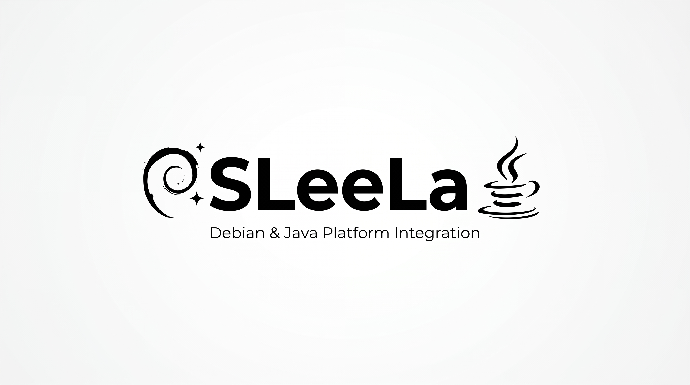

# SLeeLa IDE

Version: 0.4.0-dev

The primary IDE direction is a **native SLeeLa desktop application**, authored
in SLeeLa on SleelaUI. It is designed for SLeeLa, C, C++, and Java projects
without embedding the IntelliJ Platform or requiring a JetBrains installation.

## Native application

The GUI and workbench composition live in:

- `lib/ide-workbench/SLIdeWorkbenchUI.sleela` — native desktop shell and event loop.
- `lib/ide-workbench/SLIdeMenuBar.sleela` — File, Edit, View, Navigate, Code,
  Run, Tools, and Help menu groups.
- `lib/ide-workbench/SLIdeToolbar.sleela` — New, Open, Save, Build, Run, Debug,
  and Stop actions.
- `lib/ide-workbench/SLIdeLanguageBar.sleela` — SLeeLa, C, C++, and Java selector.
- `lib/user-interface/SLTextView.sleela` — native multi-line code editor.
- `lib/ide-workbench/SLIdeEditor.sleela`, `SLIdeTabGroup.sleela`,
  `SLIdeProjectTree.sleela`, and `SLIdeDiagnosticsPanel.sleela` — editor,
  tabs, project model, and diagnostics.

The shell uses the existing SLeeLa GUI / SleelaUI native bridge. No foreign
widget toolkit is introduced.

## Language roles

| Language | Native IDE integration |
|---|---|
| SLeeLa | First-class language, compiler and runtime integration |
| C | C toolchain discovery, source/header navigation and native build integration |
| C++ | C++ toolchain discovery, source/header navigation and native build integration |
| Java | JDK discovery, compile/run and JVM debugging integration |

Toolchains are discovered on the host and activated on demand. The base IDE
does not bundle complete C/C++/Java toolchains.

## Optional IntelliJ interoperability

`ide/sleela-intellij` remains an optional plugin project for users who already
run an IntelliJ Platform IDE. It is not the native SLeeLa IDE and is not a
dependency of the native application. Likewise, `/jetbrains` contains
source-acquisition helpers and research notes, not a requirement to download
the IntelliJ source tree.

## Footprint objective

Keep the native IDE's installed footprint substantially below the cited 6.2 GB
JetBrains installation by reusing SLeeLa's existing GUI, compiler, and runtime,
and by discovering external toolchains instead of bundling them. Actual
installer size will be measured after packaging; no size claim is made before
that measurement.

## First milestone

The first native GUI milestone now has the main window, project explorer,
editor notebook, menu groups, toolbar actions, language selector, and status
surface. File dialogs, real filesystem enumeration, compiler process execution,
language intelligence, and debugger process control remain service integrations
to complete and verify.

Run the current GUI walkthrough:

```sh
impl/build/sleela run lib/ide-workbench/ide-workbench-gui-demo.sleela
```

**Max Rupplin — MEARVK LLC — 2026**
