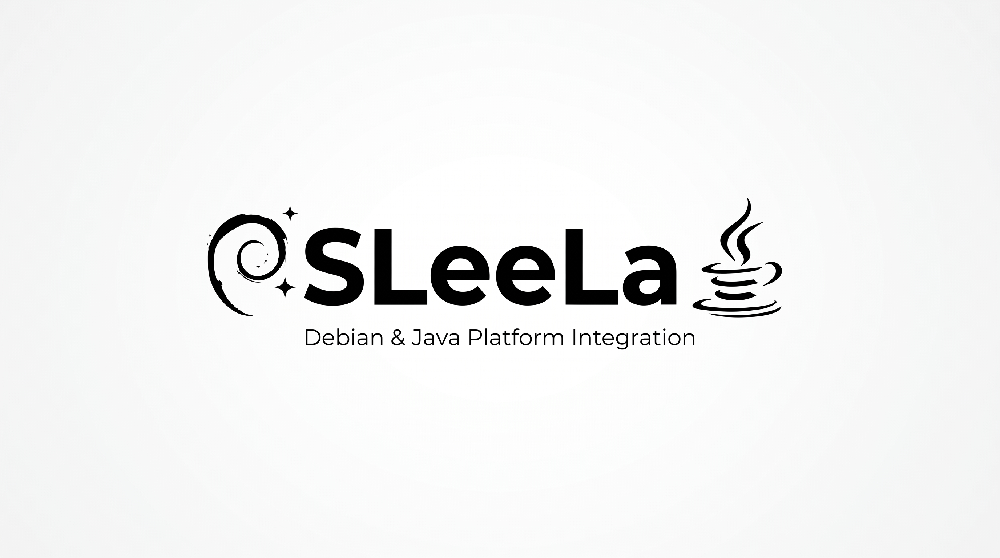

# SLeeLa Java Library

The `/lib/java` library family defines the SLeeLa boundary for Java interoperability.

## Native Library Inventory

The current repository inventory contains **8,989 files under `/lib/java`**. This count is validated from the Git index by the repository CI rather than being treated as an unverified documentation number.

The collection is a native SLeeLa source surface for Java-facing language and framework concepts. It is intended to give the SLeeLa Compiler, Loader, SST, and Nordshrift a stable source-level vocabulary for Java packages, classes, procedures, interfaces, runtime concepts, and interoperability boundaries.

The inventory is deliberately distinguished from a copy of the Java implementation. A file in this directory represents a SLeeLa-side language object, binding, contract, facade, or interoperability definition unless its documentation explicitly identifies another role.

## Machine-Readable Inventory

`MANIFEST.json` is the machine-readable contract for this directory. It records the expected inventory count and the rules used by CI to validate the collection.

`validate.py` is the authoritative validator used by CI. It can also be run locally from the repository root:

```text
python3 lib/java/validate.py
```

The validator checks:

- the `/lib/java` directory exists;
- the Git-indexed file count matches the recorded **8,989-file** baseline;
- manifest schema and root metadata are present;
- the expected Java interoperability boundary is documented;
- required source-role metadata is present; and
- the inventory has not silently fallen below its established baseline.

When files are intentionally added or removed, the baseline and manifest must be updated in the same change. CI therefore makes library growth an explicit engineering event rather than allowing the documented count to drift.

## Java-to-SLeeLa Mapping

The intended mapping is:

`Java package/class/procedure → SLeeLa Family symbol → SLeeLa source → compiler/loader → runtime service`

A Java-facing source unit should identify, where applicable:

1. **Java owner** — the Java package, class, interface, record, enum, method, or framework concept represented.
2. **SLeeLa symbol** — the stable SLeeLa class, symbol, facade, or procedural definition.
3. **Source role** — binding, facade, native boundary, runtime service, compatibility definition, or other documented role.
4. **Execution boundary** — SLeeLa-native, C, C++, Java/JVM, or platform-specific implementation.
5. **Loader visibility** — how the Compiler and Loader discover the symbol.
6. **Compatibility surface** — the Java/JDK version or API family represented.

This makes the Java relationship traceable instead of leaving the 8,989-file collection as an opaque directory.

## JDK 28 Framework Bindings

SLeeLa provides controlled source-level bindings for selected JDK 28 framework types. JDK 28 currently has a draft/ad-hoc API specification, so these files describe the framework contract without copying or reimplementing Java's internal implementation.

The initial binding families include:

- `java.lang`
- `java.util`
- `java.io`
- `java.nio`
- `java.nio.file`
- `java.net`
- `java.time`
- `java.math`

Additional JDK framework families will be added as the SLeeLa Java bridge matures, including reflection, concurrency, security, HTTP, class-file APIs, and compiler APIs.

## SLeeLa Control

A Java framework binding does **not** make SLeeLa subordinate to Java. The SLeeLa Compiler and Loader remain responsible for resolving the SLeeLa source model and deciding when a Java framework operation is permitted.

The intended model is:

`SLeeLa source → SLeeLa Compiler → controlled Java binding → JVM/JDK service`

In the parallel execution model, Java procedural behavior may also have a pre-compiled SLeeLa source representation:

`Java procedure ↔ SLeeLa Family representation ↔ pre-compiled SLeeLa source ↔ SLeeLa VM`

This permits a user to employ Java framework facilities while retaining SLeeLa syntax, source definitions, loading rules, and runtime control.

## SLeeLa on a C/C++ Virtual Machine

SLeeLa executes on a **C/C++ native virtual-machine foundation**. C and C++ provide the machine-facing runtime substrate, including memory and process boundaries, platform integration, native facilities, and the mechanisms needed to load and execute SLeeLa procedural representations.

The core execution path is:

`SLeeLa source → Compiler/Loader → SLeeLa VM → C/C++ native runtime`

Java is a cooperating runtime/language surface, not a replacement for the SLeeLa VM:

`Java source/procedure ↔ SLeeLa Family representation ↔ pre-compiled SLeeLa source ↔ SLeeLa VM`

C, C++, Java, and SLeeLa therefore retain distinct responsibilities. SLeeLa supplies the language and procedural source model; the SLeeLa VM supplies execution; C/C++ supplies the native foundation; and Java supplies a cooperating language/runtime surface represented through defined SLeeLa boundaries.

## Compiler and Loader

The Java library is intended to be visible to the SLeeLa Compiler, Loader, and Nordshrift symbol collection.

New Java-facing source units should participate in:

`source → Java/SLeeLa mapping → package/library resolution → semantic analysis → compilation → artifact/loader resolution`

A source file should not be considered integrated merely because it exists under `/lib/java`; it should be discoverable through the same package, symbol, compiler, and loader mechanisms used by the rest of the SLeeLa library.

## Source Standard

Every SLeeLa source file in this directory should include, as applicable:

- A documentation header.
- An explicit Definition.
- A stable SLeeLa class or symbol declaration.
- A declared Java framework type or interoperability role.
- A documented execution boundary.
- No copied Java implementation code.
- No undocumented native behavior.

## Interoperability Test Targets

The Java bridge should be validated in both directions where a feature supports it:

`Java procedure → SLeeLa representation → compile → SLeeLa VM`

`SLeeLa procedure → Java-compatible representation → Java-side execution`

The native execution foundation should also remain testable:

`SLeeLa source → Compiler → C/C++ VM → execution`

These paths are architectural test targets; a particular binding must not claim support until its implementation and CI tests establish that support.

## Expansion

Future Java library work should extend this family rather than placing Java interoperability types in unrelated library directories.

When extending `/lib/java`, update **the source file, its mapping/documentation where needed, `MANIFEST.json`, and validation expectations together**. This keeps the native library count, language bridge, compiler/loader visibility, and CI contract synchronized.

## SLeeLa-native String UTF-16 operations

The `JavaStringValue.sleela` implementation exposes `length()` and
`charAt(int)` through the versioned Native Drive scalar/UTF-8 ABI.
`length()` returns UTF-16 code units; `charAt(int)` returns the selected
16-bit code unit as an integer because the current SLeeLa value model does not
yet define a Java-compatible `char` primitive. Supplementary characters
therefore occupy two independently addressable positions.

The VM's existing `OP_NATIVE_CALL` retains the active interpreter call frame
as a GC root while the plugin executes. The UTF-16 plugin methods accept only
a length-delimited UTF-8 String and an integer index; no VM pointers or object
handles cross the native ABI. Malformed UTF-8, negative indices, and
out-of-range indices fail closed with a `java.lang.StringIndexOutOfBoundsException`
runtime diagnostic; malformed text and invalid arguments use
`java.lang.IllegalArgumentException` diagnostics. These are class-compatible
runtime error labels, not yet catchable Java exception objects. The current VM
String representation also excludes embedded NUL bytes; Java Strings containing NUL
or isolated surrogate code units require a future UTF-16-backed String storage
model for full fidelity.

Typed Java exception objects are not yet available at this boundary: the
present VM does not construct or expose `StringIndexOutOfBoundsException` /
`IndexOutOfBoundsException` instances. This remains a compatibility gap.


UTF-16 conversion currently accepts well-formed UTF-8 scalar values. Java
Strings can also contain isolated surrogate code units, which are not valid
Unicode scalar values and cannot be represented in standard UTF-8. Preserving
arbitrary isolated surrogates will require a UTF-16-backed SLeeLa string value
or a lossless internal string encoding; this adapter does not claim that
additional case yet.


## Lossless Java String semantic core

The native runtime now contains an immutable-by-convention, length-delimited
UTF-16 Java String value in `impl/core/sleela_java_string.h` and
`impl/core/sleela_java_string.c`. Unlike the existing `SL_STR` intern table,
this representation preserves embedded U+0000 and isolated high/low surrogate
code units exactly as Java `String` permits.

The semantic kernel implements UTF-16 `length`, `charAt`, `codePointAt`,
`codePointCount`, `offsetByCodePoints`, half-open `substring`,
`concat`, `equals`, Java's 32-bit `hashCode`, and UTF-16 lexicographic
`compareTo`. Its focused native smoke target is:

```sh
make -C impl test-java-string
```

**Integration status:** this is the storage/semantic foundation, not yet a
replacement for the VM's existing `SL_STR` value. The current VM value tag,
artifact serialization, bytecode operators, native ABI, and SLeeLa-level
`JavaStringValue` binding still require a coordinated follow-up. Existing
`SL_STR` behavior and artifact tag numbers remain unchanged. The smoke target
has been added but was not executed as part of this change.
