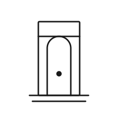

# Gate 1 — The Threshold

| | |
|---|---|
| **Index** | 01 |
| **Name** | The Threshold |
| **Emblem** | [`images/gate-01.svg`](../images/gate-01.svg) |

## Motif

A plain doorway — two upright posts, a lintel across the top, and a stepped sill at the foot —
with a small marker set on the threshold line itself. The arched inner opening frames the way in.

## Meaning

The first gate is the **decision to begin**. It marks the line between standing outside a thing
and committing to enter it: the moment before a journey, a project, or a change, when the only act
required is to step across. It carries no promise about what lies beyond — only the fact of
crossing. Everything after it depends on this first, simple choice.

> Original work authored for this repository; not derived from any copyrighted source.
