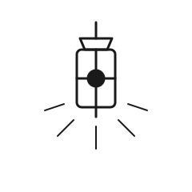

# Gate 2 — The Lantern

| | |
|---|---|
| **Index** | 02 |
| **Name** | The Lantern |
| **Emblem** | [`images/gate-02.svg`](../images/gate-02.svg) |

## Motif

A lantern hung from a short chain, its glass body divided by a cross-bar, a bright point glowing
at its center, and short rays spreading outward below.

## Meaning

The second gate is **sight in the dark** — the first guidance offered once a journey has begun.
It does not light the whole road, only the next few steps; its value is not in revealing the
destination but in making the immediate ground visible. It stands for the first mentor, the first
map, the first understanding that keeps a beginner moving instead of lost.

> Original work authored for this repository; not derived from any copyrighted source.
