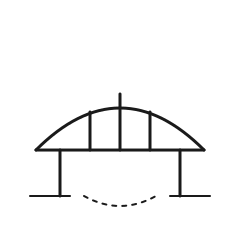

# Gate 3 — The Bridge

| | |
|---|---|
| **Index** | 03 |
| **Name** | The Bridge |
| **Emblem** | [`images/gate-03.svg`](../images/gate-03.svg) |

## Motif

A single arched span resting on two piers, with vertical supports dropping from the deck and a
faint, dashed line below marking the gap it crosses.

## Meaning

The third gate is **commitment over a void**. Where the threshold was a step and the lantern was
guidance, the bridge is the stretch where there is no turning back halfway — you are over the gap
and must reach the far side. It stands for the part of any undertaking that cannot be done in
small reversible increments: the leap, the signed decision, the span held up by work already done.

> Original work authored for this repository; not derived from any copyrighted source.
