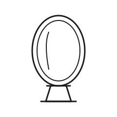

# Gate 4 — The Mirror

| | |
|---|---|
| **Index** | 04 |
| **Name** | The Mirror |
| **Emblem** | [`images/svg/gate-04.svg`](../images/svg/gate-04.svg) |

## Motif

A standing oval mirror in a double frame on a small base, with a single curved highlight across
its surface suggesting a reflection.

## Meaning

The fourth gate is **self-knowledge**. Partway through any passage, the thing that most needs
examining is the one who set out — the habits, assumptions, and strengths carried in from the
start. The mirror asks what you actually brought with you rather than what you intended to bring.
It is the pause for honest reckoning before the harder gates ahead.

> Original work authored for this repository; not derived from any copyrighted source.
