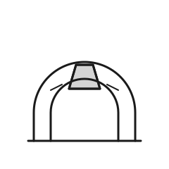

# Gate 5 — The Keystone

| | |
|---|---|
| **Index** | 05 |
| **Name** | The Keystone |
| **Emblem** | [`images/gate-05.svg`](../images/gate-05.svg) |

## Motif

A stone arch drawn as two nested curves, with the central wedge at its crown — the keystone —
picked out and lightly filled.

## Meaning

The fifth gate is **the load-bearing center**: the single piece that locks everything else in
place. An arch is only a pile of stones until the keystone is set; then each stone holds the next.
It stands for the one decision, person, or principle on which a whole effort depends — easy to
overlook because it does its work silently, and catastrophic to remove. The middle gate of nine,
fittingly, is the one that holds the rest together.

> Original work authored for this repository; not derived from any copyrighted source.
