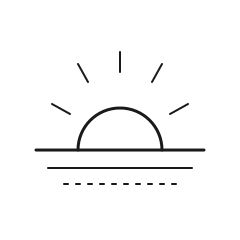

# Gate 9 — The Horizon

| | |
|---|---|
| **Index** | 09 |
| **Name** | The Horizon |
| **Emblem** | [`images/gate-09.svg`](../images/gate-09.svg) |

## Motif

A sun rising over a level horizon line, its rays spreading, framed so the arc of the sun reads as
one last open gateway onto the distance.

## Meaning

The ninth gate is **arrival that is also a beginning**. The horizon is reached but never
closed — step to it and it opens again. The final gate stands for completion that does not end in
a wall: the goal attained, and in the same moment the next distance made visible. It is the open
end of the sequence, deliberately not a locked door.

> Original work authored for this repository; not derived from any copyrighted source.
