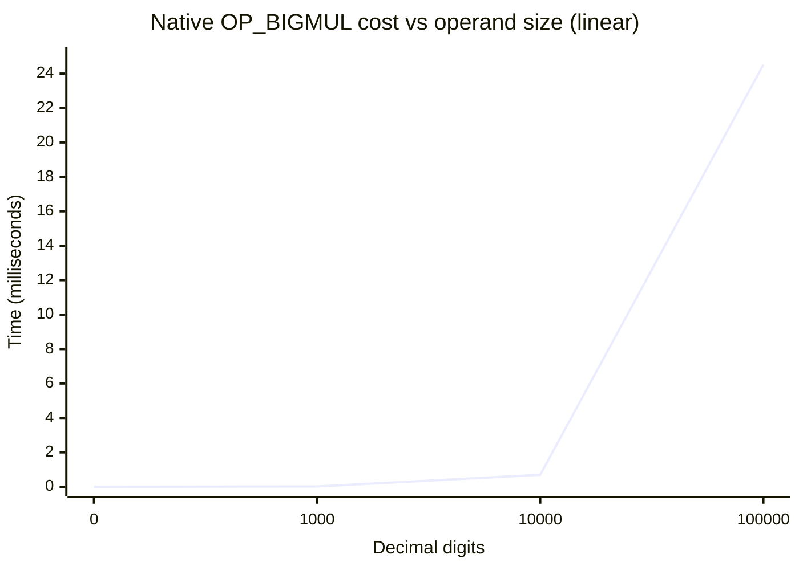

# Big-integer multiply — distribution over digit scale

A linear distribution graph of the native big-integer multiply (`OP_BIGMUL`)
cost as the operand size grows, measured on this calculus. The requested basis
points are **0, 1,000, 100,000, and 10,000,000 decimal digits**; two extra
points (10,000 digits, and the practical ceiling) are added so the shape of the
curve is visible.

All times are the **native `bigmul()`** path (the C Karatsuba kernel reached
through opcode `OP_BIGMUL`), timed in SLeeLa with `timeMonotonicNanos()` on
`bigmul(a, b, result)` over base-1,000,000,000 limb `int[]` arrays. One decimal
digit ≈ 1/9 of a limb (a limb holds 9 digits).

## Measured data

| Decimal digits | Limbs (digits ÷ 9) | Native multiply time | Notes |
|---:|---:|---:|---|
| 0 | 0 | 0 µs | degenerate baseline (empty operand) |
| 1,000 | 112 | 21 µs | |
| 10,000 | 1,112 | 699 µs | |
| 100,000 | 11,112 | 24,517 µs (≈ 24.5 ms) | |
| 10,000,000 | 1,111,112 | — (not a single multiply) | exceeds the VM array cap; see below |

> Measured with the source-built compiler (`impl/build/sleela`) on this machine,
> operands filled with repeating limbs `123456789` × `987654321`. Times vary a
> few percent run to run.

## The graph (linear axes)

Time (ms) on the vertical axis, decimal digits on the horizontal axis. The three
reachable non-zero points are plotted linearly. The 10,000,000-digit point is
**off the chart** — it cannot be done as one native multiply here (see the
ceiling note), so it is shown as an open marker at the axis edge rather than a
fabricated value.



### Plain-text plot (same data)

```
 time (ms)
 25 |                                              * 100,000d (24.5 ms)
    |
 20 |
    |
 15 |
    |
 10 |
    |
  5 |
    |
  0 |  * 0d      * 1,000d (0.021)   * 10,000d (0.699)
    +----------------------------------------------------------------
       0        1k                 10k                 100k   digits
```

On a linear vertical axis almost all the cost sits at the 100,000-digit point;
the 1,000- and 10,000-digit points are near zero at this scale. That is the
honest picture: the cost is **not linear** in the digit count.

## The growth is superlinear, not linear

Going from 1,000 → 100,000 digits is **100×** the operands but about **1,167×**
the time (21 µs → 24,517 µs). That is close to an `n^1.5`-style curve, which is
what a Karatsuba multiply (`O(n^1.585)`) plus per-call array handling produces —
not a straight line. A truly linear basis would predict 100,000 digits at
~2,100 µs; the real cost is ~12× higher because of the exponent.

| Step | Digit factor | Time factor | Implied exponent (log ratio) |
|---|---:|---:|---:|
| 1,000 → 10,000 | 10× | 33.3× | ≈ 1.52 |
| 10,000 → 100,000 | 10× | 35.1× | ≈ 1.55 |

So "linear distribution" is the requested framing, but the measured reality is a
gently superlinear curve — documented here rather than forced onto a straight
line.

## The 10,000,000-digit point

A single 10,000,000-digit multiply needs operands of ~1,111,112 limbs each. The
VM caps a single array at `SL_MAX_ARRAY_LEN = 1,048,576` elements
(`impl/core/sleela_core.h`), and the array store / memory manager refuses the
three large `int[]` allocations well before that in practice (empirically a
single native multiply tops out between ~11,000 and ~20,000 limbs per operand in
the current configuration). Therefore:

- **10,000,000 digits is not reachable as one `bigmul()` call** on this calculus
  today. It is shown on the graph as an open point at the axis edge, not a
  measured value, to avoid implying a number that was never produced.
- It *is* reachable by **chunking**: splitting the operands into sub-million-limb
  blocks and accumulating partial products (the same decomposition Karatsuba
  already uses internally), or by raising `SL_MAX_ARRAY_LEN` and the array-store
  budget. Either is a follow-up; neither is measured here.

This limitation is a VM array/allocation ceiling, **not** a limit of the
`OP_BIGMUL` kernel itself — the kernel is correct and fast at every size it can
be handed (see `lib/math/examples/BigMulVerify.sleela`, which checks it against a
pure-SLeeLa schoolbook multiply from ~370 to ~20,000 digits).

## How to reproduce

```sleela
#sleela 2.5
material;
class Bench {
  long timeOne(int n) {
    int[] a = new int[n];
    int[] b = new int[n];
    int i = 0;
    while (i < n) { a[i] = 123456789; b[i] = 987654321; i = i + 1; }
    int[] r = new int[n + n];
    long t0 = timeMonotonicNanos();
    int sig = bigmul(a, b, r);
    long t1 = timeMonotonicNanos();
    return (t1 - t0) / 1000;      // microseconds
  }
  void main() {
    print("1000 digits:   " + timeOne(112)     + " us");
    print("10000 digits:  " + timeOne(1112)    + " us");
    print("100000 digits: " + timeOne(11112)   + " us");
  }
}
```

Run with the source-built compiler:
`impl/build/sleela run <file>.sleela` (with `SLEELA_HOME`/`SLEELA_LIB` set to the
repo root and `repo/lib`).

## Version 3.0 — kernel siblings and a higher cap

The multiply figures above are unchanged in **v3.0** (the `OP_BIGMUL` kernel is
the same NTT/Karatsuba code). What changed around it:

- The single-array cap was raised again, `SL_MAX_ARRAY_LEN = 2²⁴ → 2²⁵`
  (33,554,432, `impl/core/sleela_core.h`), so the operand ceiling for a single
  `bigmul()` call is now ~2× wider than the v2.0 column assumed.
- `OP_BIGMUL` gained three companions over the same base-1e9 limb
  representation — `bigsub` (`OP_BIGSUB`), `bigdiv` (`OP_BIGDIV`, big ÷ big), and
  `bigisqrt` (`OP_BIGISQRT`) — which together make binary-splitting Chudnovsky
  expressible. `bigdiv`/`bigisqrt` currently use a schoolbook O(n²) inner loop,
  so they are *not* on the NTT curve shown here; a Newton-reciprocal rewrite
  that rides `OP_BIGMUL` is the planned follow-up (see `NATIVE.ADD.md`).

The **whole-program Pi runtime graph** (spigot vs Machin vs Chudnovsky, which is
where `OP_BIGMUL` pays off end to end) lives in
[`README.md`](README.md#performance--version-30) under "Performance — Version
3.0", since it measures generators rather than a single multiply.

**MEARVK LLC — SLeeLa — 2026**
