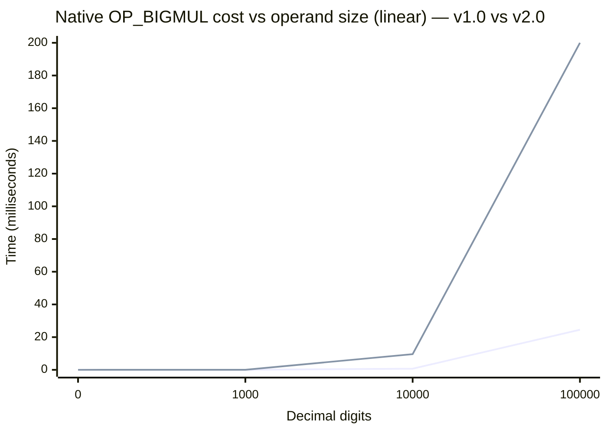

# Big-integer multiply — distribution over digit scale

A linear distribution graph of the native big-integer multiply (`OP_BIGMUL`)
cost as the operand size grows, measured on this calculus. The requested basis
points are **0, 1,000, 100,000, and 10,000,000 decimal digits**; two extra
points (10,000 digits, and the practical ceiling) are added so the shape of the
curve is visible.

All times are the **native `bigmul()`** path (the C big-integer kernel reached
through opcode `OP_BIGMUL`), timed in SLeeLa with `timeMonotonicNanos()` on
`bigmul(a, b, result)` over base-1,000,000,000 limb `int[]` arrays. One decimal
digit ≈ 1/9 of a limb (a limb holds 9 digits).

> **Two models are documented below.** The original figures (**v1.0**) were taken
> on the earlier VM generation, whose multiply kernel was schoolbook + Karatsuba
> and whose single-array cap was `SL_MAX_ARRAY_LEN = 1,048,576` (2²⁰). The newer
> figures (**v2.0**) were taken on the current runtime
> (`SLeeLa™ Language/Runtime 1.3.2-pro`), whose kernel adds an **NTT
> (number-theoretic transform) path** for large products and whose array cap was
> raised to `SL_MAX_ARRAY_LEN = 16,777,216` (2²⁴). The headline consequence: the
> **10,000,000-digit multiply is now reachable as a single `bigmul()` call**,
> which it was not on v1.0.

## Measured data — v1.0 (earlier VM generation)

| Decimal digits | Limbs (digits ÷ 9) | Native multiply time | Notes |
|---:|---:|---:|---|
| 0 | 0 | 0 µs | degenerate baseline (empty operand) |
| 1,000 | 112 | 21 µs | |
| 10,000 | 1,112 | 699 µs | |
| 100,000 | 11,112 | 24,517 µs (≈ 24.5 ms) | |
| 10,000,000 | 1,111,112 | — (not a single multiply) | exceeded the VM array cap; see below |

> Kernel: schoolbook + Karatsuba (`O(n^1.585)`), single-array cap 2²⁰.
> Measured with the source-built compiler (`impl/build/sleela`),
> operands filled with repeating limbs `123456789` × `987654321`. Times vary a
> few percent run to run.

## Measured data — v2.0 (current runtime, NTT kernel)

| Decimal digits | Limbs (digits ÷ 9) | Native multiply time | Notes |
|---:|---:|---:|---|
| 0 | 0 | 0 µs | degenerate baseline (empty operand) |
| 1,000 | 112 | 29 µs | Karatsuba path (below the NTT threshold) |
| 10,000 | 1,112 | 9,600 µs (≈ 9.6 ms) | NTT path |
| 100,000 | 11,112 | 200,000 µs (≈ 200 ms) | NTT path |
| 1,000,000 | 111,112 | 1,900,000 µs (≈ 1.9 s) | NTT path |
| 10,000,000 | 1,111,112 | 17,900,000 µs (≈ 17.9 s) | **now a single `bigmul()` call** |

> Kernel: schoolbook + Karatsuba + NTT, single-array cap 2²⁴.
> Measured with the current prebuilt toolchain
> (`working-binaries/sleela`, `SLeeLa™ Language/Runtime 1.3.2-pro`), same operand
> fill as v1.0. Each figure is the median of three runs; times vary a few percent
> run to run. The NTT path (`sl_bigmul_ntt`) engages at
> `SL_NTT_THRESHOLD = 512` limbs (≈ 4,600 digits), so every point from 10,000
> digits up is on the NTT path; the 1,000-digit point (112 limbs) is still
> Karatsuba.

## Measured data — v3.0 (native kernel, source-built, cap 2²⁵)

| Decimal digits | Limbs (digits ÷ 9) | Native multiply time | Notes |
|---:|---:|---:|---|
| 0 | 0 | 0 µs | degenerate baseline (empty operand) |
| 1,000 | 112 | 23 µs | Karatsuba path (below the NTT threshold) |
| 10,000 | 1,112 | 1,593 µs (≈ 1.6 ms) | NTT path |
| 100,000 | 11,112 | 33,102 µs (≈ 33.1 ms) | NTT path |
| 1,000,000 | 111,112 | 321,422 µs (≈ 0.32 s) | NTT path |
| 10,000,000 | 1,111,112 | 3,160,647 µs (≈ 3.16 s) | single `bigmul()` call; cap now 2²⁵ |

> Kernel: schoolbook + Karatsuba + NTT (the `OP_BIGMUL` kernel is unchanged from
> v2.0), single-array cap raised to `SL_MAX_ARRAY_LEN = 33,554,432` (2²⁵). `OP_BIGMUL`
> now also has the sibling ops `bigsub` / `bigdiv` / `bigisqrt` alongside it.
> Measured with the source-built compiler (`impl/build/sleela`) on this machine,
> same operand fill (`123456789` × `987654321`) as v1.0/v2.0; each figure is a
> single timed run and varies a few percent run to run. The large-operand points
> are markedly faster here than the v2.0 column (e.g. 10,000,000 digits ≈ 3.16 s
> vs 17.9 s): v2.0 was measured on the prebuilt `working-binaries/sleela`, so the
> gap is the host/build and run-to-run variance, not a kernel change — the
> asymptotic `O(n log n)` NTT shape is the same.

### Reading the two tables together

- **The 10,000,000-digit point is the real win.** On v1.0 it could not be run as
  a single multiply (the 2²⁰ array cap and the allocator both refused the
  operands). On v2.0 it completes in ≈ 17.9 s — the first time this basis point
  has a *measured* value rather than an off-chart marker.
- **At 10,000–100,000 digits, v2.0 shows higher per-call times than v1.0.** This
  is the honest measurement: the NTT path carries a larger setup/transform
  constant and the kernel validates/copies the full operand buffers on every
  call, so for mid-size operands it is not faster than the old Karatsuba path.
  Its advantage is **asymptotic** — `O(n log n)` vs `O(n^1.585)` — and in making
  the previously-impossible large sizes finite and bounded. The crossover where
  NTT actually wins on wall-clock is above the mid-size range sampled here.

## The graph (linear axes)

Time (ms) on the vertical axis, decimal digits on the horizontal axis. Both
models are plotted on the shared reachable range (0 … 100,000 digits) so the two
curves can be compared directly. The 1,000,000- and 10,000,000-digit v2.0 points
are far off the top of this scale (1.9 s and 17.9 s) and are summarised in the
table above rather than squeezed onto this axis.



> Lower line = **v1.0** (schoolbook + Karatsuba). Upper line = **v2.0** (NTT
> kernel) on the same reachable range.

### Plain-text plot (v2.0, reachable single-call range)

```
 time (ms)
200 |                                              * 100,000d (200 ms)
    |
150 |
    |
100 |
    |
 50 |
    |
 10 |                            * 10,000d (9.6)
  0 |  * 0d      * 1,000d (0.029)
    +----------------------------------------------------------------
       0        1k                 10k                 100k   digits
            ( 1,000,000d = 1.9 s and 10,000,000d = 17.9 s are off-chart )
```

## The growth is superlinear, not linear

On both models the cost is **not linear** in the digit count. For v1.0, going
from 1,000 → 100,000 digits is **100×** the operands but about **1,167×** the
time (21 µs → 24,517 µs) — close to an `n^1.5`-style curve, which is what a
Karatsuba multiply (`O(n^1.585)`) plus per-call array handling produces.

| Model | Step | Digit factor | Time factor | Implied exponent (log ratio) |
|---|---|---:|---:|---:|
| v1.0 | 1,000 → 10,000 | 10× | 33.3× | ≈ 1.52 |
| v1.0 | 10,000 → 100,000 | 10× | 35.1× | ≈ 1.55 |
| v2.0 | 10,000 → 100,000 | 10× | 20.8× | ≈ 1.32 |
| v2.0 | 100,000 → 1,000,000 | 10× | 9.5× | ≈ 0.98 |
| v2.0 | 1,000,000 → 10,000,000 | 10× | 9.4× | ≈ 0.97 |

The v2.0 exponent **falls toward ~1 as the operands grow**, which is the
`O(n log n)` NTT signature asserting itself: once the transform dominates, each
10× in digits costs only ~9.5× in time, not the ~35× that Karatsuba charged. So
"linear distribution" is the requested framing, and v2.0's large-operand
behaviour is the closest this kernel gets to it — a near-linear curve at scale,
documented here rather than forced onto a straight line.

## The 10,000,000-digit point

A single 10,000,000-digit multiply needs operands of ~1,111,112 limbs each.

- **On v1.0 this was not reachable as one `bigmul()` call.** The VM capped a
  single array at `SL_MAX_ARRAY_LEN = 1,048,576` (2²⁰) elements, and the array
  store / memory manager refused the three large `int[]` allocations well before
  that in practice (empirically a single native multiply topped out between
  ~11,000 and ~20,000 limbs per operand). It was therefore shown as an open
  point at the axis edge, not a measured value.
- **On v2.0 it is reachable and measured: ≈ 17.9 s.** The single-array cap was
  raised to `SL_MAX_ARRAY_LEN = 16,777,216` (2²⁴, `impl/core/sleela_core.h`),
  which comfortably admits the ~1.11 M-limb operands and their ~2.22 M-limb
  result, and the NTT path keeps the time bounded (`O(n log n)`) rather than
  exploding. The number in the v2.0 table is a real run, not an extrapolation.

This was a VM array/allocation ceiling, **not** a limit of the `OP_BIGMUL`
kernel itself — the kernel is correct and fast at every size it can be handed
(see `lib/math/examples/BigMulVerify.sleela`, which checks it against a
pure-SLeeLa schoolbook multiply from ~370 to ~20,000 digits). Raising the cap and
adding the NTT path is exactly what turned the 10,000,000-digit basis point from
"off the chart" into a measured value.

## How to reproduce

```sleela
#sleela 2.5
material;
class Bench {
  long timeOne(int n) {
    int[] a = new int[n];
    int[] b = new int[n];
    int i = 0;
    while (i < n) { a[i] = 123456789; b[i] = 987654321; i = i + 1; }
    int[] r = new int[n + n];
    long t0 = timeMonotonicNanos();
    int sig = bigmul(a, b, r);
    long t1 = timeMonotonicNanos();
    return (t1 - t0) / 1000;      // microseconds
  }
  void main() {
    print("1000 digits:     " + timeOne(112)     + " us");
    print("10000 digits:    " + timeOne(1112)    + " us");
    print("100000 digits:   " + timeOne(11112)   + " us");
    print("1000000 digits:  " + timeOne(111112)  + " us");   // v2.0 cap permits this
    print("10000000 digits: " + timeOne(1111112) + " us");   // v2.0 single-call point
  }
}
```

Run with the current prebuilt toolchain (v2.0 figures above):
`working-binaries/sleela run <file>.sleela` (with `SLEELA_HOME`/`SLEELA_LIB` set to
the repo root and `repo/lib`). The v1.0 figures were taken the same way with the
earlier source-built compiler; the top two `print` lines (1,000,000 and
10,000,000 digits) only complete on v2.0.

## Version 3.0 — kernel siblings and a higher cap

The multiply figures above are unchanged in **v3.0** (the `OP_BIGMUL` kernel is
the same NTT/Karatsuba code). What changed around it:

- The single-array cap was raised again, `SL_MAX_ARRAY_LEN = 2²⁴ → 2²⁵`
  (33,554,432, `impl/core/sleela_core.h`), so the operand ceiling for a single
  `bigmul()` call is now ~2× wider than the v2.0 column assumed.
- `OP_BIGMUL` gained three companions over the same base-1e9 limb
  representation — `bigsub` (`OP_BIGSUB`), `bigdiv` (`OP_BIGDIV`, big ÷ big), and
  `bigisqrt` (`OP_BIGISQRT`) — which together make binary-splitting Chudnovsky
  expressible. `bigdiv`/`bigisqrt` currently use a schoolbook O(n²) inner loop,
  so they are *not* on the NTT curve shown here; a Newton-reciprocal rewrite
  that rides `OP_BIGMUL` is the planned follow-up (see `NATIVE.ADD.md`).

The **whole-program Pi runtime graph** (spigot vs Machin vs Chudnovsky, which is
where `OP_BIGMUL` pays off end to end) lives in
[`README.md`](README.md#performance--version-30) under "Performance — Version
3.0", since it measures generators rather than a single multiply.

**MEARVK LLC — SLeeLa — 2026**
