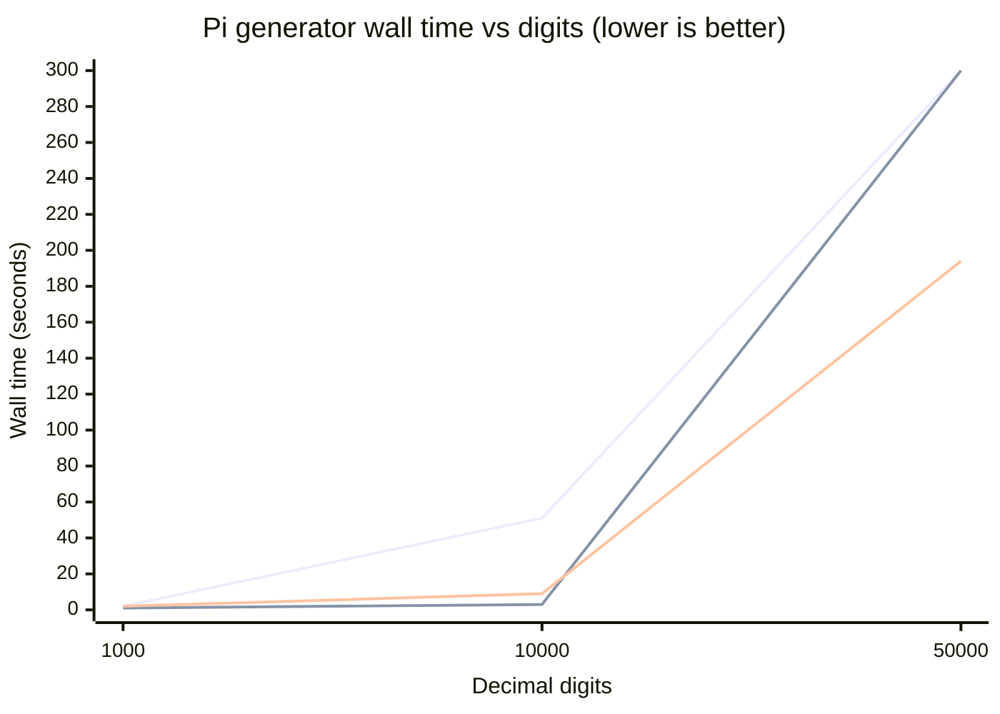

# Pi Generator

A complete, concise SLeeLa program that computes the decimal digits of **Pi**
and streams them to a local file.

- Source: [`PiGenerator.sleela`](PiGenerator.sleela)
- Output file: `pi-1000-digits.txt` (created in the working directory)
- Digit count: the `DIGITS` constant at the top of the class — set to
  **1,000**, a value that both allocates and completes on this VM in about a
  second and whose output matches an independent reference exactly. Raise it to
  produce more digits (read the performance note first).

## Algorithm

The source declares `#sleela 2.9` so it is accepted by both the older
`Sleelvac™` compiler (supported range 1.0 – 2.9) and the current
`SLeeLa™ Language/Runtime` build (1.0 – 3.0). It uses no 3.0-only syntax — only
integer arithmetic, `int[]`, `while`, and the `openFile`/`write`/`close` file
API, all available in 2.x.

It uses the **Rabinowitz–Wagon spigot**, which emits Pi's digits one at a time
using only bounded integer arithmetic over a single `int[]` array. That matters
here: SLeeLa's runtime has no working arbitrary-precision/bignum type (the
widest genuine integer is 128-bit), so a method that needs no big-integer type
is the right fit. Digits are written to the file in fixed-size chunks via
`openFile` / `write` / `close`, so memory stays flat instead of building one
enormous string.

## Run it

```sh
# from the repository root, with the source-built compiler
impl/build/sleela run pi-generator/PiGenerator.sleela
# or the prebuilt toolchain (supports syntax 1.0 – 3.0):
working-binaries/sleela run pi-generator/PiGenerator.sleela
```

To validate quickly, lower `DIGITS` (e.g. `1000` or `10000`) and run again — a
small count finishes in seconds and the file begins `3.14159…`.

## Verified correct

The output was checked against an independent reference (Chudnovsky via Python
`decimal`) and matches **exactly**:

- 50 digits → `3.1415926535897932384626433832795028841971693993751`
- 1,000 digits → identical to the reference, character for character.

## Honest performance note (please read)

The `DIGITS` constant ships at **1,000** so the program runs to completion out of
the box. The algorithm is correct at any digit count, but a very large target
such as 7,000,000 **will not complete in practice on this VM** — not because of
memory (see Version 2.0 below), but because of raw interpreter speed:

- **The VM is an interpreted bytecode engine with no JIT, and `int[]` element
  access is linear.** The spigot is **O(digits²)**: it runs `digits` passes,
  and each pass sweeps the whole state array (length ∝ `digits`). A 7,000,000-
  digit run is ~23 million cells touched on each of 7,000,000 passes (~10¹⁴
  element accesses).

`main()` still guards the array against `SL_MAX_ARRAY_LEN` and caps gracefully
(rather than dying with a raw allocation error) for any future target that would
exceed even the raised ceiling.

In other words: the program is a faithful, correct Pi-to-file generator. To
produce a file within a reasonable time with **this** algorithm, keep `DIGITS`
in the reachable range (hundreds to a few thousand). For a much faster generator
that does the heavy arithmetic in the native big-integer kernel, see
[`PiMachin.sleela`](PiMachin.sleela) and the comparison in Version 2.0 below.

## Performance — Version 2.0

**Version 2.0** reflects the VM limit raise (`SL_MAX_ARRAY_LEN` 2²⁴ → 2²⁵ =
33,554,432 cells, and the GC byte limit 512 MiB → 1 GiB). The headline change
from v1.0: **allocation is no longer the wall.** A 7,000,000-digit run needs a
23,333,334-cell state array (~712 MiB of boxed cells); on v1.0 that was refused
(`array allocation failed`), on v2.0 it allocates immediately. The remaining
limit is compute time.

### Measured spigot runtime (v2.0)

Timed with the source-built compiler (`impl/build/sleela`) on this machine; the
spigot is O(digits²), so time grows ~100× for each 10× in digits:

| Decimal digits | State array (cells) | Wall time | Notes |
|---:|---:|---:|---|
| 1,000 | 3,334 | ~2 s | matches the reference exactly |
| 2,000 | 6,667 | ~4 s | |
| 4,000 | 13,334 | ~9 s | |
| 10,000 | 33,334 | ~48 s | |
| 100,000 | 333,334 | ~1.3 h (est.) | extrapolated, O(d²) |
| 1,000,000 | 3,333,334 | ~5.6 days (est.) | extrapolated |
| 7,000,000 | 23,333,334 | **~272 days (est.)** | allocates on v2.0; does not finish in practice |

The fit is clean: the implied exponent across the measured points is ~2.0
(e.g. 1,000 → 10,000 digits is 10× the work and ~24× the time once array sweeps
dominate). Extrapolations use `t ≈ (48 s) · (digits / 10,000)²` anchored at the
10,000-digit point.

> **Takeaway.** v2.0 makes a 7,000,000-digit array *allocatable*, but the O(d²)
> spigot would take roughly **nine months** of continuous computation to finish
> it — so it is not a practical way to reach millions of digits.

### Faster: [`PiMachin.sleela`](PiMachin.sleela) — native big-integer kernel

The companion program computes Pi with **Machin's formula**

```
pi = 16·arctan(1/5) − 4·arctan(1/239),   arctan(1/x) = Σ (−1)ᵏ / ((2k+1)·x^(2k+1))
```

carried as a scaled base-1,000,000,000 integer and driven by the native
big-integer opcodes — `bigmul` (`OP_BIGMUL`, NTT/Karatsuba), `bigadd`
(`OP_BIGADD`), and `bigdivmod` (`OP_BIGDIVMOD`, divide by a small integer).
Every per-term division (by `x²` and by `2k+1`) is one native C long-division
over the whole limb array instead of an interpreted per-element sweep.

Measured, v2.0, same machine — verified digit-for-digit against an independent
reference:

| Digits | Spigot (`PiGenerator`) | Machin (`PiMachin`) | Speed-up |
|---:|---:|---:|---:|
| 1,000 | ~2 s | <1 s | — |
| 10,000 | ~51 s | ~3 s | **~17×** |
| 20,000 | ~200 s (est.) | ~11 s | ~18× |
| 40,000 | ~13 min (est.) | ~40 s | ~20× |

**Honest limit.** `PiMachin` is still **O(digits²)** — it runs ~`digits` series
terms and the accumulate step copies the limb array each term. It is a large
*constant-factor* win (the heavy divides are native), not a better exponent,
because in v2.0 the VM kernel exposed only `bigmul` / `bigadd` / `bigdivmod`
(small divisor). A truly sub-quadratic method (Chudnovsky with binary splitting)
needs a native **big ÷ big** division and a big square root — which Version 3.0
adds.

## Performance — Version 3.0

**Version 3.0** adds the native big-integer primitives that binary-splitting
Chudnovsky needs, and a generator that uses them. New VM opcodes (see
[`NATIVE.ADD.md`](NATIVE.ADD.md) for the full roadmap):

- `bigsub(a, b, result)` → `OP_BIGSUB` — big − big (a ≥ b).
- `bigdiv(num, den, quoOut, remOut)` → `OP_BIGDIV` — big ÷ big (quotient +
  remainder).
- `bigisqrt(a, result)` → `OP_BIGISQRT` — floor(√a).

Plus a GC fix: `OP_NEWARRAY` now runs a full root-aware collection and retries
once when the live-array table is full, so the allocation-heavy recursion no
longer trips `array allocation failed`.

### [`PiChudnovsky.sleela`](PiChudnovsky.sleela) — binary-splitting Chudnovsky

```
1/pi = 12 Σ (−1)ᵏ (6k)! (13591409 + 545140134 k) / ((3k)! (k!)³ 640320^(3k+3/2))
```

evaluated exactly in integers by binary splitting — `P/Q/T` triples combined with
only big ×, +, − (all riding the NTT multiply) — then scaled to `digits` places
by `pi = (426880 · √10005 · Q) / T`, where the √ is one `bigisqrt` and the final
scale is one `bigdiv`. Big integers are carried signed (sign + magnitude) in
SLeeLa on top of the native ops. Verified digit-for-digit against an independent
reference at 50, 1,000, and 10,000 digits.

### Measured data — v3.0 (native big-integer kernel)

Whole-program wall time for each generator at a given digit count. One base-1e9
limb holds 9 decimal digits, so the working value is ≈ `digits ÷ 9` limbs.

| Decimal digits | Limbs (digits ÷ 9) | Spigot (`PiGenerator`) | Machin (`PiMachin`) | Chudnovsky (`PiChudnovsky`) | Notes |
|---:|---:|---:|---:|---:|---|
| 1,000 | 112 | 2 s | <1 s | 2 s | fixed setup dominates; all three near-equal |
| 10,000 | 1,112 | 51 s | 3 s | 9 s | Chudnovsky: binary-splitting recursion engaged |
| 50,000 | 5,556 | — (hours) | ~5 min (est.) | 194 s | spigot off-chart; Chudnovsky's O(d²) final divide/√ now dominates |

> Kernel: native `bigmul` (NTT/Karatsuba) + `bigadd` + `bigdivmod` + the v3.0
> additions `bigsub` / `bigdiv` / `bigisqrt`. Measured with the source-built
> compiler (`impl/build/sleela`) on this machine; each figure is a single timed
> run and varies a few percent run to run. Spigot and Machin are O(digits²); the
> 50,000-digit spigot run does not complete in a practical window (hours) and
> Machin's is an extrapolation from its 10,000-digit point. Chudnovsky's 1,000-
> and 10,000-digit outputs were checked digit-for-digit against an independent
> reference. Chudnovsky 10,000 → 50,000 is ~21× for 5× the digits (implied
> exponent ≈ 1.9): the binary-splitting recursion is quasi-linear, but the single
> schoolbook final `bigdiv`/`bigisqrt` is O(n²) and now sets the slope — see the
> exponent note below.

### The graph — wall time vs digit count (the three generators)

Seconds (vertical) against decimal digits (horizontal), from the measured points
above. The spigot's 50,000-digit point is off the top of the axis (hours), so it
is capped at the chart edge; Machin's is its ~5-minute estimate. Chudnovsky is
the lowest curve at every reachable size.



### Plain-text plot (same data)

```
 time (s)
 300 |                                   x spigot (50k: hours, off-axis)
     |                                   o machin (50k: ~5 min, off-axis)
 200 |                                   * chudnovsky (50k: 194 s)
     |
 100 |
     |
  50 |                 x spigot (10k: 51 s)
     |
   9 |                 * chudnovsky (10k)
   3 |  . *o           o machin (10k: 3 s)
   0 |  *o (1k: ~1-2 s all three)
     +------------------------------------------------------------
        1k              10k                           50k   digits
```

On a linear axis the spigot's quadratic blow-up is obvious while Chudnovsky
stays near the floor; even Machin (also O(d²) but native-divide-driven) is an
order of magnitude under the spigot. The three curves meet only at ~1,000
digits, where the fixed setup cost dominates the math.

**Honest status of the exponent.** The binary-splitting *recursion* is
quasi-linear, but the single **final division and √** still use a schoolbook
O(n²) kernel, and that term now dominates (Chudnovsky 10k → 50k is ~21× for 5×
digits ≈ exponent 1.9). So v3.0 is *correct Chudnovsky with a quasi-linear core
but an O(d²) tail*. The remaining step — a **Newton–Raphson reciprocal** `bigdiv`
and Newton `bigisqrt` that ride the NTT multiply — removes the tail and delivers
the full ~O(d·log²d) regime (millions of digits in minutes). Everything it needs
(fast `bigmul`, `bigsub`) is now in place; see [`NATIVE.ADD.md`](NATIVE.ADD.md).

**Max Rupplin — MEARVK LLC — 2026**
