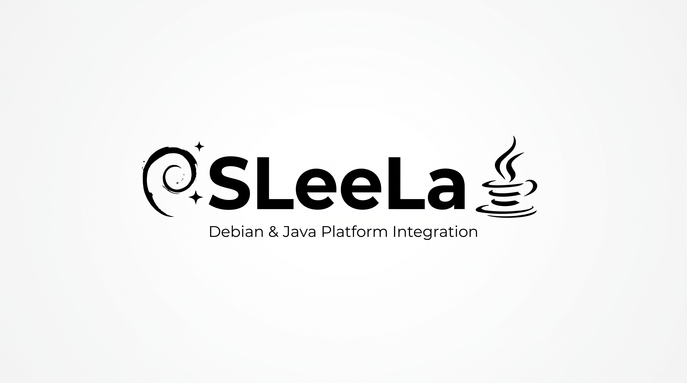

# Regression set

The language-wide regression set for SLeeLa: C, C++ and Python suites that build the code under
test with strict flags, a compiler test through its command line, a corpus of hostile inputs, and a
mutation test that proves the suites notice injected defects.

    python3 test-suites/regression/python/run_regression.py            # everything
    python3 test-suites/regression/python/run_regression.py --fast     # skip mutation testing
    python3 test-suites/regression/python/run_regression.py --only native corpus
    python3 test-suites/regression/python/run_regression.py --list     # every test id
    python3 test-suites/regression/python/run_regression.py --sanitize # ASan + UBSan (see below)
    SLEELA_BIN=impl/build/sleela python3 test-suites/regression/python/run_regression.py

Build the compiler first with
`cd impl && SLEELA_SHA256_MANIFEST="$(pwd)/../security/sha256-manifest.json" make build/sleela`
(without it the set uses the committed `working-binaries/sleela`). After any edit under `lib/**` or
`impl/`, regenerate the manifest: `python3 tools/generate-sha256-manifest.py --root . --output security/sha256-manifest.json`.

## Groups

| Group | Tests | What it does |
|---|---|---|
| `native` | `python/test_native_suites.py` | Builds and runs every C and C++ suite (below). |
| `ctypes` | `python/test_ctypes_differential.py` | The C core driven from Python against Python oracles. |
| `cli` | `python/test_cli_*.py` | The `sleela` compiler: language semantics, contract, transpilers. |
| `corpus` | `python/test_corpus.py` | Hostile and malformed inputs with documented outcomes: [`corpus/README.md`](corpus/README.md). |
| `integrity` | `python/test_integrity_tools.py` | The SHA-256 gate tooling, the committed manifest, the `/lib` inventory. |
| `mutation` | `python/test_mutation_kill.py` | Injects defects into the code under test; every one must be caught. Skipped by `--fast`. |

## Native suites (`c/`, `cpp/`)

Each suite is built with `-std=c11`/`c++17 -Wall -Wextra -Wpedantic -Wconversion -Wshadow -Wformat=2 -Werror`
and linked with the instrumented allocator in `c/reg_support.c`, so every case is also checked for leaks,
heap overflow and underflow (guard bytes), and can be made to fail the Nth allocation. The allocator is
mutex-protected, so suites with worker threads may allocate; worker threads must not call the `REG_` macros.

| Suite | Code under test |
|---|---|
| `reg_utf16`, `reg_java_string`, `reg_java_string_codec` | `impl/core/sleela_utf16.c`, `sleela_java_string*.c` |
| `reg_regex`, `reg_path` | `impl/core/sleela_regex.c`, `sleela_path.c` |
| `reg_time_memory` | `impl/core/sleela_time.c`, `sleela_memory.c` |
| `reg_events` | `impl/core/sleela_events.c` (timeouts, wake-up, bounded queue, signals) |
| `reg_memmgr` | `impl/core/sleela_memmgr.c` (limits, accounting, realloc, concurrency) |
| `reg_thread` | `impl/core/sleela_thread.c` (null arguments, mutual exclusion, broadcast) |
| `reg_net` | `impl/core/sleela_net.c` (invalid handles, loopback transfer, timeouts, platform selection) |
| `reg_synchro` | `impl/core/sleela_synchro.c` (UDP probes against a loopback echo server) |
| `reg_http6` | `http-6.0/http6_protocol.c` (frame layout, truncation, oversized lengths, round trips, random input) |
| `reg_lexer`, `reg_model` | `impl/frontend/lexer.cpp`; a model-based differential over the string and path code |
| `events_portable.c` | A standalone events test for the CI matrix on Linux, macOS and Windows (not part of `native`) |

The network suites use only the loopback interface and scan a high port range, so a busy port is skipped
instead of failing the case.

## Sanitizers

`--sanitize` (or `REG_SANITIZE=1`) builds the native suites with `-fsanitize=address,undefined`. On a host
where the runtime library is installed under a versioned name only, point the loader at it, for example
`LD_LIBRARY_PATH=<dir containing libasan.so.N>`. `test_ctypes_differential` skips under `--sanitize`
(an instrumented shared object cannot be loaded into an uninstrumented Python); the native suites cover the
same code.

## Status and history

[`PROGRESS.NOVEMBER.17.2026.md`](PROGRESS.NOVEMBER.17.2026.md) records the stages of this work and the
current state; the root `REGRESSION.md` records the verification and repair pass.

## November 18 session update

The language-wide test counts below and in the November 17 progress note remain historical until re-run. The Java converter/JDK 28 qualification work merged separately and is tracked in the [root regression status](../../REGRESSION.md#november-18-session-java-converter-jdk-28-validation-and-release-qualification) and [November 18 session continuation note](../../docs/reference/SESSION.CONTINUATION.2026-11-18.md). Do not interpret the November 17 211-test result as validation of the November 18 Java converter changes.
