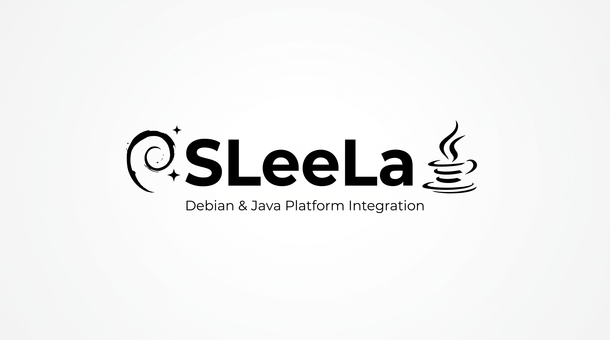

# Regression Corpus

Deterministic hostile and malformed inputs, each with a documented outcome. A case
exists because the input once exposed a defect or because it protects a contract the
code must keep. The corpus is run by `python/test_corpus.py` as the `corpus` group of
`python/run_regression.py`, so it runs with the rest of the regression set (also with
`--fast`), in CI, and through `test-suites/run-all.sh --regression`.

## Rules

- **Bounded and deterministic.** Every case finishes within seconds. A hang is a failure.
  Random input uses a fixed seed (see `c/reg_http6.c`); nothing reads the network or the clock.
- **No crash, ever.** Whatever a case expects, the tool must not die from a signal and must not
  exit with a shell failure code (126 or above). A crash on hostile input is always a defect.
- **No secrets or personal data.** Fixtures are synthetic.
- **The expected outcome is written beside the fixture**, in a `NAME.expect` sidecar, and again
  in the table below. A test fails if a fixture has no `.expect`, if a case is missing from the
  table, or if a `reference` path does not exist.
- **Every case names its reason**: the `reference` file it protects, and for a former defect the
  `defect` id it was written for.

## Layout

    corpus/
      README.md              this file (the case table is checked against the fixtures)
      annotations/           NAME.sleela + NAME.expect   document annotations, @next destinations
      parser/                NAME.sleela + NAME.expect   lexer, version pragma, parser and semantic rejection
      http/                  NAME.hex    + NAME.expect   HTTP 6.0 frames as annotated hex text
      tools/http6_decode.c   driver that feeds one hex fixture to http6_frame_decode

Inputs too large to commit (a 2,000,000-character identifier, 20,000 nested parentheses) are
generated by the `GENERATED` list in `python/test_corpus.py`; they have the same fields and appear in
the same table.

## The `.expect` format

One `key: value` per line; `#` starts a comment; a key may repeat.

| Key | Meaning |
|---|---|
| `id` | Unique case id (`FAMILY-WHAT`). Used in test names and in the table. |
| `family` | One of the families below. |
| `expect` | `accept` or `reject`. |
| `command` | `check` (default) or `run`; the `sleela` subcommand used. Ignored for HTTP cases. |
| `message` | For `reject`: text that must appear in the diagnostics. Repeatable. |
| `warning` | For `accept`: text that must appear on stderr as a warning. Repeatable. |
| `output` | For `accept` with `run`: text that must appear in the program output. Repeatable. |
| `rc` | HTTP cases only: the exact result of `http6_frame_decode`. |
| `status` | `known-issue` when the case states a contract the code does not honour yet. |
| `reference` | The source or document the case protects (first word must be an existing path). |
| `defect` | The id of the defect the case was written for, if any. |
| `note` | One or two sentences: what the input is and why it matters. |

A `known-issue` case is reported as `OPEN` at the end of the run and does not fail it. When the code
starts to honour the contract the report says `FIXED`; remove the `status` line to make the case a
hard assertion.

## Families

| Family | What it covers | Where |
|---|---|---|
| `annotations` | Document annotation syntax, repetition policy, unknown names, the `@next` forwarding rules. | `annotations/` |
| `traversal` | `@next` destinations that would leave the architecture tree: absolute, parent (`..`), embedded parent, drive letters, backslashes. | `annotations/` |
| `percent-encoding` | Encoded traversal (`%2e%2e`). The policy refuses `%` instead of trusting every consumer to decode safely. | `annotations/` |
| `http-framing` | HTTP 6.0 frames: truncated header, truncated payload, oversized and maximal lengths, wrong version, undefined types. | `http/` |
| `parser-rejection` | Version pragma, lexical, syntax and semantic errors; each must be a clear diagnostic. | `parser/` |
| `parser-acceptance` | Inputs that look odd but are legal. | `parser/` |
| `resource-limits` | Compile-time nesting, chain and identifier limits, and run-time recursion, array and stack limits. All end in a diagnostic, not a crash. | generated |

## Limits the corpus pins

The compiler refuses, with a `Syntax error ... too deep / too long` message, source that would
otherwise exhaust the native stack: more than 1000 levels of `()`, `[]` and `{}`, more than 5000
operators between two statement separators, more than 1000 prefix operators in a row, and more than
1000 back-to-back casts. The caps sit far above real programs; `LIMIT-NEST-AT-CAP` and
`LIMIT-CHAIN-AT-CAP` run programs just under them. Other deep shapes are not capped (for example a
very long `else if` chain still parses), so a crash from a new shape is a defect to add here.

## Known gaps

- `ANN-CLASS-BOUND`: an annotation written directly before `class` binds to that class, so it skips the
  `@next` validation that document annotations get. `impl/frontend/ANNOTATION_PIPELINE.md` describes the
  older behaviour (document annotations before the first class). Which one is intended is a language
  decision.
- `ANN-NEXT-SPELLING`: the parser joins annotation tokens with spaces, so a forwarded `system/net` is
  reported as `system / net`.
- `impl/frontend/ANNOTATION_PIPELINE.md` and `test-suites/cpp/test_frontend_annotations.cpp` use the
  line form `@scope system`; the parser accepts only `@scope(system)`.

## Running

    python3 test-suites/regression/python/run_regression.py --only corpus        # the corpus
    python3 test-suites/regression/python/run_regression.py --only corpus -k ANN  # cases whose id contains ANN
    python3 test-suites/regression/python/run_regression.py --only corpus -v      # one line per case

## Adding a case

1. Put the input in `corpus/<dir>/NAME.sleela` (or `.hex`), or add a `gen(...)` entry for a large one.
2. Write `NAME.expect` with at least `id`, `family`, `expect`, `reference` and `note`.
3. Run the corpus. A new case that exposes a defect should fail first; fix the code, then keep the case.
4. Add the id to the table below. The bookkeeping test names any case that is missing.

## Cases

| ID | Family | Input | Outcome | What it protects |
|---|---|---|---|---|
| `ANN-AFTER-CLASS` | annotations | `annotations/annotation-after-declaration.sleela` | reject (`check`) | A document annotation after the first class is refused. |
| `ANN-DUP-SCOPE` | annotations | `annotations/scope-duplicate.sleela` | reject (`check`) | Only next, requires, capability, counter and supporter may repeat. |
| `ANN-NEXT-BARE` | annotations | `annotations/next-bare-marker.sleela` | reject (`check`) | @next without parentheses carries no destination. |
| `ANN-NEXT-EMPTY` | annotations | `annotations/next-empty-value.sleela` | reject (`check`) | A value-form annotation needs a value. |
| `ANN-NEXT-MULTI-CHECK` | annotations | `annotations/next-multiple-checks.sleela` | accept (`check`) | Several @next declarations are legal metadata; only forwarding refuses them (next case). |
| `ANN-NEXT-MULTI-RUN` | annotations | `annotations/next-multiple-forwarding.sleela` | reject (`run`) | The runtime refuses ambiguous forwarding before any code runs. |
| `ANN-NEXT-SPELLING` | annotations | `annotations/forwarded-destination-keeps-its-slashes.sleela` | known issue (accept per contract) | The parser joins an annotation's tokens with single spaces, so the forwarded destination reads 'system / net' instead of 'system/net'. The safety... |
| `ANN-OK-DOCUMENT` | annotations | `annotations/ok-document-annotations.sleela` | accept (`check`) | The reference shape: document annotations, one safe relative @next. |
| `ANN-UNKNOWN` | annotations | `annotations/unknown-annotation.sleela` | accept (`check`) | Unknown annotations are kept and reported as a warning, never silently dropped. |
| `ANN-UNTERMINATED` | annotations | `annotations/unterminated-parenthesis.sleela` | reject (`check`) | The parenthesis is never closed. |
| `ANN-CLASS-BOUND` | traversal | `annotations/class-bound-annotation-is-not-document-metadata.sleela` | known issue (reject per contract) | The pipeline document says annotations before the first class are document annotations and are validated. The parser now binds them to that class... |
| `ANN-NEXT-ABSOLUTE` | traversal | `annotations/next-absolute-path.sleela` | reject (`check`) | An absolute destination would leave the architecture tree. |
| `ANN-NEXT-BACKSLASH` | traversal | `annotations/next-backslash.sleela` | reject (`check`) | A backslash is not a legal source character; the lexer refuses it before the policy sees it. |
| `ANN-NEXT-DRIVE` | traversal | `annotations/next-drive-letter.sleela` | reject (`check`) | Windows-absolute destination. |
| `ANN-NEXT-EMBEDDED-PARENT` | traversal | `annotations/next-embedded-parent.sleela` | reject (`check`) | A parent component in the middle of a path. |
| `ANN-NEXT-PARENT` | traversal | `annotations/next-parent-traversal.sleela` | reject (`check`) | Parent-directory traversal. |
| `ANN-NEXT-PERCENT` | percent-encoding | `annotations/next-percent-encoded-parent.sleela` | reject (`check`) | Percent-encoded parent directory. |
| `HTTP6-EMPTY` | http-framing | `http/empty-input.hex` | reject, decode returns -2 | Nothing to read is a short header, not a crash. |
| `HTTP6-LENGTH-FFFFFFFF` | http-framing | `http/maximum-length-field.hex` | reject, decode returns -3 | The largest 32-bit length must not wrap a size computation. |
| `HTTP6-OK-DATA` | http-framing | `http/data-with-payload.hex` | accept, decode returns 0 | Header fields and payload round-trip. |
| `HTTP6-OK-PING` | http-framing | `http/ping-empty-payload.hex` | accept, decode returns 0 | The smallest legal frame. |
| `HTTP6-OVERSIZE` | http-framing | `http/oversized-length.hex` | reject, decode returns -3 | One byte over the 16 MiB cap. |
| `HTTP6-TRUNC-HEADER` | http-framing | `http/truncated-header.hex` | reject, decode returns -2 | One byte short of a header. |
| `HTTP6-TRUNC-PAYLOAD` | http-framing | `http/truncated-payload.hex` | reject, decode returns -3 | The declared length exceeds the bytes available. |
| `HTTP6-TYPE-0` | http-framing | `http/type-zero.hex` | reject, decode returns -3 | Types start at 1. |
| `HTTP6-TYPE-21` | http-framing | `http/type-past-last.hex` | reject, decode returns -3 | Type 20 (RECIPIENT_LABEL) is the last one. |
| `HTTP6-VERSION` | http-framing | `http/wrong-version.hex` | reject, decode returns -3 | Only version 6 is accepted. |
| `PARSE-BRACE-MISSING` | parser-rejection | `parser/missing-closing-brace.sleela` | reject (`check`) | The file ends inside a method. |
| `PARSE-COMMENT-UNTERMINATED` | parser-rejection | `parser/unterminated-block-comment.sleela` | reject (`check`) | The << comment has no >>. |
| `PARSE-EMPTY` | parser-rejection | `parser/empty-file.sleela` | reject (`check`) | A zero-byte file. |
| `PARSE-INT-OVERFLOW` | parser-rejection | `parser/integer-literal-overflow.sleela` | reject (`check`) | A literal wider than 64 bits. |
| `PARSE-NO-CLASSES` | parser-rejection | `parser/no-classes.sleela` | reject (`check`) | A pragma and nothing else. |
| `PARSE-NUL` | parser-rejection | `parser/nul-byte-in-source.sleela` | reject (`check`) | A NUL byte inside code is a lexical error. |
| `PARSE-PRAGMA-FUTURE` | parser-rejection | `parser/pragma-too-new.sleela` | reject (`check`) | One minor above the ceiling. |
| `PARSE-PRAGMA-MALFORMED` | parser-rejection | `parser/pragma-malformed.sleela` | reject (`check`) | A non-numeric version. |
| `PARSE-PRAGMA-OLD` | parser-rejection | `parser/pragma-too-old.sleela` | reject (`check`) | Below the floor. |
| `PARSE-PRAGMA-OVERFLOW` | parser-rejection | `parser/pragma-huge-number.sleela` | reject (`check`) | A major number that overflows an int is malformed, not wrapped. |
| `PARSE-STRING-UNTERMINATED` | parser-rejection | `parser/unterminated-string.sleela` | reject (`check`) | The closing quote is missing. |
| `SEM-DUP-METHOD` | parser-rejection | `parser/duplicate-method.sleela` | reject (`check`) | Two methods with one signature. |
| `SEM-UNDECLARED` | parser-rejection | `parser/undeclared-variable.sleela` | reject (`check`) | Assignment before declaration. |
| `SEM-UNKNOWN-TYPE` | parser-rejection | `parser/unknown-type.sleela` | reject (`check`) | Type check, not parse. |
| `PARSE-OK-BLANK-LINES` | parser-acceptance | `parser/blank-and-whitespace-lines.sleela` | accept (`run`) | Empty and whitespace-only lines before the first declaration. |
| `PARSE-OK-COMMENTS` | parser-acceptance | `parser/every-comment-form.sleela` | accept (`run`) | All four comment forms are skipped; an angle comment must start its line. |
| `PARSE-OK-CRLF` | parser-acceptance | generated | accept (`run`) | A file with Windows line endings is the same program. Generated because the repository normalizes text files to LF. |
| `PARSE-OK-MAX-LONG` | parser-acceptance | `parser/largest-long-literal.sleela` | accept (`run`) | The largest 64-bit literal is in range (one more is PARSE-INT-OVERFLOW). |
| `PARSE-OK-NO-FINAL-NEWLINE` | parser-acceptance | `parser/no-trailing-newline.sleela` | accept (`run`) | The last token may end the file. |
| `PARSE-OK-UNICODE` | parser-acceptance | `parser/unicode-string-literal.sleela` | accept (`run`) | Non-ASCII text, including a character outside the BMP, survives lexing and printing. |
| `LIMIT-CAST-CHAIN` | resource-limits | generated | reject (`check`) | 30,000 back-to-back casts nest without any open bracket. |
| `LIMIT-CHAIN-AT-CAP` | resource-limits | generated | accept (`run`) | A 4,000-operator statement is under the cap and still runs. |
| `LIMIT-LONG-IDENTIFIER` | resource-limits | generated | accept (`check`) | A 2,000,000-character identifier is legal. Dependency discovery used std::regex, which recurses per character and crashed. |
| `LIMIT-LONG-IDENTIFIER-RUN` | resource-limits | generated | accept (`run`) | A 50,000-character identifier runs end to end. |
| `LIMIT-MANY-CLASSES` | resource-limits | generated | accept (`check`) | 20,000 declarations. |
| `LIMIT-NEST-AT-CAP` | resource-limits | generated | accept (`run`) | 900 nested parentheses is under the cap and still runs. |
| `LIMIT-NEST-BLOCKS` | resource-limits | generated | reject (`check`) | 5,000 nested blocks. |
| `LIMIT-NEST-PARENS` | resource-limits | generated | reject (`check`) | 20,000 nested parentheses. The parser recursed once per level and crashed with a segmentation fault. |
| `LIMIT-OPERATOR-CHAIN` | resource-limits | generated | reject (`check`) | One statement of 100,000 chained operators builds a left-deep tree that later passes walk recursively. |
| `LIMIT-PREFIX-RUN` | resource-limits | generated | reject (`check`) | 5,000 prefix operators in a row. |
| `LIMIT-STRING-1MB` | resource-limits | generated | accept (`run`) | A one-megabyte string literal. |
| `RUN-ARRAY-NEGATIVE` | resource-limits | generated | reject (`run`) | A negative array size. |
| `RUN-ARRAY-TOO-LARGE` | resource-limits | generated | reject (`run`) | An array far beyond the heap limit. |
| `RUN-DIVIDE-BY-ZERO` | resource-limits | generated | reject (`run`) | Integer division by zero. |
| `RUN-MANY-LOCALS` | resource-limits | generated | reject (`run`) | 30,000 locals in one method exhaust the VM stack with a runtime error. |
| `RUN-RECURSION` | resource-limits | generated | reject (`run`) | Unbounded recursion ends with a runtime error, not a crash. |
