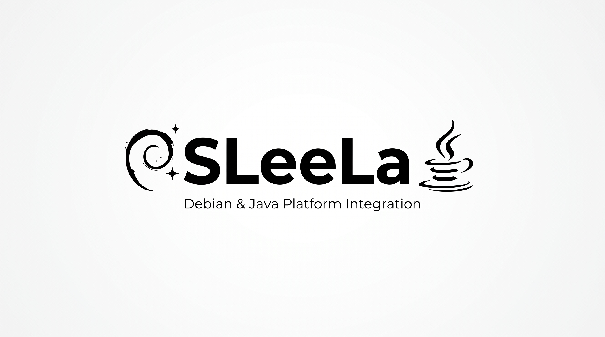

# SLeeLa Native and Integration Tests

Tests are organized around completion gates: memory safety, reflection metadata, Nordshrift binding resolution, lowering/artifact compatibility, networking, HTTP, server lifecycle, VoIP, drivers, package verification and cross-platform behavior.

## Native test build dependencies

The default native smoke-test build compiles the networking/security check
against OpenSSL's SHA-256 implementation and links the platform socket layer.

Install the OpenSSL development package before running `make -C tests all`:

- Debian / Ubuntu: `sudo apt-get install build-essential libssl-dev`
- Fedora: `sudo dnf install gcc-c++ openssl-devel`
- Arch Linux: `sudo pacman -S base-devel openssl`
- macOS (Homebrew): `brew install openssl@3 pkg-config`
- Windows (MSYS2 UCRT64): `pacman -S mingw-w64-ucrt-x86_64-gcc mingw-w64-ucrt-x86_64-openssl mingw-w64-ucrt-x86_64-pkgconf`

The Makefile obtains non-default OpenSSL include and library paths from
`pkg-config`. If OpenSSL is installed in a custom prefix, set
`OPENSSL_CFLAGS` and `OPENSSL_LIBS` explicitly. The Windows build uses
Winsock through `-lws2_32`; build from the matching MSYS2 MinGW/UCRT64 shell.

## JDK 28 Java Conformance

`jdk28_functional_equivalence.py` audits every `lib/java/**/*.sleela` declaration against the official JDK 28 API index.

It has two gates:

1. **API identity / envelope contract** — verifies that each declaration identifies a documented JDK 28 type and exposes the required SLeeLa Java bridge operations.
2. **Functional equivalence** — requires the SLeeLa declaration to represent the Java cousin's actual API surface. A generated source envelope alone does not satisfy this gate.

This distinction is intentional: a type-name envelope is not evidence that the Java class is functionally implemented. CI therefore reports the current gap instead of treating `invoke()` as a substitute for the Java API.

Run locally:

```bash
python3 tests/jdk28_functional_equivalence.py
python3 tests/jdk28_functional_equivalence.py --functional
```

---

# SLeeLa
<p align="center"></p>
<p align="center"></p>
