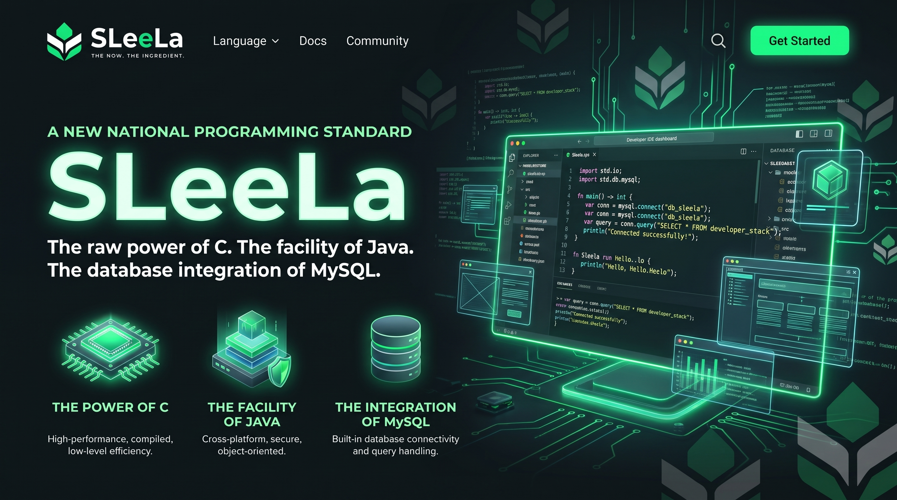

# working-binaries

Prebuilt native SLeeLa toolchain binaries, kept here for quick access.

| Binary | What it is | Size |
|--------|------------|------|
| `sleela` | `SLeeLa™ Language/Runtime 1.3.2-pro` — the authoritative SLeeLa compiler/runner. **Supported source syntax 1.0 – 3.1**, native C/C++ Core VM. Subcommands include `check`, `run`, `compile -o <out>`, `validate-artifact`, `nordshrift [--emit\|--roundtrip] [--target=…]`, `version`. **There is no separate `sleelac`** — compilation is `sleela compile`. | ~3.0 MB |
| `nordshrift` | `Nordshrift 2.7.1-dev` — the SLeeLa `.sst` transpiler driver (NS-SST-0001 spec 2.2); drives SLeeLa source syntax up to 3.1. Subcommands: `check`, `build`, `objects`, `relevance --target=java\|sleela\|c`, `version`. (The SLeeLa → Nordshrift → back round-trip is `sleela nordshrift`, inside the `sleela` binary.) | ~2.6 MB |

## Important caveats

- **Platform-specific.** These are **Linux x86-64**, dynamically linked ELF
  executables (`/lib64/ld-linux-x86-64.so.2`, glibc). They will **not** run on
  macOS, Windows, ARM, or musl-only systems. Rebuild from source for any other
  target.
- **Not the integrity-gated artifact.** The repository ships a SHA-256
  execution gate (`security/sha256-manifest.json`); the authoritative,
  reproducible way to obtain these tools is to **build from source**, not to
  trust a committed blob. These copies are a convenience for this environment,
  not a replacement for the verified build.
- Treat them as disposable. If they are stale or fail to run, rebuild.

## Build from source (authoritative)

```sh
# from the repository root
make compiler          # or: ./build-linux.sh
# output lands in impl/build/sleela and impl/build/nordshrift
```

## Quick use

```sh
./working-binaries/sleela version
./working-binaries/sleela check lib/idea/IdeaSystem.sleela
./working-binaries/sleela run   lib/idea/IdeaSystem.sleela

# or let the helper pick a binary / build on demand:
SLEELA_BIN=working-binaries/sleela tools/idea-check.sh
```

## Provenance

Built in the Kiro sandbox on 2026-11-12 from this repository's `impl/` tree
(`g++ -std=c++17 -O2`, pthread, `-fopenmp`; `make build/sleela` and
`make build/nordshrift`). VM ABI 1.8, 185 opcodes: this build includes the
Java UTF-16 String intrinsics (`javaStringFromUtf8`, `javaStringToUtf8`,
`javaStringFromCodeUnit`, ...), which the previous committed copy predated.
Rebuilt 2026-11-12 (`sleela` only) for the /lib loader rule that treats
`lib/java/jdk-28/` as a reference tier (`impl/frontend/driver.cpp`), so its
files never make a real `lib/java/java/...` class ambiguous.
Rebuilt 2026-11-12 (`sleela` and `nordshrift`) for the `Sleela.home` lineage
(SLEELA.syntax section 42: `parent`, `child`, `root`, `parents("---")` or `parents("...")`, `->`,
`super("constructor")`, `Sleela.VM|System|OS`, and the `Security2` boot).
Rebuilt 2026-11-13 (`sleela` and `nordshrift`) from `impl/` at the syntax 3.1 (3.01)
edition: character literals, array initializers, labeled `break`/`continue`,
`finally` on abrupt exit (SLEELA.syntax section 44), the `char` and array
specifications (sections 45, 46), and the Java-tier runtime changes through
SLEELA.syntax 43.7 and 37.5. Checked: `version` reports source syntax 1.0 – 3.1,
and a `#sleela 3.1` program using a char literal, an array initializer and
`a.length` checks and runs (the previous copy could not).
Rebuilt again 2026-11-13 for a VM performance fix, same versions: the plain String
intern table (`intern()` in `impl/core/sleela_core.c`) now has a hash index instead
of a linear scan over every String ever made. Behaviour and output are unchanged;
String-heavy programs no longer slow down as they run (the `lib/java/converter` run
on its 17-file JDK sample went from 66 s to 6.6 s). Regression check:
`impl/examples/string_intern_scaling.sleela`.

Rebuilt 2026-11-14 (third time), same versions: static fields without an
initialiser take their defaults before any initialiser runs (SLEELA.syntax 43.9;
`impl/tests/java_references/oop/static_default_order`).

Rebuilt again 2026-11-14, same versions: an interface may extend several
interfaces (SLEELA.syntax 43.8; `impl/tests/java_references/oop/multi_extends`).

Rebuilt 2026-11-14, same versions: `read(handle)` no longer ends a piece inside a
UTF-8 character (`read_utf8_piece` in `impl/core/sleela_core.c`); an incomplete
tail waits for the next read. Before, a non-ASCII file could not be read safely
in pieces (`javaStringFromUtf8` stopped the VM on a split character). Regression
check: `impl/examples/read_utf8_pieces.sleela`.

Rebuilt 2026-11-17 (`sleela` and `nordshrift`), same versions, for the defects the
regression set (`test-suites/regression/`) found: regex quantifier overflow
(`sleela_regex.c`); instants before 1970 and JSON escaping in `sleela_time.c`;
full token text for `!=`, `<=`, `>=` (`lexer.cpp`); `String s += <value>`
(`semantic.cpp`); and the Nordshrift emitters, which now fail closed on any node they
cannot print, give the C target real bitwise/shift operators, assignments, `++`/`--`
and `?:`, and make the Sleela target keep `static`, `protected`, `extends` and
`implements`. Checked: `test-suites/regression/python/run_regression.py` with
`SLEELA_BIN=working-binaries/sleela`.

Rebuilt again 2026-11-17 (`sleela` and `nordshrift`), same versions:
- the VM no longer hangs converting an array of arrays to text (`print(m)`,
  `"m=" + m`); `value_to_text` held the array lock across the recursive call
  (`impl/core/sleela_core.c`). Nesting deeper than 16 prints `[...]`.
- the Nordshrift C target emits arrays (creation, `{...}` literals, any rank,
  element read/write and compound assignment, `.length`, printing, bounds
  errors) and `++`/`--` whose value is used; the shared lowering gate accepts
  array indexing and checks array-initializer elements. The Java and Sleela
  targets still refuse arrays (fail closed).
Checked: 121/121 regression tests with
`SLEELA_BIN=$PWD/working-binaries/sleela` (an absolute path; a relative one now
also works).

Rebuilt again 2026-11-17 (`sleela` and `nordshrift`), same versions, for the defects the
extended regression set (corpus, memory manager, threads, sockets, synchro, HTTP 6.0 frames) found:
- the compiler no longer crashes on hostile source. Parser pre-pass limits (1000 nesting levels, 5000
  operators per statement, 1000 prefix operators, 1000 back-to-back casts) end in a `Syntax error ... too
  deep / too long` diagnostic instead of a stack overflow (`impl/frontend/parser.cpp`); dependency
  discovery scans identifiers by hand instead of with `std::regex`, which overflowed the stack on an
  identifier of about 50,000 characters (`impl/frontend/driver.cpp`).
- `@next` destinations: a parent component hidden by token spacing (`../..` arrived as `. . / . .`), a drive
  or scheme (`:`), `%` and control characters are refused (`impl/annotation/ForwardingAnnotation.cpp`).
- `slmm_realloc` no longer refuses a growth whose result fits under the limit (old and new were both
  counted); `slthread_*` return -1 for a NULL argument instead of crashing on POSIX; `slnet_write` on an
  invalid handle fails for a zero-length write too.
- `@next` is judged by the same destination rule on a class, method or field as on the document, and a forwarded
  destination is reported as written (`system/net`, not `system / net`).
- the Nordshrift Sleela target emits arrays (creation of any rank, `{...}` initializers in declarations, element
  read/write and compound assignment, `.length`) and prints annotations as `@name(value)`; the output runs
  identically and re-emits to itself. The Java target still refuses arrays on purpose.
Checked: 203/203 regression tests (with mutation testing) with
`SLEELA_BIN=$PWD/working-binaries/sleela`.

Reported versions:

- `sleela` — `SLeeLa™ Language/Runtime 1.3.2-pro` (supported source syntax 1.0 – 3.1)
- `nordshrift` — `Nordshrift 2.7.1-dev` (NS-SST-0001 spec 2.2; drives SLeeLa up to 3.1)

SHA-256 of the committed copies:

```
c63a351075a92fd61aa3420e55cf14c21f765e7fcaba3eef423d73ef465fccf8  sleela
ad138060fc19ed1da398880818ec624af7de8823777f51fd37892717d5db223f  nordshrift
```

---

# SLeeLa
<p align="center"></p>
<p align="center"></p>
